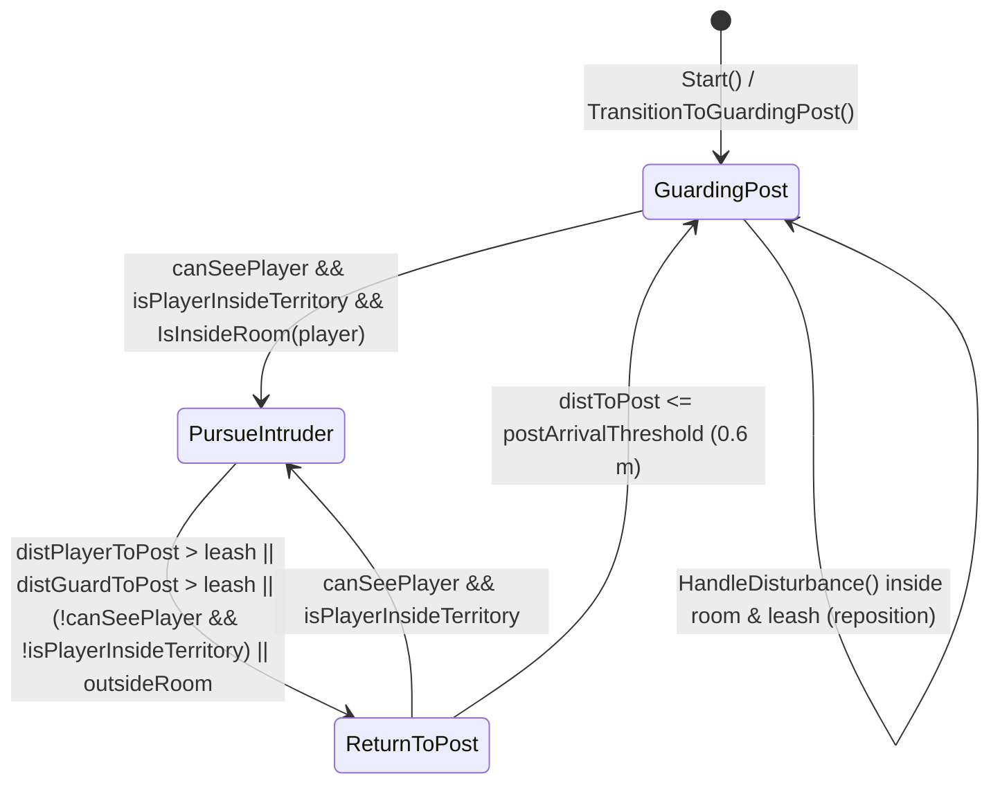

# DefensiveGuardAI & DefenseDecisionPolicy Trace

**Owner:** Aqqil (`IT24104314`)
**Scripts:** `Assets/Scripts/DefensiveGuardAI.cs`, `Assets/Scripts/DefenseDecisionPolicy.cs`
**Assigned Sector:** `Room_4_Defensive` (Route B — Access Card B)

<!-- BLOCK:POLICY_INTRO -->
## 1. Scope and Design Goals

The Room 4 defensive guard (`Guard_Aqqil_Defensive`) protects the Access Card B security
terminal (`AccessCard_Pickup_Defensive`) without abandoning Room 4 to chase the player
across the warehouse. Unlike `PatrolGuardAI` (Room 2 circuit) or `SearchGuardAI` (Room 3
belief search), `DefensiveGuardAI` stays anchored to a defensive post, evaluates nearby
cover and shotgun engagement range, and returns to post when the intruder disengages.

### 1.1 Baseline Design Parameters

- **Sight Range / FOV:** `10.0 m` / `90 deg` (`eyeHeight = 0.6 m`)
- **Defense Perimeter:** `defenseRadius = 6.0 m` around `postPosition`
- **Pursuit Leash:** `leashDistance = 8.5 m` (code default) / `9.0 m` (Room 4 scene)
- **Weapon Loadout:** `WeaponType.Combat_Shotgun` (`12 dmg x 6 pellets`, `220 HP`)
- **Policy Module:** `DefenseDecisionPolicy.Score(...)` (pure static utility scorer)
- **Candidate Topology:** `17` points (`1` anchor + `2` concentric `8`-point rings)
<!-- END:POLICY_INTRO -->

<!-- SECTION:STATE_MACHINE -->
## 2. Attack / Guard / Retreat Decision Tree Architecture

Replacing the simple direct-chase draft and static 3-waypoint circuit, `DefensiveGuardAI`
combines a 3-state `DefensiveGuardState` FSM with a 17-candidate tactical ring evaluated
through `DefenseDecisionPolicy.Score`. Unity `NavMesh` computes complete paths (`TryReachable`);
the authored AI layer handles candidate generation, occlusion/range scoring, and leash bounds.

### 2.1 State-Transition Diagram



### 2.2 Attack / Guard / Retreat Role Matrix

| Posture | Enum State | Tactical Target Selection | Weapon / Perception Action |
| --- | --- | --- | --- |
| **GUARD** | `GuardingPost` | Anchor + 2x8 rings (`hasThreat=false`, or `true` on sound cue) | Sweeps `+/- 28 deg` (`sin(t*1.8)*28`); transitions on sight in territory |
| **ATTACK** | `PursueIntruder` | `DispatchPursuitDestination()` every `0.25 s` (throttled `0.75 s`) | Fires `Combat_Shotgun` only with `GuardShooting.HasVisualTarget` |
| **RETREAT** | `ReturnToPost` | Direct NavMesh return to `postPosition` | `perceptionMemory.SetReturningState()`; snaps to `postFacing` on arrival |

### 2.3 Complete Transition Condition Table (`DefensiveGuardAI.cs`)

| From State | To State | Exact Boolean Guard Condition | Side Effects on Transition |
| --- | --- | --- | --- |
| `Any` | `GuardingPost` | `Start()` or arrival `distToPost <= 0.6 m` | `isReturning = false`, `inspectionWaitTimer = Random(2.0, 2.5)`, `nextTacticalDecision = 0` |
| `GuardingPost` | `PursueIntruder` | `canSeePlayer && isPlayerInsideTerritory && IsInsideRoom(player)` | `enemyMovement.SetChaseSpeed()`, `nextTacticalDecision = 0`, `DispatchPursuitDestination()` |
| `PursueIntruder` | `ReturnToPost` | `distPlayer > leash || distGuard > leash || (!canSee && !inTerr) || !insideRoom` | `SetDestination(postPosition)`, `perceptionMemory.SetReturningState()`, `SetPatrolSpeed()` |
| `ReturnToPost` | `PursueIntruder` | `canSeePlayer && isPlayerInsideTerritory && IsInsideRoom(player)` | Cancels retreat immediately if player steps back into `defenseRadius` with LOS |

### 2.4 17-Point Tactical Ring Generation (`DispatchInspectionPoint`)

- `i = 0`: `raw = postPosition` (`(16.0, 1.08, 8.0)` objective anchor).
- `i = 1..8`: inner ring at `r1 = min(2.5 m, max(0.5 m, leashDistance - 1 m))` every `45 deg`.
- `i = 9..16`: outer ring at `r2 = min(5.0 m, max(0.5 m, leashDistance - 1 m))` every `45 deg`.
- Only candidates passing `IsInsideRoom(raw)`, `GuardDecisionQueries.TryReachable`
  (`NavMeshPathStatus.PathComplete`), `IsInsideRoom(c.position)`, and `dist <= leashDistance`
  are scored; failed slots record `"Outside room/leash or no complete path"`.
<!-- END:STATE_MACHINE -->
<!-- SECTION:DECISION_POLICY_BASE -->
## 3. Anchor Proximity & Visibility Scoring (`hasThreat = false`)

When no visual or sound threat has been logged within `7.5 s` (`HasThreat == false`),
`DefenseDecisionPolicy.Score` balances objective anchor proximity, local ray visibility,
inspection freshness, and complete-path travel penalty:

```csharp
float utility = 0.45f * objective + 0.30f * visibility + 0.25f * freshness;
return utility - 0.15f * Mathf.Clamp01(pathLength / 20f);
```

### 3.1 Feature Computation (`DefensiveGuardAI` & `GuardDecisionQueries`)

- **`objective`:** `1 - Mathf.Clamp01(Vector3.Distance(c.position, postPosition) / Mathf.Max(1, leashDistance))`.
  At `leashDistance = 9.0 m`, anchor = `1.000`, `2.5 m` ring = `0.722`, `5.0 m` ring = `0.444`.
- **`visibility`:** `GuardDecisionQueries.Visibility(c.position, obstacleMask, transform)` —
  fires 8 horizontal `6.0 m` rays at `floor + 1.5 m`, returning `clearCount / 8f`.
- **`freshness`:** `lastInspected.TryGetValue(i, out t) ? Mathf.Clamp01((Time.time - t) / 20f) : 1f`.
  Uninspected nodes start at `1.000` and recover linearly over `20.0 s` after inspection.
- **`travel cost`:** `-0.15f * Mathf.Clamp01(pathLength / 20f)` from summed `NavMeshPath.corners`.

### 3.2 Selected Inspection Winners Across Twenty-Six Idle Sweeps

| Sweep Window | Selected Candidate | Winning `Score` |
| --- | --- | --- |
| Sweep #01 (t=0s, initial) | `C00 (Anchor (0.0m))` | `0.9224` |
| Sweep #02 (t=3s, C00 visited) | `C01 (2.5m (0 deg N))` | `0.8175` |
| Sweep #03 (t=6s, C01 visited) | `C07 (2.5m (270 deg W))` | `0.8175` |
| Sweep #04 (t=9s, C07 visited) | `C00 (Anchor (0.0m))` | `0.7849` |
| Sweep #05 (t=12s, C02 visited) | `C00 (Anchor (0.0m))` | `0.8224` |
| Sweep #06 (t=15s, C06 visited) | `C00 (Anchor (0.0m))` | `0.8599` |
| Sweep #07 (t=18s, C08 visited) | `C00 (Anchor (0.0m))` | `0.8974` |
| Sweep #08 (t=21s, C00 re-aged) | `C00 (Anchor (0.0m))` | `0.9224` |
| Sweep #09 (t=24s, C03 visited) | `C01 (2.5m (0 deg N))` | `0.8050` |
| Sweep #10 (t=27s, C04 visited) | `C01 (2.5m (0 deg N))` | `0.8050` |
| Sweep #11 (t=30s, C14 visited) | `C01 (2.5m (0 deg N))` | `0.8050` |
| Sweep #12 (t=33s, C15 visited) | `C00 (Anchor (0.0m))` | `0.8349` |
| Sweep #13 (t=36s, C05 visited) | `C00 (Anchor (0.0m))` | `0.8724` |
| Sweep #14 (t=39s, C09 visited) | `C00 (Anchor (0.0m))` | `0.9099` |
| Sweep #15 (t=42s, C00 re-visited) | `C01 (2.5m (0 deg N))` | `0.8050` |
| Sweep #16 (t=45s, C13 visited) | `C01 (2.5m (0 deg N))` | `0.8175` |
| Sweep #17 (t=48s, C10 visited) | `C01 (2.5m (0 deg N))` | `0.8175` |
| Sweep #18 (t=51s, C12 visited) | `C00 (Anchor (0.0m))` | `0.8224` |
| Sweep #19 (t=54s, C16 visited) | `C00 (Anchor (0.0m))` | `0.8599` |
| Sweep #20 (t=57s, C11 visited) | `C00 (Anchor (0.0m))` | `0.8974` |
| Sweep #21 (t=60s, cycle 2 C00) | `C01 (2.5m (0 deg N))` | `0.8175` |
| Sweep #22 (t=63s, cycle 2 C01) | `C07 (2.5m (270 deg W))` | `0.8175` |
| Sweep #23 (t=66s, cycle 2 C07) | `C00 (Anchor (0.0m))` | `0.7849` |
| Sweep #24 (t=69s, cycle 2 C02) | `C00 (Anchor (0.0m))` | `0.8224` |
| Sweep #25 (t=72s, cycle 2 C06) | `C00 (Anchor (0.0m))` | `0.8599` |
| Sweep #26 (t=75s, full settle) | `C00 (Anchor (0.0m))` | `0.8974` |

### 3.3 Full Twenty-Six-Sweep No-Threat Trace (`442` Candidate Evaluations, `leash = 9.0 m`)

| Sweep Window | ID | World `(X, Z)` | `objective` | `visibility` | `freshness` | `path (m)` | `Score` |
| --- | --- | --- | --- | --- | --- | --- | --- |
| Sweep #01 (t=0s, initial) | `C00` | `(16.00, 8.00)` | `1.000` | `0.750` | `1.000` | `0.35` | `0.9224` |
| Sweep #01 (t=0s, initial) | `C01` | `(16.00, 10.50)` | `0.722` | `0.875` | `1.000` | `2.65` | `0.8175` |
| Sweep #01 (t=0s, initial) | `C02` | `(17.77, 9.77)` | `0.722` | `0.750` | `1.000` | `2.80` | `0.7789` |
| Sweep #01 (t=0s, initial) | `C03` | `(18.50, 8.00)` | `0.722` | `0.625` | `1.000` | `2.95` | `0.7403` |
| Sweep #01 (t=0s, initial) | `C04` | `(17.77, 6.23)` | `0.722` | `0.625` | `1.000` | `2.65` | `0.7425` |
| Sweep #01 (t=0s, initial) | `C05` | `(16.00, 5.50)` | `0.722` | `0.500` | `1.000` | `2.80` | `0.7039` |
| Sweep #01 (t=0s, initial) | `C06` | `(14.23, 6.23)` | `0.722` | `0.750` | `1.000` | `2.95` | `0.7778` |
| Sweep #01 (t=0s, initial) | `C07` | `(13.50, 8.00)` | `0.722` | `0.875` | `1.000` | `2.65` | `0.8175` |
| Sweep #01 (t=0s, initial) | `C08` | `(14.23, 9.77)` | `0.722` | `0.750` | `1.000` | `2.80` | `0.7789` |
| Sweep #01 (t=0s, initial) | `C09` | `(16.00, 13.00)` | `0.444` | `0.875` | `1.000` | `5.20` | `0.6733` |
| Sweep #01 (t=0s, initial) | `C10` | `(19.54, 11.54)` | `0.444` | `0.625` | `1.000` | `5.38` | `0.5969` |
| Sweep #01 (t=0s, initial) | `C11` | `(21.00, 8.00)` | `0.444` | `0.500` | `1.000` | `5.56` | `0.5581` |
| Sweep #01 (t=0s, initial) | `C12` | `(19.54, 4.46)` | `0.444` | `0.625` | `1.000` | `5.74` | `0.5942` |
| Sweep #01 (t=0s, initial) | `C13` | `(16.00, 3.00)` | `0.444` | `0.750` | `1.000` | `5.20` | `0.6358` |
| Sweep #01 (t=0s, initial) | `C14` | `(12.46, 4.46)` | `0.444` | `0.875` | `1.000` | `5.38` | `0.6720` |
| Sweep #01 (t=0s, initial) | `C15` | `(11.00, 8.00)` | `0.444` | `0.875` | `1.000` | `5.56` | `0.6706` |
| Sweep #01 (t=0s, initial) | `C16` | `(12.46, 11.54)` | `0.444` | `0.625` | `1.000` | `5.74` | `0.5942` |
| Sweep #02 (t=3s, C00 visited) | `C00` | `(16.00, 8.00)` | `1.000` | `0.750` | `0.150` | `0.35` | `0.7099` |
| Sweep #02 (t=3s, C00 visited) | `C01` | `(16.00, 10.50)` | `0.722` | `0.875` | `1.000` | `2.65` | `0.8175` |
| Sweep #02 (t=3s, C00 visited) | `C02` | `(17.77, 9.77)` | `0.722` | `0.750` | `1.000` | `2.80` | `0.7789` |
| Sweep #02 (t=3s, C00 visited) | `C03` | `(18.50, 8.00)` | `0.722` | `0.625` | `1.000` | `2.95` | `0.7403` |
| Sweep #02 (t=3s, C00 visited) | `C04` | `(17.77, 6.23)` | `0.722` | `0.625` | `1.000` | `2.65` | `0.7425` |
| Sweep #02 (t=3s, C00 visited) | `C05` | `(16.00, 5.50)` | `0.722` | `0.500` | `1.000` | `2.80` | `0.7039` |
| Sweep #02 (t=3s, C00 visited) | `C06` | `(14.23, 6.23)` | `0.722` | `0.750` | `1.000` | `2.95` | `0.7778` |
| Sweep #02 (t=3s, C00 visited) | `C07` | `(13.50, 8.00)` | `0.722` | `0.875` | `1.000` | `2.65` | `0.8175` |
| Sweep #02 (t=3s, C00 visited) | `C08` | `(14.23, 9.77)` | `0.722` | `0.750` | `1.000` | `2.80` | `0.7789` |
| Sweep #02 (t=3s, C00 visited) | `C09` | `(16.00, 13.00)` | `0.444` | `0.875` | `1.000` | `5.20` | `0.6733` |
| Sweep #02 (t=3s, C00 visited) | `C10` | `(19.54, 11.54)` | `0.444` | `0.625` | `1.000` | `5.38` | `0.5969` |
| Sweep #02 (t=3s, C00 visited) | `C11` | `(21.00, 8.00)` | `0.444` | `0.500` | `1.000` | `5.56` | `0.5581` |
| Sweep #02 (t=3s, C00 visited) | `C12` | `(19.54, 4.46)` | `0.444` | `0.625` | `1.000` | `5.74` | `0.5942` |
| Sweep #02 (t=3s, C00 visited) | `C13` | `(16.00, 3.00)` | `0.444` | `0.750` | `1.000` | `5.20` | `0.6358` |
| Sweep #02 (t=3s, C00 visited) | `C14` | `(12.46, 4.46)` | `0.444` | `0.875` | `1.000` | `5.38` | `0.6720` |
| Sweep #02 (t=3s, C00 visited) | `C15` | `(11.00, 8.00)` | `0.444` | `0.875` | `1.000` | `5.56` | `0.6706` |
| Sweep #02 (t=3s, C00 visited) | `C16` | `(12.46, 11.54)` | `0.444` | `0.625` | `1.000` | `5.74` | `0.5942` |
| Sweep #03 (t=6s, C01 visited) | `C00` | `(16.00, 8.00)` | `1.000` | `0.750` | `0.300` | `0.35` | `0.7474` |
| Sweep #03 (t=6s, C01 visited) | `C01` | `(16.00, 10.50)` | `0.722` | `0.875` | `0.100` | `2.65` | `0.5925` |
| Sweep #03 (t=6s, C01 visited) | `C02` | `(17.77, 9.77)` | `0.722` | `0.750` | `1.000` | `2.80` | `0.7789` |
| Sweep #03 (t=6s, C01 visited) | `C03` | `(18.50, 8.00)` | `0.722` | `0.625` | `1.000` | `2.95` | `0.7403` |
| Sweep #03 (t=6s, C01 visited) | `C04` | `(17.77, 6.23)` | `0.722` | `0.625` | `1.000` | `2.65` | `0.7425` |
| Sweep #03 (t=6s, C01 visited) | `C05` | `(16.00, 5.50)` | `0.722` | `0.500` | `1.000` | `2.80` | `0.7039` |
| Sweep #03 (t=6s, C01 visited) | `C06` | `(14.23, 6.23)` | `0.722` | `0.750` | `1.000` | `2.95` | `0.7778` |
| Sweep #03 (t=6s, C01 visited) | `C07` | `(13.50, 8.00)` | `0.722` | `0.875` | `1.000` | `2.65` | `0.8175` |
| Sweep #03 (t=6s, C01 visited) | `C08` | `(14.23, 9.77)` | `0.722` | `0.750` | `1.000` | `2.80` | `0.7789` |
| Sweep #03 (t=6s, C01 visited) | `C09` | `(16.00, 13.00)` | `0.444` | `0.875` | `1.000` | `5.20` | `0.6733` |
| Sweep #03 (t=6s, C01 visited) | `C10` | `(19.54, 11.54)` | `0.444` | `0.625` | `1.000` | `5.38` | `0.5969` |
| Sweep #03 (t=6s, C01 visited) | `C11` | `(21.00, 8.00)` | `0.444` | `0.500` | `1.000` | `5.56` | `0.5581` |
| Sweep #03 (t=6s, C01 visited) | `C12` | `(19.54, 4.46)` | `0.444` | `0.625` | `1.000` | `5.74` | `0.5942` |
| Sweep #03 (t=6s, C01 visited) | `C13` | `(16.00, 3.00)` | `0.444` | `0.750` | `1.000` | `5.20` | `0.6358` |
| Sweep #03 (t=6s, C01 visited) | `C14` | `(12.46, 4.46)` | `0.444` | `0.875` | `1.000` | `5.38` | `0.6720` |
| Sweep #03 (t=6s, C01 visited) | `C15` | `(11.00, 8.00)` | `0.444` | `0.875` | `1.000` | `5.56` | `0.6706` |
| Sweep #03 (t=6s, C01 visited) | `C16` | `(12.46, 11.54)` | `0.444` | `0.625` | `1.000` | `5.74` | `0.5942` |
| Sweep #04 (t=9s, C07 visited) | `C00` | `(16.00, 8.00)` | `1.000` | `0.750` | `0.450` | `0.35` | `0.7849` |
| Sweep #04 (t=9s, C07 visited) | `C01` | `(16.00, 10.50)` | `0.722` | `0.875` | `0.250` | `2.65` | `0.6300` |
| Sweep #04 (t=9s, C07 visited) | `C02` | `(17.77, 9.77)` | `0.722` | `0.750` | `1.000` | `2.80` | `0.7789` |
| Sweep #04 (t=9s, C07 visited) | `C03` | `(18.50, 8.00)` | `0.722` | `0.625` | `1.000` | `2.95` | `0.7403` |
| Sweep #04 (t=9s, C07 visited) | `C04` | `(17.77, 6.23)` | `0.722` | `0.625` | `1.000` | `2.65` | `0.7425` |
| Sweep #04 (t=9s, C07 visited) | `C05` | `(16.00, 5.50)` | `0.722` | `0.500` | `1.000` | `2.80` | `0.7039` |
| Sweep #04 (t=9s, C07 visited) | `C06` | `(14.23, 6.23)` | `0.722` | `0.750` | `1.000` | `2.95` | `0.7778` |
| Sweep #04 (t=9s, C07 visited) | `C07` | `(13.50, 8.00)` | `0.722` | `0.875` | `0.100` | `2.65` | `0.5925` |
| Sweep #04 (t=9s, C07 visited) | `C08` | `(14.23, 9.77)` | `0.722` | `0.750` | `1.000` | `2.80` | `0.7789` |
| Sweep #04 (t=9s, C07 visited) | `C09` | `(16.00, 13.00)` | `0.444` | `0.875` | `1.000` | `5.20` | `0.6733` |
| Sweep #04 (t=9s, C07 visited) | `C10` | `(19.54, 11.54)` | `0.444` | `0.625` | `1.000` | `5.38` | `0.5969` |
| Sweep #04 (t=9s, C07 visited) | `C11` | `(21.00, 8.00)` | `0.444` | `0.500` | `1.000` | `5.56` | `0.5581` |
| Sweep #04 (t=9s, C07 visited) | `C12` | `(19.54, 4.46)` | `0.444` | `0.625` | `1.000` | `5.74` | `0.5942` |
| Sweep #04 (t=9s, C07 visited) | `C13` | `(16.00, 3.00)` | `0.444` | `0.750` | `1.000` | `5.20` | `0.6358` |
| Sweep #04 (t=9s, C07 visited) | `C14` | `(12.46, 4.46)` | `0.444` | `0.875` | `1.000` | `5.38` | `0.6720` |
| Sweep #04 (t=9s, C07 visited) | `C15` | `(11.00, 8.00)` | `0.444` | `0.875` | `1.000` | `5.56` | `0.6706` |
| Sweep #04 (t=9s, C07 visited) | `C16` | `(12.46, 11.54)` | `0.444` | `0.625` | `1.000` | `5.74` | `0.5942` |
| Sweep #05 (t=12s, C02 visited) | `C00` | `(16.00, 8.00)` | `1.000` | `0.750` | `0.600` | `0.35` | `0.8224` |
| Sweep #05 (t=12s, C02 visited) | `C01` | `(16.00, 10.50)` | `0.722` | `0.875` | `0.400` | `2.65` | `0.6675` |
| Sweep #05 (t=12s, C02 visited) | `C02` | `(17.77, 9.77)` | `0.722` | `0.750` | `0.100` | `2.80` | `0.5539` |
| Sweep #05 (t=12s, C02 visited) | `C03` | `(18.50, 8.00)` | `0.722` | `0.625` | `1.000` | `2.95` | `0.7403` |
| Sweep #05 (t=12s, C02 visited) | `C04` | `(17.77, 6.23)` | `0.722` | `0.625` | `1.000` | `2.65` | `0.7425` |
| Sweep #05 (t=12s, C02 visited) | `C05` | `(16.00, 5.50)` | `0.722` | `0.500` | `1.000` | `2.80` | `0.7039` |
| Sweep #05 (t=12s, C02 visited) | `C06` | `(14.23, 6.23)` | `0.722` | `0.750` | `1.000` | `2.95` | `0.7778` |
| Sweep #05 (t=12s, C02 visited) | `C07` | `(13.50, 8.00)` | `0.722` | `0.875` | `0.250` | `2.65` | `0.6300` |
| Sweep #05 (t=12s, C02 visited) | `C08` | `(14.23, 9.77)` | `0.722` | `0.750` | `1.000` | `2.80` | `0.7789` |
| Sweep #05 (t=12s, C02 visited) | `C09` | `(16.00, 13.00)` | `0.444` | `0.875` | `1.000` | `5.20` | `0.6733` |
| Sweep #05 (t=12s, C02 visited) | `C10` | `(19.54, 11.54)` | `0.444` | `0.625` | `1.000` | `5.38` | `0.5969` |
| Sweep #05 (t=12s, C02 visited) | `C11` | `(21.00, 8.00)` | `0.444` | `0.500` | `1.000` | `5.56` | `0.5581` |
| Sweep #05 (t=12s, C02 visited) | `C12` | `(19.54, 4.46)` | `0.444` | `0.625` | `1.000` | `5.74` | `0.5942` |
| Sweep #05 (t=12s, C02 visited) | `C13` | `(16.00, 3.00)` | `0.444` | `0.750` | `1.000` | `5.20` | `0.6358` |
| Sweep #05 (t=12s, C02 visited) | `C14` | `(12.46, 4.46)` | `0.444` | `0.875` | `1.000` | `5.38` | `0.6720` |
| Sweep #05 (t=12s, C02 visited) | `C15` | `(11.00, 8.00)` | `0.444` | `0.875` | `1.000` | `5.56` | `0.6706` |
| Sweep #05 (t=12s, C02 visited) | `C16` | `(12.46, 11.54)` | `0.444` | `0.625` | `1.000` | `5.74` | `0.5942` |
| Sweep #06 (t=15s, C06 visited) | `C00` | `(16.00, 8.00)` | `1.000` | `0.750` | `0.750` | `0.35` | `0.8599` |
| Sweep #06 (t=15s, C06 visited) | `C01` | `(16.00, 10.50)` | `0.722` | `0.875` | `0.550` | `2.65` | `0.7050` |
| Sweep #06 (t=15s, C06 visited) | `C02` | `(17.77, 9.77)` | `0.722` | `0.750` | `0.250` | `2.80` | `0.5914` |
| Sweep #06 (t=15s, C06 visited) | `C03` | `(18.50, 8.00)` | `0.722` | `0.625` | `1.000` | `2.95` | `0.7403` |
| Sweep #06 (t=15s, C06 visited) | `C04` | `(17.77, 6.23)` | `0.722` | `0.625` | `1.000` | `2.65` | `0.7425` |
| Sweep #06 (t=15s, C06 visited) | `C05` | `(16.00, 5.50)` | `0.722` | `0.500` | `1.000` | `2.80` | `0.7039` |
| Sweep #06 (t=15s, C06 visited) | `C06` | `(14.23, 6.23)` | `0.722` | `0.750` | `0.100` | `2.95` | `0.5528` |
| Sweep #06 (t=15s, C06 visited) | `C07` | `(13.50, 8.00)` | `0.722` | `0.875` | `0.400` | `2.65` | `0.6675` |
| Sweep #06 (t=15s, C06 visited) | `C08` | `(14.23, 9.77)` | `0.722` | `0.750` | `1.000` | `2.80` | `0.7789` |
| Sweep #06 (t=15s, C06 visited) | `C09` | `(16.00, 13.00)` | `0.444` | `0.875` | `1.000` | `5.20` | `0.6733` |
| Sweep #06 (t=15s, C06 visited) | `C10` | `(19.54, 11.54)` | `0.444` | `0.625` | `1.000` | `5.38` | `0.5969` |
| Sweep #06 (t=15s, C06 visited) | `C11` | `(21.00, 8.00)` | `0.444` | `0.500` | `1.000` | `5.56` | `0.5581` |
| Sweep #06 (t=15s, C06 visited) | `C12` | `(19.54, 4.46)` | `0.444` | `0.625` | `1.000` | `5.74` | `0.5942` |
| Sweep #06 (t=15s, C06 visited) | `C13` | `(16.00, 3.00)` | `0.444` | `0.750` | `1.000` | `5.20` | `0.6358` |
| Sweep #06 (t=15s, C06 visited) | `C14` | `(12.46, 4.46)` | `0.444` | `0.875` | `1.000` | `5.38` | `0.6720` |
| Sweep #06 (t=15s, C06 visited) | `C15` | `(11.00, 8.00)` | `0.444` | `0.875` | `1.000` | `5.56` | `0.6706` |
| Sweep #06 (t=15s, C06 visited) | `C16` | `(12.46, 11.54)` | `0.444` | `0.625` | `1.000` | `5.74` | `0.5942` |
| Sweep #07 (t=18s, C08 visited) | `C00` | `(16.00, 8.00)` | `1.000` | `0.750` | `0.900` | `0.35` | `0.8974` |
| Sweep #07 (t=18s, C08 visited) | `C01` | `(16.00, 10.50)` | `0.722` | `0.875` | `1.000` | `2.65` | `0.8175` |
| Sweep #07 (t=18s, C08 visited) | `C02` | `(17.77, 9.77)` | `0.722` | `0.750` | `0.400` | `2.80` | `0.6289` |
| Sweep #07 (t=18s, C08 visited) | `C03` | `(18.50, 8.00)` | `0.722` | `0.625` | `1.000` | `2.95` | `0.7403` |
| Sweep #07 (t=18s, C08 visited) | `C04` | `(17.77, 6.23)` | `0.722` | `0.625` | `1.000` | `2.65` | `0.7425` |
| Sweep #07 (t=18s, C08 visited) | `C05` | `(16.00, 5.50)` | `0.722` | `0.500` | `1.000` | `2.80` | `0.7039` |
| Sweep #07 (t=18s, C08 visited) | `C06` | `(14.23, 6.23)` | `0.722` | `0.750` | `0.250` | `2.95` | `0.5903` |
| Sweep #07 (t=18s, C08 visited) | `C07` | `(13.50, 8.00)` | `0.722` | `0.875` | `1.000` | `2.65` | `0.8175` |
| Sweep #07 (t=18s, C08 visited) | `C08` | `(14.23, 9.77)` | `0.722` | `0.750` | `0.100` | `2.80` | `0.5539` |
| Sweep #07 (t=18s, C08 visited) | `C09` | `(16.00, 13.00)` | `0.444` | `0.875` | `1.000` | `5.20` | `0.6733` |
| Sweep #07 (t=18s, C08 visited) | `C10` | `(19.54, 11.54)` | `0.444` | `0.625` | `1.000` | `5.38` | `0.5969` |
| Sweep #07 (t=18s, C08 visited) | `C11` | `(21.00, 8.00)` | `0.444` | `0.500` | `1.000` | `5.56` | `0.5581` |
| Sweep #07 (t=18s, C08 visited) | `C12` | `(19.54, 4.46)` | `0.444` | `0.625` | `1.000` | `5.74` | `0.5942` |
| Sweep #07 (t=18s, C08 visited) | `C13` | `(16.00, 3.00)` | `0.444` | `0.750` | `1.000` | `5.20` | `0.6358` |
| Sweep #07 (t=18s, C08 visited) | `C14` | `(12.46, 4.46)` | `0.444` | `0.875` | `1.000` | `5.38` | `0.6720` |
| Sweep #07 (t=18s, C08 visited) | `C15` | `(11.00, 8.00)` | `0.444` | `0.875` | `1.000` | `5.56` | `0.6706` |
| Sweep #07 (t=18s, C08 visited) | `C16` | `(12.46, 11.54)` | `0.444` | `0.625` | `1.000` | `5.74` | `0.5942` |
| Sweep #08 (t=21s, C00 re-aged) | `C00` | `(16.00, 8.00)` | `1.000` | `0.750` | `1.000` | `0.35` | `0.9224` |
| Sweep #08 (t=21s, C00 re-aged) | `C01` | `(16.00, 10.50)` | `0.722` | `0.875` | `0.850` | `2.65` | `0.7800` |
| Sweep #08 (t=21s, C00 re-aged) | `C02` | `(17.77, 9.77)` | `0.722` | `0.750` | `0.850` | `2.80` | `0.7414` |
| Sweep #08 (t=21s, C00 re-aged) | `C03` | `(18.50, 8.00)` | `0.722` | `0.625` | `0.850` | `2.95` | `0.7028` |
| Sweep #08 (t=21s, C00 re-aged) | `C04` | `(17.77, 6.23)` | `0.722` | `0.625` | `0.850` | `2.65` | `0.7050` |
| Sweep #08 (t=21s, C00 re-aged) | `C05` | `(16.00, 5.50)` | `0.722` | `0.500` | `0.850` | `2.80` | `0.6664` |
| Sweep #08 (t=21s, C00 re-aged) | `C06` | `(14.23, 6.23)` | `0.722` | `0.750` | `0.400` | `2.95` | `0.6278` |
| Sweep #08 (t=21s, C00 re-aged) | `C07` | `(13.50, 8.00)` | `0.722` | `0.875` | `0.850` | `2.65` | `0.7800` |
| Sweep #08 (t=21s, C00 re-aged) | `C08` | `(14.23, 9.77)` | `0.722` | `0.750` | `0.250` | `2.80` | `0.5914` |
| Sweep #08 (t=21s, C00 re-aged) | `C09` | `(16.00, 13.00)` | `0.444` | `0.875` | `0.850` | `5.20` | `0.6358` |
| Sweep #08 (t=21s, C00 re-aged) | `C10` | `(19.54, 11.54)` | `0.444` | `0.625` | `0.850` | `5.38` | `0.5595` |
| Sweep #08 (t=21s, C00 re-aged) | `C11` | `(21.00, 8.00)` | `0.444` | `0.500` | `0.850` | `5.56` | `0.5206` |
| Sweep #08 (t=21s, C00 re-aged) | `C12` | `(19.54, 4.46)` | `0.444` | `0.625` | `0.850` | `5.74` | `0.5567` |
| Sweep #08 (t=21s, C00 re-aged) | `C13` | `(16.00, 3.00)` | `0.444` | `0.750` | `0.850` | `5.20` | `0.5983` |
| Sweep #08 (t=21s, C00 re-aged) | `C14` | `(12.46, 4.46)` | `0.444` | `0.875` | `0.850` | `5.38` | `0.6345` |
| Sweep #08 (t=21s, C00 re-aged) | `C15` | `(11.00, 8.00)` | `0.444` | `0.875` | `0.850` | `5.56` | `0.6331` |
| Sweep #08 (t=21s, C00 re-aged) | `C16` | `(12.46, 11.54)` | `0.444` | `0.625` | `0.850` | `5.74` | `0.5567` |
| Sweep #09 (t=24s, C03 visited) | `C00` | `(16.00, 8.00)` | `1.000` | `0.750` | `0.200` | `0.35` | `0.7224` |
| Sweep #09 (t=24s, C03 visited) | `C01` | `(16.00, 10.50)` | `0.722` | `0.875` | `0.950` | `2.65` | `0.8050` |
| Sweep #09 (t=24s, C03 visited) | `C02` | `(17.77, 9.77)` | `0.722` | `0.750` | `0.950` | `2.80` | `0.7664` |
| Sweep #09 (t=24s, C03 visited) | `C03` | `(18.50, 8.00)` | `0.722` | `0.625` | `0.100` | `2.95` | `0.5153` |
| Sweep #09 (t=24s, C03 visited) | `C04` | `(17.77, 6.23)` | `0.722` | `0.625` | `0.950` | `2.65` | `0.7300` |
| Sweep #09 (t=24s, C03 visited) | `C05` | `(16.00, 5.50)` | `0.722` | `0.500` | `0.950` | `2.80` | `0.6914` |
| Sweep #09 (t=24s, C03 visited) | `C06` | `(14.23, 6.23)` | `0.722` | `0.750` | `0.950` | `2.95` | `0.7653` |
| Sweep #09 (t=24s, C03 visited) | `C07` | `(13.50, 8.00)` | `0.722` | `0.875` | `0.950` | `2.65` | `0.8050` |
| Sweep #09 (t=24s, C03 visited) | `C08` | `(14.23, 9.77)` | `0.722` | `0.750` | `0.400` | `2.80` | `0.6289` |
| Sweep #09 (t=24s, C03 visited) | `C09` | `(16.00, 13.00)` | `0.444` | `0.875` | `0.950` | `5.20` | `0.6608` |
| Sweep #09 (t=24s, C03 visited) | `C10` | `(19.54, 11.54)` | `0.444` | `0.625` | `0.950` | `5.38` | `0.5845` |
| Sweep #09 (t=24s, C03 visited) | `C11` | `(21.00, 8.00)` | `0.444` | `0.500` | `0.950` | `5.56` | `0.5456` |
| Sweep #09 (t=24s, C03 visited) | `C12` | `(19.54, 4.46)` | `0.444` | `0.625` | `0.950` | `5.74` | `0.5817` |
| Sweep #09 (t=24s, C03 visited) | `C13` | `(16.00, 3.00)` | `0.444` | `0.750` | `0.950` | `5.20` | `0.6233` |
| Sweep #09 (t=24s, C03 visited) | `C14` | `(12.46, 4.46)` | `0.444` | `0.875` | `0.950` | `5.38` | `0.6594` |
| Sweep #09 (t=24s, C03 visited) | `C15` | `(11.00, 8.00)` | `0.444` | `0.875` | `0.950` | `5.56` | `0.6581` |
| Sweep #09 (t=24s, C03 visited) | `C16` | `(12.46, 11.54)` | `0.444` | `0.625` | `0.950` | `5.74` | `0.5817` |
| Sweep #10 (t=27s, C04 visited) | `C00` | `(16.00, 8.00)` | `1.000` | `0.750` | `0.350` | `0.35` | `0.7599` |
| Sweep #10 (t=27s, C04 visited) | `C01` | `(16.00, 10.50)` | `0.722` | `0.875` | `0.950` | `2.65` | `0.8050` |
| Sweep #10 (t=27s, C04 visited) | `C02` | `(17.77, 9.77)` | `0.722` | `0.750` | `0.950` | `2.80` | `0.7664` |
| Sweep #10 (t=27s, C04 visited) | `C03` | `(18.50, 8.00)` | `0.722` | `0.625` | `0.250` | `2.95` | `0.5528` |
| Sweep #10 (t=27s, C04 visited) | `C04` | `(17.77, 6.23)` | `0.722` | `0.625` | `0.100` | `2.65` | `0.5175` |
| Sweep #10 (t=27s, C04 visited) | `C05` | `(16.00, 5.50)` | `0.722` | `0.500` | `0.950` | `2.80` | `0.6914` |
| Sweep #10 (t=27s, C04 visited) | `C06` | `(14.23, 6.23)` | `0.722` | `0.750` | `0.950` | `2.95` | `0.7653` |
| Sweep #10 (t=27s, C04 visited) | `C07` | `(13.50, 8.00)` | `0.722` | `0.875` | `0.950` | `2.65` | `0.8050` |
| Sweep #10 (t=27s, C04 visited) | `C08` | `(14.23, 9.77)` | `0.722` | `0.750` | `0.950` | `2.80` | `0.7664` |
| Sweep #10 (t=27s, C04 visited) | `C09` | `(16.00, 13.00)` | `0.444` | `0.875` | `0.950` | `5.20` | `0.6608` |
| Sweep #10 (t=27s, C04 visited) | `C10` | `(19.54, 11.54)` | `0.444` | `0.625` | `0.950` | `5.38` | `0.5845` |
| Sweep #10 (t=27s, C04 visited) | `C11` | `(21.00, 8.00)` | `0.444` | `0.500` | `0.950` | `5.56` | `0.5456` |
| Sweep #10 (t=27s, C04 visited) | `C12` | `(19.54, 4.46)` | `0.444` | `0.625` | `0.950` | `5.74` | `0.5817` |
| Sweep #10 (t=27s, C04 visited) | `C13` | `(16.00, 3.00)` | `0.444` | `0.750` | `0.950` | `5.20` | `0.6233` |
| Sweep #10 (t=27s, C04 visited) | `C14` | `(12.46, 4.46)` | `0.444` | `0.875` | `0.950` | `5.38` | `0.6594` |
| Sweep #10 (t=27s, C04 visited) | `C15` | `(11.00, 8.00)` | `0.444` | `0.875` | `0.950` | `5.56` | `0.6581` |
| Sweep #10 (t=27s, C04 visited) | `C16` | `(12.46, 11.54)` | `0.444` | `0.625` | `0.950` | `5.74` | `0.5817` |
| Sweep #11 (t=30s, C14 visited) | `C00` | `(16.00, 8.00)` | `1.000` | `0.750` | `0.500` | `0.35` | `0.7974` |
| Sweep #11 (t=30s, C14 visited) | `C01` | `(16.00, 10.50)` | `0.722` | `0.875` | `0.950` | `2.65` | `0.8050` |
| Sweep #11 (t=30s, C14 visited) | `C02` | `(17.77, 9.77)` | `0.722` | `0.750` | `0.950` | `2.80` | `0.7664` |
| Sweep #11 (t=30s, C14 visited) | `C03` | `(18.50, 8.00)` | `0.722` | `0.625` | `0.400` | `2.95` | `0.5903` |
| Sweep #11 (t=30s, C14 visited) | `C04` | `(17.77, 6.23)` | `0.722` | `0.625` | `0.250` | `2.65` | `0.5550` |
| Sweep #11 (t=30s, C14 visited) | `C05` | `(16.00, 5.50)` | `0.722` | `0.500` | `0.950` | `2.80` | `0.6914` |
| Sweep #11 (t=30s, C14 visited) | `C06` | `(14.23, 6.23)` | `0.722` | `0.750` | `0.950` | `2.95` | `0.7653` |
| Sweep #11 (t=30s, C14 visited) | `C07` | `(13.50, 8.00)` | `0.722` | `0.875` | `0.950` | `2.65` | `0.8050` |
| Sweep #11 (t=30s, C14 visited) | `C08` | `(14.23, 9.77)` | `0.722` | `0.750` | `0.950` | `2.80` | `0.7664` |
| Sweep #11 (t=30s, C14 visited) | `C09` | `(16.00, 13.00)` | `0.444` | `0.875` | `0.950` | `5.20` | `0.6608` |
| Sweep #11 (t=30s, C14 visited) | `C10` | `(19.54, 11.54)` | `0.444` | `0.625` | `0.950` | `5.38` | `0.5845` |
| Sweep #11 (t=30s, C14 visited) | `C11` | `(21.00, 8.00)` | `0.444` | `0.500` | `0.950` | `5.56` | `0.5456` |
| Sweep #11 (t=30s, C14 visited) | `C12` | `(19.54, 4.46)` | `0.444` | `0.625` | `0.950` | `5.74` | `0.5817` |
| Sweep #11 (t=30s, C14 visited) | `C13` | `(16.00, 3.00)` | `0.444` | `0.750` | `0.950` | `5.20` | `0.6233` |
| Sweep #11 (t=30s, C14 visited) | `C14` | `(12.46, 4.46)` | `0.444` | `0.875` | `0.100` | `5.38` | `0.4470` |
| Sweep #11 (t=30s, C14 visited) | `C15` | `(11.00, 8.00)` | `0.444` | `0.875` | `0.950` | `5.56` | `0.6581` |
| Sweep #11 (t=30s, C14 visited) | `C16` | `(12.46, 11.54)` | `0.444` | `0.625` | `0.950` | `5.74` | `0.5817` |
| Sweep #12 (t=33s, C15 visited) | `C00` | `(16.00, 8.00)` | `1.000` | `0.750` | `0.650` | `0.35` | `0.8349` |
| Sweep #12 (t=33s, C15 visited) | `C01` | `(16.00, 10.50)` | `0.722` | `0.875` | `1.000` | `2.65` | `0.8175` |
| Sweep #12 (t=33s, C15 visited) | `C02` | `(17.77, 9.77)` | `0.722` | `0.750` | `1.000` | `2.80` | `0.7789` |
| Sweep #12 (t=33s, C15 visited) | `C03` | `(18.50, 8.00)` | `0.722` | `0.625` | `1.000` | `2.95` | `0.7403` |
| Sweep #12 (t=33s, C15 visited) | `C04` | `(17.77, 6.23)` | `0.722` | `0.625` | `0.400` | `2.65` | `0.5925` |
| Sweep #12 (t=33s, C15 visited) | `C05` | `(16.00, 5.50)` | `0.722` | `0.500` | `1.000` | `2.80` | `0.7039` |
| Sweep #12 (t=33s, C15 visited) | `C06` | `(14.23, 6.23)` | `0.722` | `0.750` | `1.000` | `2.95` | `0.7778` |
| Sweep #12 (t=33s, C15 visited) | `C07` | `(13.50, 8.00)` | `0.722` | `0.875` | `1.000` | `2.65` | `0.8175` |
| Sweep #12 (t=33s, C15 visited) | `C08` | `(14.23, 9.77)` | `0.722` | `0.750` | `1.000` | `2.80` | `0.7789` |
| Sweep #12 (t=33s, C15 visited) | `C09` | `(16.00, 13.00)` | `0.444` | `0.875` | `1.000` | `5.20` | `0.6733` |
| Sweep #12 (t=33s, C15 visited) | `C10` | `(19.54, 11.54)` | `0.444` | `0.625` | `1.000` | `5.38` | `0.5969` |
| Sweep #12 (t=33s, C15 visited) | `C11` | `(21.00, 8.00)` | `0.444` | `0.500` | `1.000` | `5.56` | `0.5581` |
| Sweep #12 (t=33s, C15 visited) | `C12` | `(19.54, 4.46)` | `0.444` | `0.625` | `1.000` | `5.74` | `0.5942` |
| Sweep #12 (t=33s, C15 visited) | `C13` | `(16.00, 3.00)` | `0.444` | `0.750` | `1.000` | `5.20` | `0.6358` |
| Sweep #12 (t=33s, C15 visited) | `C14` | `(12.46, 4.46)` | `0.444` | `0.875` | `0.250` | `5.38` | `0.4845` |
| Sweep #12 (t=33s, C15 visited) | `C15` | `(11.00, 8.00)` | `0.444` | `0.875` | `0.100` | `5.56` | `0.4456` |
| Sweep #12 (t=33s, C15 visited) | `C16` | `(12.46, 11.54)` | `0.444` | `0.625` | `1.000` | `5.74` | `0.5942` |
| Sweep #13 (t=36s, C05 visited) | `C00` | `(16.00, 8.00)` | `1.000` | `0.750` | `0.800` | `0.35` | `0.8724` |
| Sweep #13 (t=36s, C05 visited) | `C01` | `(16.00, 10.50)` | `0.722` | `0.875` | `1.000` | `2.65` | `0.8175` |
| Sweep #13 (t=36s, C05 visited) | `C02` | `(17.77, 9.77)` | `0.722` | `0.750` | `1.000` | `2.80` | `0.7789` |
| Sweep #13 (t=36s, C05 visited) | `C03` | `(18.50, 8.00)` | `0.722` | `0.625` | `1.000` | `2.95` | `0.7403` |
| Sweep #13 (t=36s, C05 visited) | `C04` | `(17.77, 6.23)` | `0.722` | `0.625` | `1.000` | `2.65` | `0.7425` |
| Sweep #13 (t=36s, C05 visited) | `C05` | `(16.00, 5.50)` | `0.722` | `0.500` | `0.100` | `2.80` | `0.4789` |
| Sweep #13 (t=36s, C05 visited) | `C06` | `(14.23, 6.23)` | `0.722` | `0.750` | `1.000` | `2.95` | `0.7778` |
| Sweep #13 (t=36s, C05 visited) | `C07` | `(13.50, 8.00)` | `0.722` | `0.875` | `1.000` | `2.65` | `0.8175` |
| Sweep #13 (t=36s, C05 visited) | `C08` | `(14.23, 9.77)` | `0.722` | `0.750` | `1.000` | `2.80` | `0.7789` |
| Sweep #13 (t=36s, C05 visited) | `C09` | `(16.00, 13.00)` | `0.444` | `0.875` | `1.000` | `5.20` | `0.6733` |
| Sweep #13 (t=36s, C05 visited) | `C10` | `(19.54, 11.54)` | `0.444` | `0.625` | `1.000` | `5.38` | `0.5969` |
| Sweep #13 (t=36s, C05 visited) | `C11` | `(21.00, 8.00)` | `0.444` | `0.500` | `1.000` | `5.56` | `0.5581` |
| Sweep #13 (t=36s, C05 visited) | `C12` | `(19.54, 4.46)` | `0.444` | `0.625` | `1.000` | `5.74` | `0.5942` |
| Sweep #13 (t=36s, C05 visited) | `C13` | `(16.00, 3.00)` | `0.444` | `0.750` | `1.000` | `5.20` | `0.6358` |
| Sweep #13 (t=36s, C05 visited) | `C14` | `(12.46, 4.46)` | `0.444` | `0.875` | `0.400` | `5.38` | `0.5220` |
| Sweep #13 (t=36s, C05 visited) | `C15` | `(11.00, 8.00)` | `0.444` | `0.875` | `0.250` | `5.56` | `0.4831` |
| Sweep #13 (t=36s, C05 visited) | `C16` | `(12.46, 11.54)` | `0.444` | `0.625` | `1.000` | `5.74` | `0.5942` |
| Sweep #14 (t=39s, C09 visited) | `C00` | `(16.00, 8.00)` | `1.000` | `0.750` | `0.950` | `0.35` | `0.9099` |
| Sweep #14 (t=39s, C09 visited) | `C01` | `(16.00, 10.50)` | `0.722` | `0.875` | `1.000` | `2.65` | `0.8175` |
| Sweep #14 (t=39s, C09 visited) | `C02` | `(17.77, 9.77)` | `0.722` | `0.750` | `1.000` | `2.80` | `0.7789` |
| Sweep #14 (t=39s, C09 visited) | `C03` | `(18.50, 8.00)` | `0.722` | `0.625` | `1.000` | `2.95` | `0.7403` |
| Sweep #14 (t=39s, C09 visited) | `C04` | `(17.77, 6.23)` | `0.722` | `0.625` | `1.000` | `2.65` | `0.7425` |
| Sweep #14 (t=39s, C09 visited) | `C05` | `(16.00, 5.50)` | `0.722` | `0.500` | `0.250` | `2.80` | `0.5164` |
| Sweep #14 (t=39s, C09 visited) | `C06` | `(14.23, 6.23)` | `0.722` | `0.750` | `1.000` | `2.95` | `0.7778` |
| Sweep #14 (t=39s, C09 visited) | `C07` | `(13.50, 8.00)` | `0.722` | `0.875` | `1.000` | `2.65` | `0.8175` |
| Sweep #14 (t=39s, C09 visited) | `C08` | `(14.23, 9.77)` | `0.722` | `0.750` | `1.000` | `2.80` | `0.7789` |
| Sweep #14 (t=39s, C09 visited) | `C09` | `(16.00, 13.00)` | `0.444` | `0.875` | `0.100` | `5.20` | `0.4483` |
| Sweep #14 (t=39s, C09 visited) | `C10` | `(19.54, 11.54)` | `0.444` | `0.625` | `1.000` | `5.38` | `0.5969` |
| Sweep #14 (t=39s, C09 visited) | `C11` | `(21.00, 8.00)` | `0.444` | `0.500` | `1.000` | `5.56` | `0.5581` |
| Sweep #14 (t=39s, C09 visited) | `C12` | `(19.54, 4.46)` | `0.444` | `0.625` | `1.000` | `5.74` | `0.5942` |
| Sweep #14 (t=39s, C09 visited) | `C13` | `(16.00, 3.00)` | `0.444` | `0.750` | `1.000` | `5.20` | `0.6358` |
| Sweep #14 (t=39s, C09 visited) | `C14` | `(12.46, 4.46)` | `0.444` | `0.875` | `1.000` | `5.38` | `0.6720` |
| Sweep #14 (t=39s, C09 visited) | `C15` | `(11.00, 8.00)` | `0.444` | `0.875` | `0.400` | `5.56` | `0.5206` |
| Sweep #14 (t=39s, C09 visited) | `C16` | `(12.46, 11.54)` | `0.444` | `0.625` | `1.000` | `5.74` | `0.5942` |
| Sweep #15 (t=42s, C00 re-visited) | `C00` | `(16.00, 8.00)` | `1.000` | `0.750` | `0.120` | `0.35` | `0.7024` |
| Sweep #15 (t=42s, C00 re-visited) | `C01` | `(16.00, 10.50)` | `0.722` | `0.875` | `0.950` | `2.65` | `0.8050` |
| Sweep #15 (t=42s, C00 re-visited) | `C02` | `(17.77, 9.77)` | `0.722` | `0.750` | `0.950` | `2.80` | `0.7664` |
| Sweep #15 (t=42s, C00 re-visited) | `C03` | `(18.50, 8.00)` | `0.722` | `0.625` | `0.950` | `2.95` | `0.7278` |
| Sweep #15 (t=42s, C00 re-visited) | `C04` | `(17.77, 6.23)` | `0.722` | `0.625` | `0.950` | `2.65` | `0.7300` |
| Sweep #15 (t=42s, C00 re-visited) | `C05` | `(16.00, 5.50)` | `0.722` | `0.500` | `0.400` | `2.80` | `0.5539` |
| Sweep #15 (t=42s, C00 re-visited) | `C06` | `(14.23, 6.23)` | `0.722` | `0.750` | `0.950` | `2.95` | `0.7653` |
| Sweep #15 (t=42s, C00 re-visited) | `C07` | `(13.50, 8.00)` | `0.722` | `0.875` | `0.950` | `2.65` | `0.8050` |
| Sweep #15 (t=42s, C00 re-visited) | `C08` | `(14.23, 9.77)` | `0.722` | `0.750` | `0.950` | `2.80` | `0.7664` |
| Sweep #15 (t=42s, C00 re-visited) | `C09` | `(16.00, 13.00)` | `0.444` | `0.875` | `0.250` | `5.20` | `0.4858` |
| Sweep #15 (t=42s, C00 re-visited) | `C10` | `(19.54, 11.54)` | `0.444` | `0.625` | `0.950` | `5.38` | `0.5845` |
| Sweep #15 (t=42s, C00 re-visited) | `C11` | `(21.00, 8.00)` | `0.444` | `0.500` | `0.950` | `5.56` | `0.5456` |
| Sweep #15 (t=42s, C00 re-visited) | `C12` | `(19.54, 4.46)` | `0.444` | `0.625` | `0.950` | `5.74` | `0.5817` |
| Sweep #15 (t=42s, C00 re-visited) | `C13` | `(16.00, 3.00)` | `0.444` | `0.750` | `0.950` | `5.20` | `0.6233` |
| Sweep #15 (t=42s, C00 re-visited) | `C14` | `(12.46, 4.46)` | `0.444` | `0.875` | `0.950` | `5.38` | `0.6594` |
| Sweep #15 (t=42s, C00 re-visited) | `C15` | `(11.00, 8.00)` | `0.444` | `0.875` | `0.950` | `5.56` | `0.6581` |
| Sweep #15 (t=42s, C00 re-visited) | `C16` | `(12.46, 11.54)` | `0.444` | `0.625` | `0.950` | `5.74` | `0.5817` |
| Sweep #16 (t=45s, C13 visited) | `C00` | `(16.00, 8.00)` | `1.000` | `0.750` | `0.280` | `0.35` | `0.7424` |
| Sweep #16 (t=45s, C13 visited) | `C01` | `(16.00, 10.50)` | `0.722` | `0.875` | `1.000` | `2.65` | `0.8175` |
| Sweep #16 (t=45s, C13 visited) | `C02` | `(17.77, 9.77)` | `0.722` | `0.750` | `1.000` | `2.80` | `0.7789` |
| Sweep #16 (t=45s, C13 visited) | `C03` | `(18.50, 8.00)` | `0.722` | `0.625` | `1.000` | `2.95` | `0.7403` |
| Sweep #16 (t=45s, C13 visited) | `C04` | `(17.77, 6.23)` | `0.722` | `0.625` | `1.000` | `2.65` | `0.7425` |
| Sweep #16 (t=45s, C13 visited) | `C05` | `(16.00, 5.50)` | `0.722` | `0.500` | `1.000` | `2.80` | `0.7039` |
| Sweep #16 (t=45s, C13 visited) | `C06` | `(14.23, 6.23)` | `0.722` | `0.750` | `1.000` | `2.95` | `0.7778` |
| Sweep #16 (t=45s, C13 visited) | `C07` | `(13.50, 8.00)` | `0.722` | `0.875` | `1.000` | `2.65` | `0.8175` |
| Sweep #16 (t=45s, C13 visited) | `C08` | `(14.23, 9.77)` | `0.722` | `0.750` | `1.000` | `2.80` | `0.7789` |
| Sweep #16 (t=45s, C13 visited) | `C09` | `(16.00, 13.00)` | `0.444` | `0.875` | `0.400` | `5.20` | `0.5233` |
| Sweep #16 (t=45s, C13 visited) | `C10` | `(19.54, 11.54)` | `0.444` | `0.625` | `1.000` | `5.38` | `0.5969` |
| Sweep #16 (t=45s, C13 visited) | `C11` | `(21.00, 8.00)` | `0.444` | `0.500` | `1.000` | `5.56` | `0.5581` |
| Sweep #16 (t=45s, C13 visited) | `C12` | `(19.54, 4.46)` | `0.444` | `0.625` | `1.000` | `5.74` | `0.5942` |
| Sweep #16 (t=45s, C13 visited) | `C13` | `(16.00, 3.00)` | `0.444` | `0.750` | `0.100` | `5.20` | `0.4108` |
| Sweep #16 (t=45s, C13 visited) | `C14` | `(12.46, 4.46)` | `0.444` | `0.875` | `1.000` | `5.38` | `0.6720` |
| Sweep #16 (t=45s, C13 visited) | `C15` | `(11.00, 8.00)` | `0.444` | `0.875` | `1.000` | `5.56` | `0.6706` |
| Sweep #16 (t=45s, C13 visited) | `C16` | `(12.46, 11.54)` | `0.444` | `0.625` | `1.000` | `5.74` | `0.5942` |
| Sweep #17 (t=48s, C10 visited) | `C00` | `(16.00, 8.00)` | `1.000` | `0.750` | `0.440` | `0.35` | `0.7824` |
| Sweep #17 (t=48s, C10 visited) | `C01` | `(16.00, 10.50)` | `0.722` | `0.875` | `1.000` | `2.65` | `0.8175` |
| Sweep #17 (t=48s, C10 visited) | `C02` | `(17.77, 9.77)` | `0.722` | `0.750` | `1.000` | `2.80` | `0.7789` |
| Sweep #17 (t=48s, C10 visited) | `C03` | `(18.50, 8.00)` | `0.722` | `0.625` | `1.000` | `2.95` | `0.7403` |
| Sweep #17 (t=48s, C10 visited) | `C04` | `(17.77, 6.23)` | `0.722` | `0.625` | `1.000` | `2.65` | `0.7425` |
| Sweep #17 (t=48s, C10 visited) | `C05` | `(16.00, 5.50)` | `0.722` | `0.500` | `1.000` | `2.80` | `0.7039` |
| Sweep #17 (t=48s, C10 visited) | `C06` | `(14.23, 6.23)` | `0.722` | `0.750` | `1.000` | `2.95` | `0.7778` |
| Sweep #17 (t=48s, C10 visited) | `C07` | `(13.50, 8.00)` | `0.722` | `0.875` | `1.000` | `2.65` | `0.8175` |
| Sweep #17 (t=48s, C10 visited) | `C08` | `(14.23, 9.77)` | `0.722` | `0.750` | `1.000` | `2.80` | `0.7789` |
| Sweep #17 (t=48s, C10 visited) | `C09` | `(16.00, 13.00)` | `0.444` | `0.875` | `1.000` | `5.20` | `0.6733` |
| Sweep #17 (t=48s, C10 visited) | `C10` | `(19.54, 11.54)` | `0.444` | `0.625` | `0.100` | `5.38` | `0.3720` |
| Sweep #17 (t=48s, C10 visited) | `C11` | `(21.00, 8.00)` | `0.444` | `0.500` | `1.000` | `5.56` | `0.5581` |
| Sweep #17 (t=48s, C10 visited) | `C12` | `(19.54, 4.46)` | `0.444` | `0.625` | `1.000` | `5.74` | `0.5942` |
| Sweep #17 (t=48s, C10 visited) | `C13` | `(16.00, 3.00)` | `0.444` | `0.750` | `0.250` | `5.20` | `0.4483` |
| Sweep #17 (t=48s, C10 visited) | `C14` | `(12.46, 4.46)` | `0.444` | `0.875` | `1.000` | `5.38` | `0.6720` |
| Sweep #17 (t=48s, C10 visited) | `C15` | `(11.00, 8.00)` | `0.444` | `0.875` | `1.000` | `5.56` | `0.6706` |
| Sweep #17 (t=48s, C10 visited) | `C16` | `(12.46, 11.54)` | `0.444` | `0.625` | `1.000` | `5.74` | `0.5942` |
| Sweep #18 (t=51s, C12 visited) | `C00` | `(16.00, 8.00)` | `1.000` | `0.750` | `0.600` | `0.35` | `0.8224` |
| Sweep #18 (t=51s, C12 visited) | `C01` | `(16.00, 10.50)` | `0.722` | `0.875` | `1.000` | `2.65` | `0.8175` |
| Sweep #18 (t=51s, C12 visited) | `C02` | `(17.77, 9.77)` | `0.722` | `0.750` | `1.000` | `2.80` | `0.7789` |
| Sweep #18 (t=51s, C12 visited) | `C03` | `(18.50, 8.00)` | `0.722` | `0.625` | `1.000` | `2.95` | `0.7403` |
| Sweep #18 (t=51s, C12 visited) | `C04` | `(17.77, 6.23)` | `0.722` | `0.625` | `1.000` | `2.65` | `0.7425` |
| Sweep #18 (t=51s, C12 visited) | `C05` | `(16.00, 5.50)` | `0.722` | `0.500` | `1.000` | `2.80` | `0.7039` |
| Sweep #18 (t=51s, C12 visited) | `C06` | `(14.23, 6.23)` | `0.722` | `0.750` | `1.000` | `2.95` | `0.7778` |
| Sweep #18 (t=51s, C12 visited) | `C07` | `(13.50, 8.00)` | `0.722` | `0.875` | `1.000` | `2.65` | `0.8175` |
| Sweep #18 (t=51s, C12 visited) | `C08` | `(14.23, 9.77)` | `0.722` | `0.750` | `1.000` | `2.80` | `0.7789` |
| Sweep #18 (t=51s, C12 visited) | `C09` | `(16.00, 13.00)` | `0.444` | `0.875` | `1.000` | `5.20` | `0.6733` |
| Sweep #18 (t=51s, C12 visited) | `C10` | `(19.54, 11.54)` | `0.444` | `0.625` | `0.250` | `5.38` | `0.4094` |
| Sweep #18 (t=51s, C12 visited) | `C11` | `(21.00, 8.00)` | `0.444` | `0.500` | `1.000` | `5.56` | `0.5581` |
| Sweep #18 (t=51s, C12 visited) | `C12` | `(19.54, 4.46)` | `0.444` | `0.625` | `0.100` | `5.74` | `0.3692` |
| Sweep #18 (t=51s, C12 visited) | `C13` | `(16.00, 3.00)` | `0.444` | `0.750` | `0.400` | `5.20` | `0.4858` |
| Sweep #18 (t=51s, C12 visited) | `C14` | `(12.46, 4.46)` | `0.444` | `0.875` | `1.000` | `5.38` | `0.6720` |
| Sweep #18 (t=51s, C12 visited) | `C15` | `(11.00, 8.00)` | `0.444` | `0.875` | `1.000` | `5.56` | `0.6706` |
| Sweep #18 (t=51s, C12 visited) | `C16` | `(12.46, 11.54)` | `0.444` | `0.625` | `1.000` | `5.74` | `0.5942` |
| Sweep #19 (t=54s, C16 visited) | `C00` | `(16.00, 8.00)` | `1.000` | `0.750` | `0.750` | `0.35` | `0.8599` |
| Sweep #19 (t=54s, C16 visited) | `C01` | `(16.00, 10.50)` | `0.722` | `0.875` | `1.000` | `2.65` | `0.8175` |
| Sweep #19 (t=54s, C16 visited) | `C02` | `(17.77, 9.77)` | `0.722` | `0.750` | `1.000` | `2.80` | `0.7789` |
| Sweep #19 (t=54s, C16 visited) | `C03` | `(18.50, 8.00)` | `0.722` | `0.625` | `1.000` | `2.95` | `0.7403` |
| Sweep #19 (t=54s, C16 visited) | `C04` | `(17.77, 6.23)` | `0.722` | `0.625` | `1.000` | `2.65` | `0.7425` |
| Sweep #19 (t=54s, C16 visited) | `C05` | `(16.00, 5.50)` | `0.722` | `0.500` | `1.000` | `2.80` | `0.7039` |
| Sweep #19 (t=54s, C16 visited) | `C06` | `(14.23, 6.23)` | `0.722` | `0.750` | `1.000` | `2.95` | `0.7778` |
| Sweep #19 (t=54s, C16 visited) | `C07` | `(13.50, 8.00)` | `0.722` | `0.875` | `1.000` | `2.65` | `0.8175` |
| Sweep #19 (t=54s, C16 visited) | `C08` | `(14.23, 9.77)` | `0.722` | `0.750` | `1.000` | `2.80` | `0.7789` |
| Sweep #19 (t=54s, C16 visited) | `C09` | `(16.00, 13.00)` | `0.444` | `0.875` | `1.000` | `5.20` | `0.6733` |
| Sweep #19 (t=54s, C16 visited) | `C10` | `(19.54, 11.54)` | `0.444` | `0.625` | `0.400` | `5.38` | `0.4469` |
| Sweep #19 (t=54s, C16 visited) | `C11` | `(21.00, 8.00)` | `0.444` | `0.500` | `1.000` | `5.56` | `0.5581` |
| Sweep #19 (t=54s, C16 visited) | `C12` | `(19.54, 4.46)` | `0.444` | `0.625` | `0.250` | `5.74` | `0.4067` |
| Sweep #19 (t=54s, C16 visited) | `C13` | `(16.00, 3.00)` | `0.444` | `0.750` | `1.000` | `5.20` | `0.6358` |
| Sweep #19 (t=54s, C16 visited) | `C14` | `(12.46, 4.46)` | `0.444` | `0.875` | `1.000` | `5.38` | `0.6720` |
| Sweep #19 (t=54s, C16 visited) | `C15` | `(11.00, 8.00)` | `0.444` | `0.875` | `1.000` | `5.56` | `0.6706` |
| Sweep #19 (t=54s, C16 visited) | `C16` | `(12.46, 11.54)` | `0.444` | `0.625` | `0.100` | `5.74` | `0.3692` |
| Sweep #20 (t=57s, C11 visited) | `C00` | `(16.00, 8.00)` | `1.000` | `0.750` | `0.900` | `0.35` | `0.8974` |
| Sweep #20 (t=57s, C11 visited) | `C01` | `(16.00, 10.50)` | `0.722` | `0.875` | `1.000` | `2.65` | `0.8175` |
| Sweep #20 (t=57s, C11 visited) | `C02` | `(17.77, 9.77)` | `0.722` | `0.750` | `1.000` | `2.80` | `0.7789` |
| Sweep #20 (t=57s, C11 visited) | `C03` | `(18.50, 8.00)` | `0.722` | `0.625` | `1.000` | `2.95` | `0.7403` |
| Sweep #20 (t=57s, C11 visited) | `C04` | `(17.77, 6.23)` | `0.722` | `0.625` | `1.000` | `2.65` | `0.7425` |
| Sweep #20 (t=57s, C11 visited) | `C05` | `(16.00, 5.50)` | `0.722` | `0.500` | `1.000` | `2.80` | `0.7039` |
| Sweep #20 (t=57s, C11 visited) | `C06` | `(14.23, 6.23)` | `0.722` | `0.750` | `1.000` | `2.95` | `0.7778` |
| Sweep #20 (t=57s, C11 visited) | `C07` | `(13.50, 8.00)` | `0.722` | `0.875` | `1.000` | `2.65` | `0.8175` |
| Sweep #20 (t=57s, C11 visited) | `C08` | `(14.23, 9.77)` | `0.722` | `0.750` | `1.000` | `2.80` | `0.7789` |
| Sweep #20 (t=57s, C11 visited) | `C09` | `(16.00, 13.00)` | `0.444` | `0.875` | `1.000` | `5.20` | `0.6733` |
| Sweep #20 (t=57s, C11 visited) | `C10` | `(19.54, 11.54)` | `0.444` | `0.625` | `1.000` | `5.38` | `0.5969` |
| Sweep #20 (t=57s, C11 visited) | `C11` | `(21.00, 8.00)` | `0.444` | `0.500` | `0.100` | `5.56` | `0.3331` |
| Sweep #20 (t=57s, C11 visited) | `C12` | `(19.54, 4.46)` | `0.444` | `0.625` | `0.400` | `5.74` | `0.4442` |
| Sweep #20 (t=57s, C11 visited) | `C13` | `(16.00, 3.00)` | `0.444` | `0.750` | `1.000` | `5.20` | `0.6358` |
| Sweep #20 (t=57s, C11 visited) | `C14` | `(12.46, 4.46)` | `0.444` | `0.875` | `1.000` | `5.38` | `0.6720` |
| Sweep #20 (t=57s, C11 visited) | `C15` | `(11.00, 8.00)` | `0.444` | `0.875` | `1.000` | `5.56` | `0.6706` |
| Sweep #20 (t=57s, C11 visited) | `C16` | `(12.46, 11.54)` | `0.444` | `0.625` | `0.250` | `5.74` | `0.4067` |
| Sweep #21 (t=60s, cycle 2 C00) | `C00` | `(16.00, 8.00)` | `1.000` | `0.750` | `0.150` | `0.35` | `0.7099` |
| Sweep #21 (t=60s, cycle 2 C00) | `C01` | `(16.00, 10.50)` | `0.722` | `0.875` | `1.000` | `2.65` | `0.8175` |
| Sweep #21 (t=60s, cycle 2 C00) | `C02` | `(17.77, 9.77)` | `0.722` | `0.750` | `1.000` | `2.80` | `0.7789` |
| Sweep #21 (t=60s, cycle 2 C00) | `C03` | `(18.50, 8.00)` | `0.722` | `0.625` | `1.000` | `2.95` | `0.7403` |
| Sweep #21 (t=60s, cycle 2 C00) | `C04` | `(17.77, 6.23)` | `0.722` | `0.625` | `1.000` | `2.65` | `0.7425` |
| Sweep #21 (t=60s, cycle 2 C00) | `C05` | `(16.00, 5.50)` | `0.722` | `0.500` | `1.000` | `2.80` | `0.7039` |
| Sweep #21 (t=60s, cycle 2 C00) | `C06` | `(14.23, 6.23)` | `0.722` | `0.750` | `1.000` | `2.95` | `0.7778` |
| Sweep #21 (t=60s, cycle 2 C00) | `C07` | `(13.50, 8.00)` | `0.722` | `0.875` | `1.000` | `2.65` | `0.8175` |
| Sweep #21 (t=60s, cycle 2 C00) | `C08` | `(14.23, 9.77)` | `0.722` | `0.750` | `1.000` | `2.80` | `0.7789` |
| Sweep #21 (t=60s, cycle 2 C00) | `C09` | `(16.00, 13.00)` | `0.444` | `0.875` | `1.000` | `5.20` | `0.6733` |
| Sweep #21 (t=60s, cycle 2 C00) | `C10` | `(19.54, 11.54)` | `0.444` | `0.625` | `1.000` | `5.38` | `0.5969` |
| Sweep #21 (t=60s, cycle 2 C00) | `C11` | `(21.00, 8.00)` | `0.444` | `0.500` | `0.250` | `5.56` | `0.3706` |
| Sweep #21 (t=60s, cycle 2 C00) | `C12` | `(19.54, 4.46)` | `0.444` | `0.625` | `1.000` | `5.74` | `0.5942` |
| Sweep #21 (t=60s, cycle 2 C00) | `C13` | `(16.00, 3.00)` | `0.444` | `0.750` | `1.000` | `5.20` | `0.6358` |
| Sweep #21 (t=60s, cycle 2 C00) | `C14` | `(12.46, 4.46)` | `0.444` | `0.875` | `1.000` | `5.38` | `0.6720` |
| Sweep #21 (t=60s, cycle 2 C00) | `C15` | `(11.00, 8.00)` | `0.444` | `0.875` | `1.000` | `5.56` | `0.6706` |
| Sweep #21 (t=60s, cycle 2 C00) | `C16` | `(12.46, 11.54)` | `0.444` | `0.625` | `0.400` | `5.74` | `0.4442` |
| Sweep #22 (t=63s, cycle 2 C01) | `C00` | `(16.00, 8.00)` | `1.000` | `0.750` | `0.300` | `0.35` | `0.7474` |
| Sweep #22 (t=63s, cycle 2 C01) | `C01` | `(16.00, 10.50)` | `0.722` | `0.875` | `0.120` | `2.65` | `0.5975` |
| Sweep #22 (t=63s, cycle 2 C01) | `C02` | `(17.77, 9.77)` | `0.722` | `0.750` | `1.000` | `2.80` | `0.7789` |
| Sweep #22 (t=63s, cycle 2 C01) | `C03` | `(18.50, 8.00)` | `0.722` | `0.625` | `1.000` | `2.95` | `0.7403` |
| Sweep #22 (t=63s, cycle 2 C01) | `C04` | `(17.77, 6.23)` | `0.722` | `0.625` | `1.000` | `2.65` | `0.7425` |
| Sweep #22 (t=63s, cycle 2 C01) | `C05` | `(16.00, 5.50)` | `0.722` | `0.500` | `1.000` | `2.80` | `0.7039` |
| Sweep #22 (t=63s, cycle 2 C01) | `C06` | `(14.23, 6.23)` | `0.722` | `0.750` | `1.000` | `2.95` | `0.7778` |
| Sweep #22 (t=63s, cycle 2 C01) | `C07` | `(13.50, 8.00)` | `0.722` | `0.875` | `1.000` | `2.65` | `0.8175` |
| Sweep #22 (t=63s, cycle 2 C01) | `C08` | `(14.23, 9.77)` | `0.722` | `0.750` | `1.000` | `2.80` | `0.7789` |
| Sweep #22 (t=63s, cycle 2 C01) | `C09` | `(16.00, 13.00)` | `0.444` | `0.875` | `1.000` | `5.20` | `0.6733` |
| Sweep #22 (t=63s, cycle 2 C01) | `C10` | `(19.54, 11.54)` | `0.444` | `0.625` | `1.000` | `5.38` | `0.5969` |
| Sweep #22 (t=63s, cycle 2 C01) | `C11` | `(21.00, 8.00)` | `0.444` | `0.500` | `0.400` | `5.56` | `0.4081` |
| Sweep #22 (t=63s, cycle 2 C01) | `C12` | `(19.54, 4.46)` | `0.444` | `0.625` | `1.000` | `5.74` | `0.5942` |
| Sweep #22 (t=63s, cycle 2 C01) | `C13` | `(16.00, 3.00)` | `0.444` | `0.750` | `1.000` | `5.20` | `0.6358` |
| Sweep #22 (t=63s, cycle 2 C01) | `C14` | `(12.46, 4.46)` | `0.444` | `0.875` | `1.000` | `5.38` | `0.6720` |
| Sweep #22 (t=63s, cycle 2 C01) | `C15` | `(11.00, 8.00)` | `0.444` | `0.875` | `1.000` | `5.56` | `0.6706` |
| Sweep #22 (t=63s, cycle 2 C01) | `C16` | `(12.46, 11.54)` | `0.444` | `0.625` | `1.000` | `5.74` | `0.5942` |
| Sweep #23 (t=66s, cycle 2 C07) | `C00` | `(16.00, 8.00)` | `1.000` | `0.750` | `0.450` | `0.35` | `0.7849` |
| Sweep #23 (t=66s, cycle 2 C07) | `C01` | `(16.00, 10.50)` | `0.722` | `0.875` | `0.280` | `2.65` | `0.6375` |
| Sweep #23 (t=66s, cycle 2 C07) | `C02` | `(17.77, 9.77)` | `0.722` | `0.750` | `1.000` | `2.80` | `0.7789` |
| Sweep #23 (t=66s, cycle 2 C07) | `C03` | `(18.50, 8.00)` | `0.722` | `0.625` | `1.000` | `2.95` | `0.7403` |
| Sweep #23 (t=66s, cycle 2 C07) | `C04` | `(17.77, 6.23)` | `0.722` | `0.625` | `1.000` | `2.65` | `0.7425` |
| Sweep #23 (t=66s, cycle 2 C07) | `C05` | `(16.00, 5.50)` | `0.722` | `0.500` | `1.000` | `2.80` | `0.7039` |
| Sweep #23 (t=66s, cycle 2 C07) | `C06` | `(14.23, 6.23)` | `0.722` | `0.750` | `1.000` | `2.95` | `0.7778` |
| Sweep #23 (t=66s, cycle 2 C07) | `C07` | `(13.50, 8.00)` | `0.722` | `0.875` | `0.120` | `2.65` | `0.5975` |
| Sweep #23 (t=66s, cycle 2 C07) | `C08` | `(14.23, 9.77)` | `0.722` | `0.750` | `1.000` | `2.80` | `0.7789` |
| Sweep #23 (t=66s, cycle 2 C07) | `C09` | `(16.00, 13.00)` | `0.444` | `0.875` | `1.000` | `5.20` | `0.6733` |
| Sweep #23 (t=66s, cycle 2 C07) | `C10` | `(19.54, 11.54)` | `0.444` | `0.625` | `1.000` | `5.38` | `0.5969` |
| Sweep #23 (t=66s, cycle 2 C07) | `C11` | `(21.00, 8.00)` | `0.444` | `0.500` | `1.000` | `5.56` | `0.5581` |
| Sweep #23 (t=66s, cycle 2 C07) | `C12` | `(19.54, 4.46)` | `0.444` | `0.625` | `1.000` | `5.74` | `0.5942` |
| Sweep #23 (t=66s, cycle 2 C07) | `C13` | `(16.00, 3.00)` | `0.444` | `0.750` | `1.000` | `5.20` | `0.6358` |
| Sweep #23 (t=66s, cycle 2 C07) | `C14` | `(12.46, 4.46)` | `0.444` | `0.875` | `1.000` | `5.38` | `0.6720` |
| Sweep #23 (t=66s, cycle 2 C07) | `C15` | `(11.00, 8.00)` | `0.444` | `0.875` | `1.000` | `5.56` | `0.6706` |
| Sweep #23 (t=66s, cycle 2 C07) | `C16` | `(12.46, 11.54)` | `0.444` | `0.625` | `1.000` | `5.74` | `0.5942` |
| Sweep #24 (t=69s, cycle 2 C02) | `C00` | `(16.00, 8.00)` | `1.000` | `0.750` | `0.600` | `0.35` | `0.8224` |
| Sweep #24 (t=69s, cycle 2 C02) | `C01` | `(16.00, 10.50)` | `0.722` | `0.875` | `0.440` | `2.65` | `0.6775` |
| Sweep #24 (t=69s, cycle 2 C02) | `C02` | `(17.77, 9.77)` | `0.722` | `0.750` | `0.120` | `2.80` | `0.5589` |
| Sweep #24 (t=69s, cycle 2 C02) | `C03` | `(18.50, 8.00)` | `0.722` | `0.625` | `1.000` | `2.95` | `0.7403` |
| Sweep #24 (t=69s, cycle 2 C02) | `C04` | `(17.77, 6.23)` | `0.722` | `0.625` | `1.000` | `2.65` | `0.7425` |
| Sweep #24 (t=69s, cycle 2 C02) | `C05` | `(16.00, 5.50)` | `0.722` | `0.500` | `1.000` | `2.80` | `0.7039` |
| Sweep #24 (t=69s, cycle 2 C02) | `C06` | `(14.23, 6.23)` | `0.722` | `0.750` | `1.000` | `2.95` | `0.7778` |
| Sweep #24 (t=69s, cycle 2 C02) | `C07` | `(13.50, 8.00)` | `0.722` | `0.875` | `0.280` | `2.65` | `0.6375` |
| Sweep #24 (t=69s, cycle 2 C02) | `C08` | `(14.23, 9.77)` | `0.722` | `0.750` | `1.000` | `2.80` | `0.7789` |
| Sweep #24 (t=69s, cycle 2 C02) | `C09` | `(16.00, 13.00)` | `0.444` | `0.875` | `1.000` | `5.20` | `0.6733` |
| Sweep #24 (t=69s, cycle 2 C02) | `C10` | `(19.54, 11.54)` | `0.444` | `0.625` | `1.000` | `5.38` | `0.5969` |
| Sweep #24 (t=69s, cycle 2 C02) | `C11` | `(21.00, 8.00)` | `0.444` | `0.500` | `1.000` | `5.56` | `0.5581` |
| Sweep #24 (t=69s, cycle 2 C02) | `C12` | `(19.54, 4.46)` | `0.444` | `0.625` | `1.000` | `5.74` | `0.5942` |
| Sweep #24 (t=69s, cycle 2 C02) | `C13` | `(16.00, 3.00)` | `0.444` | `0.750` | `1.000` | `5.20` | `0.6358` |
| Sweep #24 (t=69s, cycle 2 C02) | `C14` | `(12.46, 4.46)` | `0.444` | `0.875` | `1.000` | `5.38` | `0.6720` |
| Sweep #24 (t=69s, cycle 2 C02) | `C15` | `(11.00, 8.00)` | `0.444` | `0.875` | `1.000` | `5.56` | `0.6706` |
| Sweep #24 (t=69s, cycle 2 C02) | `C16` | `(12.46, 11.54)` | `0.444` | `0.625` | `1.000` | `5.74` | `0.5942` |
| Sweep #25 (t=72s, cycle 2 C06) | `C00` | `(16.00, 8.00)` | `1.000` | `0.750` | `0.750` | `0.35` | `0.8599` |
| Sweep #25 (t=72s, cycle 2 C06) | `C01` | `(16.00, 10.50)` | `0.722` | `0.875` | `1.000` | `2.65` | `0.8175` |
| Sweep #25 (t=72s, cycle 2 C06) | `C02` | `(17.77, 9.77)` | `0.722` | `0.750` | `0.280` | `2.80` | `0.5989` |
| Sweep #25 (t=72s, cycle 2 C06) | `C03` | `(18.50, 8.00)` | `0.722` | `0.625` | `1.000` | `2.95` | `0.7403` |
| Sweep #25 (t=72s, cycle 2 C06) | `C04` | `(17.77, 6.23)` | `0.722` | `0.625` | `1.000` | `2.65` | `0.7425` |
| Sweep #25 (t=72s, cycle 2 C06) | `C05` | `(16.00, 5.50)` | `0.722` | `0.500` | `1.000` | `2.80` | `0.7039` |
| Sweep #25 (t=72s, cycle 2 C06) | `C06` | `(14.23, 6.23)` | `0.722` | `0.750` | `0.120` | `2.95` | `0.5578` |
| Sweep #25 (t=72s, cycle 2 C06) | `C07` | `(13.50, 8.00)` | `0.722` | `0.875` | `0.440` | `2.65` | `0.6775` |
| Sweep #25 (t=72s, cycle 2 C06) | `C08` | `(14.23, 9.77)` | `0.722` | `0.750` | `1.000` | `2.80` | `0.7789` |
| Sweep #25 (t=72s, cycle 2 C06) | `C09` | `(16.00, 13.00)` | `0.444` | `0.875` | `1.000` | `5.20` | `0.6733` |
| Sweep #25 (t=72s, cycle 2 C06) | `C10` | `(19.54, 11.54)` | `0.444` | `0.625` | `1.000` | `5.38` | `0.5969` |
| Sweep #25 (t=72s, cycle 2 C06) | `C11` | `(21.00, 8.00)` | `0.444` | `0.500` | `1.000` | `5.56` | `0.5581` |
| Sweep #25 (t=72s, cycle 2 C06) | `C12` | `(19.54, 4.46)` | `0.444` | `0.625` | `1.000` | `5.74` | `0.5942` |
| Sweep #25 (t=72s, cycle 2 C06) | `C13` | `(16.00, 3.00)` | `0.444` | `0.750` | `1.000` | `5.20` | `0.6358` |
| Sweep #25 (t=72s, cycle 2 C06) | `C14` | `(12.46, 4.46)` | `0.444` | `0.875` | `1.000` | `5.38` | `0.6720` |
| Sweep #25 (t=72s, cycle 2 C06) | `C15` | `(11.00, 8.00)` | `0.444` | `0.875` | `1.000` | `5.56` | `0.6706` |
| Sweep #25 (t=72s, cycle 2 C06) | `C16` | `(12.46, 11.54)` | `0.444` | `0.625` | `1.000` | `5.74` | `0.5942` |
| Sweep #26 (t=75s, full settle) | `C00` | `(16.00, 8.00)` | `1.000` | `0.750` | `0.900` | `0.35` | `0.8974` |
| Sweep #26 (t=75s, full settle) | `C01` | `(16.00, 10.50)` | `0.722` | `0.875` | `0.950` | `2.65` | `0.8050` |
| Sweep #26 (t=75s, full settle) | `C02` | `(17.77, 9.77)` | `0.722` | `0.750` | `0.950` | `2.80` | `0.7664` |
| Sweep #26 (t=75s, full settle) | `C03` | `(18.50, 8.00)` | `0.722` | `0.625` | `0.950` | `2.95` | `0.7278` |
| Sweep #26 (t=75s, full settle) | `C04` | `(17.77, 6.23)` | `0.722` | `0.625` | `0.950` | `2.65` | `0.7300` |
| Sweep #26 (t=75s, full settle) | `C05` | `(16.00, 5.50)` | `0.722` | `0.500` | `0.950` | `2.80` | `0.6914` |
| Sweep #26 (t=75s, full settle) | `C06` | `(14.23, 6.23)` | `0.722` | `0.750` | `0.280` | `2.95` | `0.5978` |
| Sweep #26 (t=75s, full settle) | `C07` | `(13.50, 8.00)` | `0.722` | `0.875` | `0.950` | `2.65` | `0.8050` |
| Sweep #26 (t=75s, full settle) | `C08` | `(14.23, 9.77)` | `0.722` | `0.750` | `0.950` | `2.80` | `0.7664` |
| Sweep #26 (t=75s, full settle) | `C09` | `(16.00, 13.00)` | `0.444` | `0.875` | `0.950` | `5.20` | `0.6608` |
| Sweep #26 (t=75s, full settle) | `C10` | `(19.54, 11.54)` | `0.444` | `0.625` | `0.950` | `5.38` | `0.5845` |
| Sweep #26 (t=75s, full settle) | `C11` | `(21.00, 8.00)` | `0.444` | `0.500` | `0.950` | `5.56` | `0.5456` |
| Sweep #26 (t=75s, full settle) | `C12` | `(19.54, 4.46)` | `0.444` | `0.625` | `0.950` | `5.74` | `0.5817` |
| Sweep #26 (t=75s, full settle) | `C13` | `(16.00, 3.00)` | `0.444` | `0.750` | `0.950` | `5.20` | `0.6233` |
| Sweep #26 (t=75s, full settle) | `C14` | `(12.46, 4.46)` | `0.444` | `0.875` | `0.950` | `5.38` | `0.6594` |
| Sweep #26 (t=75s, full settle) | `C15` | `(11.00, 8.00)` | `0.444` | `0.875` | `0.950` | `5.56` | `0.6581` |
| Sweep #26 (t=75s, full settle) | `C16` | `(12.46, 11.54)` | `0.444` | `0.625` | `0.950` | `5.74` | `0.5817` |
<!-- END:DECISION_POLICY_BASE -->
<!-- SECTION:THREAT_COVER_RANGE -->
<!-- SECTION:LEASH_BOUNDS -->
<!-- SECTION:SWITCHING_BONUS -->
<!-- SECTION:PRESSURE_RETREAT -->
<!-- SECTION:VERIFICATION_LOG -->
