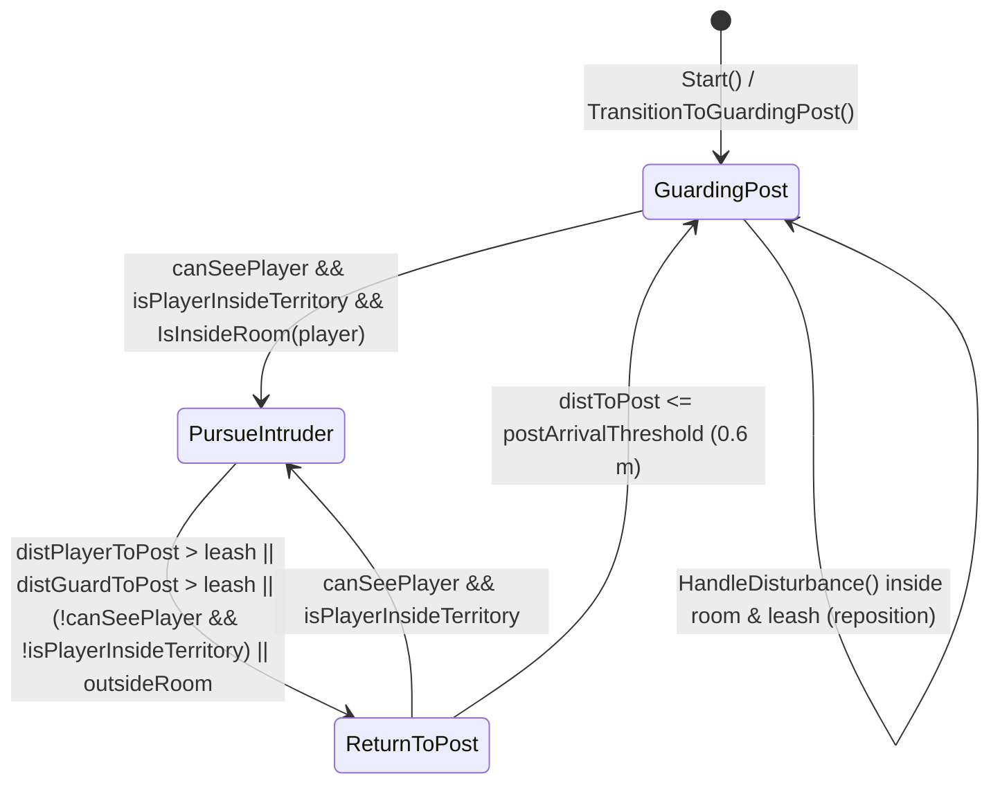

# DefensiveGuardAI & DefenseDecisionPolicy Trace

**Owner:** Aqqil (`IT24104314`)
**Scripts:** `Assets/Scripts/DefensiveGuardAI.cs`, `Assets/Scripts/DefenseDecisionPolicy.cs`
**Assigned Sector:** `Room_4_Defensive` (Route B — Access Card B)

<!-- BLOCK:POLICY_INTRO -->
## 1. Scope and Design Goals

The Room 4 defensive guard (`Guard_Aqqil_Defensive`) protects the Access Card B security
terminal (`AccessCard_Pickup_Defensive`) without abandoning Room 4 to chase the player
across the warehouse. Unlike `PatrolGuardAI` (Room 2 circuit) or `SearchGuardAI` (Room 3
belief search), `DefensiveGuardAI` stays anchored to a defensive post, evaluates nearby
cover and shotgun engagement range, and returns to post when the intruder disengages.

### 1.1 Baseline Design Parameters

- **Sight Range / FOV:** `10.0 m` / `90 deg` (`eyeHeight = 0.6 m`)
- **Defense Perimeter:** `defenseRadius = 6.0 m` around `postPosition`
- **Pursuit Leash:** `leashDistance = 8.5 m` (code default) / `9.0 m` (Room 4 scene)
- **Weapon Loadout:** `WeaponType.Combat_Shotgun` (`12 dmg x 6 pellets`, `220 HP`)
- **Policy Module:** `DefenseDecisionPolicy.Score(...)` (pure static utility scorer)
- **Candidate Topology:** `17` points (`1` anchor + `2` concentric `8`-point rings)
<!-- END:POLICY_INTRO -->

<!-- SECTION:STATE_MACHINE -->
## 2. Attack / Guard / Retreat Decision Tree Architecture

Replacing the simple direct-chase draft and static 3-waypoint circuit, `DefensiveGuardAI`
combines a 3-state `DefensiveGuardState` FSM with a 17-candidate tactical ring evaluated
through `DefenseDecisionPolicy.Score`. Unity `NavMesh` computes complete paths (`TryReachable`);
the authored AI layer handles candidate generation, occlusion/range scoring, and leash bounds.

### 2.1 State-Transition Diagram



### 2.2 Attack / Guard / Retreat Role Matrix

| Posture | Enum State | Tactical Target Selection | Weapon / Perception Action |
| --- | --- | --- | --- |
| **GUARD** | `GuardingPost` | Anchor + 2x8 rings (`hasThreat=false`, or `true` on sound cue) | Sweeps `+/- 28 deg` (`sin(t*1.8)*28`); transitions on sight in territory |
| **ATTACK** | `PursueIntruder` | `DispatchPursuitDestination()` every `0.25 s` (throttled `0.75 s`) | Fires `Combat_Shotgun` only with `GuardShooting.HasVisualTarget` |
| **RETREAT** | `ReturnToPost` | Direct NavMesh return to `postPosition` | `perceptionMemory.SetReturningState()`; snaps to `postFacing` on arrival |

### 2.3 Complete Transition Condition Table (`DefensiveGuardAI.cs`)

| From State | To State | Exact Boolean Guard Condition | Side Effects on Transition |
| --- | --- | --- | --- |
| `Any` | `GuardingPost` | `Start()` or arrival `distToPost <= 0.6 m` | `isReturning = false`, `inspectionWaitTimer = Random(2.0, 2.5)`, `nextTacticalDecision = 0` |
| `GuardingPost` | `PursueIntruder` | `canSeePlayer && isPlayerInsideTerritory && IsInsideRoom(player)` | `enemyMovement.SetChaseSpeed()`, `nextTacticalDecision = 0`, `DispatchPursuitDestination()` |
| `PursueIntruder` | `ReturnToPost` | `distPlayer > leash || distGuard > leash || (!canSee && !inTerr) || !insideRoom` | `SetDestination(postPosition)`, `perceptionMemory.SetReturningState()`, `SetPatrolSpeed()` |
| `ReturnToPost` | `PursueIntruder` | `canSeePlayer && isPlayerInsideTerritory && IsInsideRoom(player)` | Cancels retreat immediately if player steps back into `defenseRadius` with LOS |

### 2.4 17-Point Tactical Ring Generation (`DispatchInspectionPoint`)

- `i = 0`: `raw = postPosition` (`(16.0, 1.08, 8.0)` objective anchor).
- `i = 1..8`: inner ring at `r1 = min(2.5 m, max(0.5 m, leashDistance - 1 m))` every `45 deg`.
- `i = 9..16`: outer ring at `r2 = min(5.0 m, max(0.5 m, leashDistance - 1 m))` every `45 deg`.
- Only candidates passing `IsInsideRoom(raw)`, `GuardDecisionQueries.TryReachable`
  (`NavMeshPathStatus.PathComplete`), `IsInsideRoom(c.position)`, and `dist <= leashDistance`
  are scored; failed slots record `"Outside room/leash or no complete path"`.
<!-- END:STATE_MACHINE -->
<!-- SECTION:DECISION_POLICY_BASE -->
## 3. Anchor Proximity & Visibility Scoring (`hasThreat = false`)

When no visual or sound threat has been logged within `7.5 s` (`HasThreat == false`),
`DefenseDecisionPolicy.Score` balances objective anchor proximity, local ray visibility,
inspection freshness, and complete-path travel penalty:

```csharp
float utility = 0.45f * objective + 0.30f * visibility + 0.25f * freshness;
return utility - 0.15f * Mathf.Clamp01(pathLength / 20f);
```

### 3.1 Feature Computation (`DefensiveGuardAI` & `GuardDecisionQueries`)

- **`objective`:** `1 - Mathf.Clamp01(Vector3.Distance(c.position, postPosition) / Mathf.Max(1, leashDistance))`.
  At `leashDistance = 9.0 m`, anchor = `1.000`, `2.5 m` ring = `0.722`, `5.0 m` ring = `0.444`.
- **`visibility`:** `GuardDecisionQueries.Visibility(c.position, obstacleMask, transform)` —
  fires 8 horizontal `6.0 m` rays at `floor + 1.5 m`, returning `clearCount / 8f`.
- **`freshness`:** `lastInspected.TryGetValue(i, out t) ? Mathf.Clamp01((Time.time - t) / 20f) : 1f`.
  Uninspected nodes start at `1.000` and recover linearly over `20.0 s` after inspection.
- **`travel cost`:** `-0.15f * Mathf.Clamp01(pathLength / 20f)` from summed `NavMeshPath.corners`.

### 3.2 Selected Inspection Winners Across Twenty-Six Idle Sweeps

| Sweep Window | Selected Candidate | Winning `Score` |
| --- | --- | --- |
| Sweep #01 (t=0s, initial) | `C00 (Anchor (0.0m))` | `0.9224` |
| Sweep #02 (t=3s, C00 visited) | `C01 (2.5m (0 deg N))` | `0.8175` |
| Sweep #03 (t=6s, C01 visited) | `C07 (2.5m (270 deg W))` | `0.8175` |
| Sweep #04 (t=9s, C07 visited) | `C00 (Anchor (0.0m))` | `0.7849` |
| Sweep #05 (t=12s, C02 visited) | `C00 (Anchor (0.0m))` | `0.8224` |
| Sweep #06 (t=15s, C06 visited) | `C00 (Anchor (0.0m))` | `0.8599` |
| Sweep #07 (t=18s, C08 visited) | `C00 (Anchor (0.0m))` | `0.8974` |
| Sweep #08 (t=21s, C00 re-aged) | `C00 (Anchor (0.0m))` | `0.9224` |
| Sweep #09 (t=24s, C03 visited) | `C01 (2.5m (0 deg N))` | `0.8050` |
| Sweep #10 (t=27s, C04 visited) | `C01 (2.5m (0 deg N))` | `0.8050` |
| Sweep #11 (t=30s, C14 visited) | `C01 (2.5m (0 deg N))` | `0.8050` |
| Sweep #12 (t=33s, C15 visited) | `C00 (Anchor (0.0m))` | `0.8349` |
| Sweep #13 (t=36s, C05 visited) | `C00 (Anchor (0.0m))` | `0.8724` |
| Sweep #14 (t=39s, C09 visited) | `C00 (Anchor (0.0m))` | `0.9099` |
| Sweep #15 (t=42s, C00 re-visited) | `C01 (2.5m (0 deg N))` | `0.8050` |
| Sweep #16 (t=45s, C13 visited) | `C01 (2.5m (0 deg N))` | `0.8175` |
| Sweep #17 (t=48s, C10 visited) | `C01 (2.5m (0 deg N))` | `0.8175` |
| Sweep #18 (t=51s, C12 visited) | `C00 (Anchor (0.0m))` | `0.8224` |
| Sweep #19 (t=54s, C16 visited) | `C00 (Anchor (0.0m))` | `0.8599` |
| Sweep #20 (t=57s, C11 visited) | `C00 (Anchor (0.0m))` | `0.8974` |
| Sweep #21 (t=60s, cycle 2 C00) | `C01 (2.5m (0 deg N))` | `0.8175` |
| Sweep #22 (t=63s, cycle 2 C01) | `C07 (2.5m (270 deg W))` | `0.8175` |
| Sweep #23 (t=66s, cycle 2 C07) | `C00 (Anchor (0.0m))` | `0.7849` |
| Sweep #24 (t=69s, cycle 2 C02) | `C00 (Anchor (0.0m))` | `0.8224` |
| Sweep #25 (t=72s, cycle 2 C06) | `C00 (Anchor (0.0m))` | `0.8599` |
| Sweep #26 (t=75s, full settle) | `C00 (Anchor (0.0m))` | `0.8974` |

### 3.3 Full Twenty-Six-Sweep No-Threat Trace (`442` Candidate Evaluations, `leash = 9.0 m`)

| Sweep Window | ID | World `(X, Z)` | `objective` | `visibility` | `freshness` | `path (m)` | `Score` |
| --- | --- | --- | --- | --- | --- | --- | --- |
| Sweep #01 (t=0s, initial) | `C00` | `(16.00, 8.00)` | `1.000` | `0.750` | `1.000` | `0.35` | `0.9224` |
| Sweep #01 (t=0s, initial) | `C01` | `(16.00, 10.50)` | `0.722` | `0.875` | `1.000` | `2.65` | `0.8175` |
| Sweep #01 (t=0s, initial) | `C02` | `(17.77, 9.77)` | `0.722` | `0.750` | `1.000` | `2.80` | `0.7789` |
| Sweep #01 (t=0s, initial) | `C03` | `(18.50, 8.00)` | `0.722` | `0.625` | `1.000` | `2.95` | `0.7403` |
| Sweep #01 (t=0s, initial) | `C04` | `(17.77, 6.23)` | `0.722` | `0.625` | `1.000` | `2.65` | `0.7425` |
| Sweep #01 (t=0s, initial) | `C05` | `(16.00, 5.50)` | `0.722` | `0.500` | `1.000` | `2.80` | `0.7039` |
| Sweep #01 (t=0s, initial) | `C06` | `(14.23, 6.23)` | `0.722` | `0.750` | `1.000` | `2.95` | `0.7778` |
| Sweep #01 (t=0s, initial) | `C07` | `(13.50, 8.00)` | `0.722` | `0.875` | `1.000` | `2.65` | `0.8175` |
| Sweep #01 (t=0s, initial) | `C08` | `(14.23, 9.77)` | `0.722` | `0.750` | `1.000` | `2.80` | `0.7789` |
| Sweep #01 (t=0s, initial) | `C09` | `(16.00, 13.00)` | `0.444` | `0.875` | `1.000` | `5.20` | `0.6733` |
| Sweep #01 (t=0s, initial) | `C10` | `(19.54, 11.54)` | `0.444` | `0.625` | `1.000` | `5.38` | `0.5969` |
| Sweep #01 (t=0s, initial) | `C11` | `(21.00, 8.00)` | `0.444` | `0.500` | `1.000` | `5.56` | `0.5581` |
| Sweep #01 (t=0s, initial) | `C12` | `(19.54, 4.46)` | `0.444` | `0.625` | `1.000` | `5.74` | `0.5942` |
| Sweep #01 (t=0s, initial) | `C13` | `(16.00, 3.00)` | `0.444` | `0.750` | `1.000` | `5.20` | `0.6358` |
| Sweep #01 (t=0s, initial) | `C14` | `(12.46, 4.46)` | `0.444` | `0.875` | `1.000` | `5.38` | `0.6720` |
| Sweep #01 (t=0s, initial) | `C15` | `(11.00, 8.00)` | `0.444` | `0.875` | `1.000` | `5.56` | `0.6706` |
| Sweep #01 (t=0s, initial) | `C16` | `(12.46, 11.54)` | `0.444` | `0.625` | `1.000` | `5.74` | `0.5942` |
| Sweep #02 (t=3s, C00 visited) | `C00` | `(16.00, 8.00)` | `1.000` | `0.750` | `0.150` | `0.35` | `0.7099` |
| Sweep #02 (t=3s, C00 visited) | `C01` | `(16.00, 10.50)` | `0.722` | `0.875` | `1.000` | `2.65` | `0.8175` |
| Sweep #02 (t=3s, C00 visited) | `C02` | `(17.77, 9.77)` | `0.722` | `0.750` | `1.000` | `2.80` | `0.7789` |
| Sweep #02 (t=3s, C00 visited) | `C03` | `(18.50, 8.00)` | `0.722` | `0.625` | `1.000` | `2.95` | `0.7403` |
| Sweep #02 (t=3s, C00 visited) | `C04` | `(17.77, 6.23)` | `0.722` | `0.625` | `1.000` | `2.65` | `0.7425` |
| Sweep #02 (t=3s, C00 visited) | `C05` | `(16.00, 5.50)` | `0.722` | `0.500` | `1.000` | `2.80` | `0.7039` |
| Sweep #02 (t=3s, C00 visited) | `C06` | `(14.23, 6.23)` | `0.722` | `0.750` | `1.000` | `2.95` | `0.7778` |
| Sweep #02 (t=3s, C00 visited) | `C07` | `(13.50, 8.00)` | `0.722` | `0.875` | `1.000` | `2.65` | `0.8175` |
| Sweep #02 (t=3s, C00 visited) | `C08` | `(14.23, 9.77)` | `0.722` | `0.750` | `1.000` | `2.80` | `0.7789` |
| Sweep #02 (t=3s, C00 visited) | `C09` | `(16.00, 13.00)` | `0.444` | `0.875` | `1.000` | `5.20` | `0.6733` |
| Sweep #02 (t=3s, C00 visited) | `C10` | `(19.54, 11.54)` | `0.444` | `0.625` | `1.000` | `5.38` | `0.5969` |
| Sweep #02 (t=3s, C00 visited) | `C11` | `(21.00, 8.00)` | `0.444` | `0.500` | `1.000` | `5.56` | `0.5581` |
| Sweep #02 (t=3s, C00 visited) | `C12` | `(19.54, 4.46)` | `0.444` | `0.625` | `1.000` | `5.74` | `0.5942` |
| Sweep #02 (t=3s, C00 visited) | `C13` | `(16.00, 3.00)` | `0.444` | `0.750` | `1.000` | `5.20` | `0.6358` |
| Sweep #02 (t=3s, C00 visited) | `C14` | `(12.46, 4.46)` | `0.444` | `0.875` | `1.000` | `5.38` | `0.6720` |
| Sweep #02 (t=3s, C00 visited) | `C15` | `(11.00, 8.00)` | `0.444` | `0.875` | `1.000` | `5.56` | `0.6706` |
| Sweep #02 (t=3s, C00 visited) | `C16` | `(12.46, 11.54)` | `0.444` | `0.625` | `1.000` | `5.74` | `0.5942` |
| Sweep #03 (t=6s, C01 visited) | `C00` | `(16.00, 8.00)` | `1.000` | `0.750` | `0.300` | `0.35` | `0.7474` |
| Sweep #03 (t=6s, C01 visited) | `C01` | `(16.00, 10.50)` | `0.722` | `0.875` | `0.100` | `2.65` | `0.5925` |
| Sweep #03 (t=6s, C01 visited) | `C02` | `(17.77, 9.77)` | `0.722` | `0.750` | `1.000` | `2.80` | `0.7789` |
| Sweep #03 (t=6s, C01 visited) | `C03` | `(18.50, 8.00)` | `0.722` | `0.625` | `1.000` | `2.95` | `0.7403` |
| Sweep #03 (t=6s, C01 visited) | `C04` | `(17.77, 6.23)` | `0.722` | `0.625` | `1.000` | `2.65` | `0.7425` |
| Sweep #03 (t=6s, C01 visited) | `C05` | `(16.00, 5.50)` | `0.722` | `0.500` | `1.000` | `2.80` | `0.7039` |
| Sweep #03 (t=6s, C01 visited) | `C06` | `(14.23, 6.23)` | `0.722` | `0.750` | `1.000` | `2.95` | `0.7778` |
| Sweep #03 (t=6s, C01 visited) | `C07` | `(13.50, 8.00)` | `0.722` | `0.875` | `1.000` | `2.65` | `0.8175` |
| Sweep #03 (t=6s, C01 visited) | `C08` | `(14.23, 9.77)` | `0.722` | `0.750` | `1.000` | `2.80` | `0.7789` |
| Sweep #03 (t=6s, C01 visited) | `C09` | `(16.00, 13.00)` | `0.444` | `0.875` | `1.000` | `5.20` | `0.6733` |
| Sweep #03 (t=6s, C01 visited) | `C10` | `(19.54, 11.54)` | `0.444` | `0.625` | `1.000` | `5.38` | `0.5969` |
| Sweep #03 (t=6s, C01 visited) | `C11` | `(21.00, 8.00)` | `0.444` | `0.500` | `1.000` | `5.56` | `0.5581` |
| Sweep #03 (t=6s, C01 visited) | `C12` | `(19.54, 4.46)` | `0.444` | `0.625` | `1.000` | `5.74` | `0.5942` |
| Sweep #03 (t=6s, C01 visited) | `C13` | `(16.00, 3.00)` | `0.444` | `0.750` | `1.000` | `5.20` | `0.6358` |
| Sweep #03 (t=6s, C01 visited) | `C14` | `(12.46, 4.46)` | `0.444` | `0.875` | `1.000` | `5.38` | `0.6720` |
| Sweep #03 (t=6s, C01 visited) | `C15` | `(11.00, 8.00)` | `0.444` | `0.875` | `1.000` | `5.56` | `0.6706` |
| Sweep #03 (t=6s, C01 visited) | `C16` | `(12.46, 11.54)` | `0.444` | `0.625` | `1.000` | `5.74` | `0.5942` |
| Sweep #04 (t=9s, C07 visited) | `C00` | `(16.00, 8.00)` | `1.000` | `0.750` | `0.450` | `0.35` | `0.7849` |
| Sweep #04 (t=9s, C07 visited) | `C01` | `(16.00, 10.50)` | `0.722` | `0.875` | `0.250` | `2.65` | `0.6300` |
| Sweep #04 (t=9s, C07 visited) | `C02` | `(17.77, 9.77)` | `0.722` | `0.750` | `1.000` | `2.80` | `0.7789` |
| Sweep #04 (t=9s, C07 visited) | `C03` | `(18.50, 8.00)` | `0.722` | `0.625` | `1.000` | `2.95` | `0.7403` |
| Sweep #04 (t=9s, C07 visited) | `C04` | `(17.77, 6.23)` | `0.722` | `0.625` | `1.000` | `2.65` | `0.7425` |
| Sweep #04 (t=9s, C07 visited) | `C05` | `(16.00, 5.50)` | `0.722` | `0.500` | `1.000` | `2.80` | `0.7039` |
| Sweep #04 (t=9s, C07 visited) | `C06` | `(14.23, 6.23)` | `0.722` | `0.750` | `1.000` | `2.95` | `0.7778` |
| Sweep #04 (t=9s, C07 visited) | `C07` | `(13.50, 8.00)` | `0.722` | `0.875` | `0.100` | `2.65` | `0.5925` |
| Sweep #04 (t=9s, C07 visited) | `C08` | `(14.23, 9.77)` | `0.722` | `0.750` | `1.000` | `2.80` | `0.7789` |
| Sweep #04 (t=9s, C07 visited) | `C09` | `(16.00, 13.00)` | `0.444` | `0.875` | `1.000` | `5.20` | `0.6733` |
| Sweep #04 (t=9s, C07 visited) | `C10` | `(19.54, 11.54)` | `0.444` | `0.625` | `1.000` | `5.38` | `0.5969` |
| Sweep #04 (t=9s, C07 visited) | `C11` | `(21.00, 8.00)` | `0.444` | `0.500` | `1.000` | `5.56` | `0.5581` |
| Sweep #04 (t=9s, C07 visited) | `C12` | `(19.54, 4.46)` | `0.444` | `0.625` | `1.000` | `5.74` | `0.5942` |
| Sweep #04 (t=9s, C07 visited) | `C13` | `(16.00, 3.00)` | `0.444` | `0.750` | `1.000` | `5.20` | `0.6358` |
| Sweep #04 (t=9s, C07 visited) | `C14` | `(12.46, 4.46)` | `0.444` | `0.875` | `1.000` | `5.38` | `0.6720` |
| Sweep #04 (t=9s, C07 visited) | `C15` | `(11.00, 8.00)` | `0.444` | `0.875` | `1.000` | `5.56` | `0.6706` |
| Sweep #04 (t=9s, C07 visited) | `C16` | `(12.46, 11.54)` | `0.444` | `0.625` | `1.000` | `5.74` | `0.5942` |
| Sweep #05 (t=12s, C02 visited) | `C00` | `(16.00, 8.00)` | `1.000` | `0.750` | `0.600` | `0.35` | `0.8224` |
| Sweep #05 (t=12s, C02 visited) | `C01` | `(16.00, 10.50)` | `0.722` | `0.875` | `0.400` | `2.65` | `0.6675` |
| Sweep #05 (t=12s, C02 visited) | `C02` | `(17.77, 9.77)` | `0.722` | `0.750` | `0.100` | `2.80` | `0.5539` |
| Sweep #05 (t=12s, C02 visited) | `C03` | `(18.50, 8.00)` | `0.722` | `0.625` | `1.000` | `2.95` | `0.7403` |
| Sweep #05 (t=12s, C02 visited) | `C04` | `(17.77, 6.23)` | `0.722` | `0.625` | `1.000` | `2.65` | `0.7425` |
| Sweep #05 (t=12s, C02 visited) | `C05` | `(16.00, 5.50)` | `0.722` | `0.500` | `1.000` | `2.80` | `0.7039` |
| Sweep #05 (t=12s, C02 visited) | `C06` | `(14.23, 6.23)` | `0.722` | `0.750` | `1.000` | `2.95` | `0.7778` |
| Sweep #05 (t=12s, C02 visited) | `C07` | `(13.50, 8.00)` | `0.722` | `0.875` | `0.250` | `2.65` | `0.6300` |
| Sweep #05 (t=12s, C02 visited) | `C08` | `(14.23, 9.77)` | `0.722` | `0.750` | `1.000` | `2.80` | `0.7789` |
| Sweep #05 (t=12s, C02 visited) | `C09` | `(16.00, 13.00)` | `0.444` | `0.875` | `1.000` | `5.20` | `0.6733` |
| Sweep #05 (t=12s, C02 visited) | `C10` | `(19.54, 11.54)` | `0.444` | `0.625` | `1.000` | `5.38` | `0.5969` |
| Sweep #05 (t=12s, C02 visited) | `C11` | `(21.00, 8.00)` | `0.444` | `0.500` | `1.000` | `5.56` | `0.5581` |
| Sweep #05 (t=12s, C02 visited) | `C12` | `(19.54, 4.46)` | `0.444` | `0.625` | `1.000` | `5.74` | `0.5942` |
| Sweep #05 (t=12s, C02 visited) | `C13` | `(16.00, 3.00)` | `0.444` | `0.750` | `1.000` | `5.20` | `0.6358` |
| Sweep #05 (t=12s, C02 visited) | `C14` | `(12.46, 4.46)` | `0.444` | `0.875` | `1.000` | `5.38` | `0.6720` |
| Sweep #05 (t=12s, C02 visited) | `C15` | `(11.00, 8.00)` | `0.444` | `0.875` | `1.000` | `5.56` | `0.6706` |
| Sweep #05 (t=12s, C02 visited) | `C16` | `(12.46, 11.54)` | `0.444` | `0.625` | `1.000` | `5.74` | `0.5942` |
| Sweep #06 (t=15s, C06 visited) | `C00` | `(16.00, 8.00)` | `1.000` | `0.750` | `0.750` | `0.35` | `0.8599` |
| Sweep #06 (t=15s, C06 visited) | `C01` | `(16.00, 10.50)` | `0.722` | `0.875` | `0.550` | `2.65` | `0.7050` |
| Sweep #06 (t=15s, C06 visited) | `C02` | `(17.77, 9.77)` | `0.722` | `0.750` | `0.250` | `2.80` | `0.5914` |
| Sweep #06 (t=15s, C06 visited) | `C03` | `(18.50, 8.00)` | `0.722` | `0.625` | `1.000` | `2.95` | `0.7403` |
| Sweep #06 (t=15s, C06 visited) | `C04` | `(17.77, 6.23)` | `0.722` | `0.625` | `1.000` | `2.65` | `0.7425` |
| Sweep #06 (t=15s, C06 visited) | `C05` | `(16.00, 5.50)` | `0.722` | `0.500` | `1.000` | `2.80` | `0.7039` |
| Sweep #06 (t=15s, C06 visited) | `C06` | `(14.23, 6.23)` | `0.722` | `0.750` | `0.100` | `2.95` | `0.5528` |
| Sweep #06 (t=15s, C06 visited) | `C07` | `(13.50, 8.00)` | `0.722` | `0.875` | `0.400` | `2.65` | `0.6675` |
| Sweep #06 (t=15s, C06 visited) | `C08` | `(14.23, 9.77)` | `0.722` | `0.750` | `1.000` | `2.80` | `0.7789` |
| Sweep #06 (t=15s, C06 visited) | `C09` | `(16.00, 13.00)` | `0.444` | `0.875` | `1.000` | `5.20` | `0.6733` |
| Sweep #06 (t=15s, C06 visited) | `C10` | `(19.54, 11.54)` | `0.444` | `0.625` | `1.000` | `5.38` | `0.5969` |
| Sweep #06 (t=15s, C06 visited) | `C11` | `(21.00, 8.00)` | `0.444` | `0.500` | `1.000` | `5.56` | `0.5581` |
| Sweep #06 (t=15s, C06 visited) | `C12` | `(19.54, 4.46)` | `0.444` | `0.625` | `1.000` | `5.74` | `0.5942` |
| Sweep #06 (t=15s, C06 visited) | `C13` | `(16.00, 3.00)` | `0.444` | `0.750` | `1.000` | `5.20` | `0.6358` |
| Sweep #06 (t=15s, C06 visited) | `C14` | `(12.46, 4.46)` | `0.444` | `0.875` | `1.000` | `5.38` | `0.6720` |
| Sweep #06 (t=15s, C06 visited) | `C15` | `(11.00, 8.00)` | `0.444` | `0.875` | `1.000` | `5.56` | `0.6706` |
| Sweep #06 (t=15s, C06 visited) | `C16` | `(12.46, 11.54)` | `0.444` | `0.625` | `1.000` | `5.74` | `0.5942` |
| Sweep #07 (t=18s, C08 visited) | `C00` | `(16.00, 8.00)` | `1.000` | `0.750` | `0.900` | `0.35` | `0.8974` |
| Sweep #07 (t=18s, C08 visited) | `C01` | `(16.00, 10.50)` | `0.722` | `0.875` | `1.000` | `2.65` | `0.8175` |
| Sweep #07 (t=18s, C08 visited) | `C02` | `(17.77, 9.77)` | `0.722` | `0.750` | `0.400` | `2.80` | `0.6289` |
| Sweep #07 (t=18s, C08 visited) | `C03` | `(18.50, 8.00)` | `0.722` | `0.625` | `1.000` | `2.95` | `0.7403` |
| Sweep #07 (t=18s, C08 visited) | `C04` | `(17.77, 6.23)` | `0.722` | `0.625` | `1.000` | `2.65` | `0.7425` |
| Sweep #07 (t=18s, C08 visited) | `C05` | `(16.00, 5.50)` | `0.722` | `0.500` | `1.000` | `2.80` | `0.7039` |
| Sweep #07 (t=18s, C08 visited) | `C06` | `(14.23, 6.23)` | `0.722` | `0.750` | `0.250` | `2.95` | `0.5903` |
| Sweep #07 (t=18s, C08 visited) | `C07` | `(13.50, 8.00)` | `0.722` | `0.875` | `1.000` | `2.65` | `0.8175` |
| Sweep #07 (t=18s, C08 visited) | `C08` | `(14.23, 9.77)` | `0.722` | `0.750` | `0.100` | `2.80` | `0.5539` |
| Sweep #07 (t=18s, C08 visited) | `C09` | `(16.00, 13.00)` | `0.444` | `0.875` | `1.000` | `5.20` | `0.6733` |
| Sweep #07 (t=18s, C08 visited) | `C10` | `(19.54, 11.54)` | `0.444` | `0.625` | `1.000` | `5.38` | `0.5969` |
| Sweep #07 (t=18s, C08 visited) | `C11` | `(21.00, 8.00)` | `0.444` | `0.500` | `1.000` | `5.56` | `0.5581` |
| Sweep #07 (t=18s, C08 visited) | `C12` | `(19.54, 4.46)` | `0.444` | `0.625` | `1.000` | `5.74` | `0.5942` |
| Sweep #07 (t=18s, C08 visited) | `C13` | `(16.00, 3.00)` | `0.444` | `0.750` | `1.000` | `5.20` | `0.6358` |
| Sweep #07 (t=18s, C08 visited) | `C14` | `(12.46, 4.46)` | `0.444` | `0.875` | `1.000` | `5.38` | `0.6720` |
| Sweep #07 (t=18s, C08 visited) | `C15` | `(11.00, 8.00)` | `0.444` | `0.875` | `1.000` | `5.56` | `0.6706` |
| Sweep #07 (t=18s, C08 visited) | `C16` | `(12.46, 11.54)` | `0.444` | `0.625` | `1.000` | `5.74` | `0.5942` |
| Sweep #08 (t=21s, C00 re-aged) | `C00` | `(16.00, 8.00)` | `1.000` | `0.750` | `1.000` | `0.35` | `0.9224` |
| Sweep #08 (t=21s, C00 re-aged) | `C01` | `(16.00, 10.50)` | `0.722` | `0.875` | `0.850` | `2.65` | `0.7800` |
| Sweep #08 (t=21s, C00 re-aged) | `C02` | `(17.77, 9.77)` | `0.722` | `0.750` | `0.850` | `2.80` | `0.7414` |
| Sweep #08 (t=21s, C00 re-aged) | `C03` | `(18.50, 8.00)` | `0.722` | `0.625` | `0.850` | `2.95` | `0.7028` |
| Sweep #08 (t=21s, C00 re-aged) | `C04` | `(17.77, 6.23)` | `0.722` | `0.625` | `0.850` | `2.65` | `0.7050` |
| Sweep #08 (t=21s, C00 re-aged) | `C05` | `(16.00, 5.50)` | `0.722` | `0.500` | `0.850` | `2.80` | `0.6664` |
| Sweep #08 (t=21s, C00 re-aged) | `C06` | `(14.23, 6.23)` | `0.722` | `0.750` | `0.400` | `2.95` | `0.6278` |
| Sweep #08 (t=21s, C00 re-aged) | `C07` | `(13.50, 8.00)` | `0.722` | `0.875` | `0.850` | `2.65` | `0.7800` |
| Sweep #08 (t=21s, C00 re-aged) | `C08` | `(14.23, 9.77)` | `0.722` | `0.750` | `0.250` | `2.80` | `0.5914` |
| Sweep #08 (t=21s, C00 re-aged) | `C09` | `(16.00, 13.00)` | `0.444` | `0.875` | `0.850` | `5.20` | `0.6358` |
| Sweep #08 (t=21s, C00 re-aged) | `C10` | `(19.54, 11.54)` | `0.444` | `0.625` | `0.850` | `5.38` | `0.5595` |
| Sweep #08 (t=21s, C00 re-aged) | `C11` | `(21.00, 8.00)` | `0.444` | `0.500` | `0.850` | `5.56` | `0.5206` |
| Sweep #08 (t=21s, C00 re-aged) | `C12` | `(19.54, 4.46)` | `0.444` | `0.625` | `0.850` | `5.74` | `0.5567` |
| Sweep #08 (t=21s, C00 re-aged) | `C13` | `(16.00, 3.00)` | `0.444` | `0.750` | `0.850` | `5.20` | `0.5983` |
| Sweep #08 (t=21s, C00 re-aged) | `C14` | `(12.46, 4.46)` | `0.444` | `0.875` | `0.850` | `5.38` | `0.6345` |
| Sweep #08 (t=21s, C00 re-aged) | `C15` | `(11.00, 8.00)` | `0.444` | `0.875` | `0.850` | `5.56` | `0.6331` |
| Sweep #08 (t=21s, C00 re-aged) | `C16` | `(12.46, 11.54)` | `0.444` | `0.625` | `0.850` | `5.74` | `0.5567` |
| Sweep #09 (t=24s, C03 visited) | `C00` | `(16.00, 8.00)` | `1.000` | `0.750` | `0.200` | `0.35` | `0.7224` |
| Sweep #09 (t=24s, C03 visited) | `C01` | `(16.00, 10.50)` | `0.722` | `0.875` | `0.950` | `2.65` | `0.8050` |
| Sweep #09 (t=24s, C03 visited) | `C02` | `(17.77, 9.77)` | `0.722` | `0.750` | `0.950` | `2.80` | `0.7664` |
| Sweep #09 (t=24s, C03 visited) | `C03` | `(18.50, 8.00)` | `0.722` | `0.625` | `0.100` | `2.95` | `0.5153` |
| Sweep #09 (t=24s, C03 visited) | `C04` | `(17.77, 6.23)` | `0.722` | `0.625` | `0.950` | `2.65` | `0.7300` |
| Sweep #09 (t=24s, C03 visited) | `C05` | `(16.00, 5.50)` | `0.722` | `0.500` | `0.950` | `2.80` | `0.6914` |
| Sweep #09 (t=24s, C03 visited) | `C06` | `(14.23, 6.23)` | `0.722` | `0.750` | `0.950` | `2.95` | `0.7653` |
| Sweep #09 (t=24s, C03 visited) | `C07` | `(13.50, 8.00)` | `0.722` | `0.875` | `0.950` | `2.65` | `0.8050` |
| Sweep #09 (t=24s, C03 visited) | `C08` | `(14.23, 9.77)` | `0.722` | `0.750` | `0.400` | `2.80` | `0.6289` |
| Sweep #09 (t=24s, C03 visited) | `C09` | `(16.00, 13.00)` | `0.444` | `0.875` | `0.950` | `5.20` | `0.6608` |
| Sweep #09 (t=24s, C03 visited) | `C10` | `(19.54, 11.54)` | `0.444` | `0.625` | `0.950` | `5.38` | `0.5845` |
| Sweep #09 (t=24s, C03 visited) | `C11` | `(21.00, 8.00)` | `0.444` | `0.500` | `0.950` | `5.56` | `0.5456` |
| Sweep #09 (t=24s, C03 visited) | `C12` | `(19.54, 4.46)` | `0.444` | `0.625` | `0.950` | `5.74` | `0.5817` |
| Sweep #09 (t=24s, C03 visited) | `C13` | `(16.00, 3.00)` | `0.444` | `0.750` | `0.950` | `5.20` | `0.6233` |
| Sweep #09 (t=24s, C03 visited) | `C14` | `(12.46, 4.46)` | `0.444` | `0.875` | `0.950` | `5.38` | `0.6594` |
| Sweep #09 (t=24s, C03 visited) | `C15` | `(11.00, 8.00)` | `0.444` | `0.875` | `0.950` | `5.56` | `0.6581` |
| Sweep #09 (t=24s, C03 visited) | `C16` | `(12.46, 11.54)` | `0.444` | `0.625` | `0.950` | `5.74` | `0.5817` |
| Sweep #10 (t=27s, C04 visited) | `C00` | `(16.00, 8.00)` | `1.000` | `0.750` | `0.350` | `0.35` | `0.7599` |
| Sweep #10 (t=27s, C04 visited) | `C01` | `(16.00, 10.50)` | `0.722` | `0.875` | `0.950` | `2.65` | `0.8050` |
| Sweep #10 (t=27s, C04 visited) | `C02` | `(17.77, 9.77)` | `0.722` | `0.750` | `0.950` | `2.80` | `0.7664` |
| Sweep #10 (t=27s, C04 visited) | `C03` | `(18.50, 8.00)` | `0.722` | `0.625` | `0.250` | `2.95` | `0.5528` |
| Sweep #10 (t=27s, C04 visited) | `C04` | `(17.77, 6.23)` | `0.722` | `0.625` | `0.100` | `2.65` | `0.5175` |
| Sweep #10 (t=27s, C04 visited) | `C05` | `(16.00, 5.50)` | `0.722` | `0.500` | `0.950` | `2.80` | `0.6914` |
| Sweep #10 (t=27s, C04 visited) | `C06` | `(14.23, 6.23)` | `0.722` | `0.750` | `0.950` | `2.95` | `0.7653` |
| Sweep #10 (t=27s, C04 visited) | `C07` | `(13.50, 8.00)` | `0.722` | `0.875` | `0.950` | `2.65` | `0.8050` |
| Sweep #10 (t=27s, C04 visited) | `C08` | `(14.23, 9.77)` | `0.722` | `0.750` | `0.950` | `2.80` | `0.7664` |
| Sweep #10 (t=27s, C04 visited) | `C09` | `(16.00, 13.00)` | `0.444` | `0.875` | `0.950` | `5.20` | `0.6608` |
| Sweep #10 (t=27s, C04 visited) | `C10` | `(19.54, 11.54)` | `0.444` | `0.625` | `0.950` | `5.38` | `0.5845` |
| Sweep #10 (t=27s, C04 visited) | `C11` | `(21.00, 8.00)` | `0.444` | `0.500` | `0.950` | `5.56` | `0.5456` |
| Sweep #10 (t=27s, C04 visited) | `C12` | `(19.54, 4.46)` | `0.444` | `0.625` | `0.950` | `5.74` | `0.5817` |
| Sweep #10 (t=27s, C04 visited) | `C13` | `(16.00, 3.00)` | `0.444` | `0.750` | `0.950` | `5.20` | `0.6233` |
| Sweep #10 (t=27s, C04 visited) | `C14` | `(12.46, 4.46)` | `0.444` | `0.875` | `0.950` | `5.38` | `0.6594` |
| Sweep #10 (t=27s, C04 visited) | `C15` | `(11.00, 8.00)` | `0.444` | `0.875` | `0.950` | `5.56` | `0.6581` |
| Sweep #10 (t=27s, C04 visited) | `C16` | `(12.46, 11.54)` | `0.444` | `0.625` | `0.950` | `5.74` | `0.5817` |
| Sweep #11 (t=30s, C14 visited) | `C00` | `(16.00, 8.00)` | `1.000` | `0.750` | `0.500` | `0.35` | `0.7974` |
| Sweep #11 (t=30s, C14 visited) | `C01` | `(16.00, 10.50)` | `0.722` | `0.875` | `0.950` | `2.65` | `0.8050` |
| Sweep #11 (t=30s, C14 visited) | `C02` | `(17.77, 9.77)` | `0.722` | `0.750` | `0.950` | `2.80` | `0.7664` |
| Sweep #11 (t=30s, C14 visited) | `C03` | `(18.50, 8.00)` | `0.722` | `0.625` | `0.400` | `2.95` | `0.5903` |
| Sweep #11 (t=30s, C14 visited) | `C04` | `(17.77, 6.23)` | `0.722` | `0.625` | `0.250` | `2.65` | `0.5550` |
| Sweep #11 (t=30s, C14 visited) | `C05` | `(16.00, 5.50)` | `0.722` | `0.500` | `0.950` | `2.80` | `0.6914` |
| Sweep #11 (t=30s, C14 visited) | `C06` | `(14.23, 6.23)` | `0.722` | `0.750` | `0.950` | `2.95` | `0.7653` |
| Sweep #11 (t=30s, C14 visited) | `C07` | `(13.50, 8.00)` | `0.722` | `0.875` | `0.950` | `2.65` | `0.8050` |
| Sweep #11 (t=30s, C14 visited) | `C08` | `(14.23, 9.77)` | `0.722` | `0.750` | `0.950` | `2.80` | `0.7664` |
| Sweep #11 (t=30s, C14 visited) | `C09` | `(16.00, 13.00)` | `0.444` | `0.875` | `0.950` | `5.20` | `0.6608` |
| Sweep #11 (t=30s, C14 visited) | `C10` | `(19.54, 11.54)` | `0.444` | `0.625` | `0.950` | `5.38` | `0.5845` |
| Sweep #11 (t=30s, C14 visited) | `C11` | `(21.00, 8.00)` | `0.444` | `0.500` | `0.950` | `5.56` | `0.5456` |
| Sweep #11 (t=30s, C14 visited) | `C12` | `(19.54, 4.46)` | `0.444` | `0.625` | `0.950` | `5.74` | `0.5817` |
| Sweep #11 (t=30s, C14 visited) | `C13` | `(16.00, 3.00)` | `0.444` | `0.750` | `0.950` | `5.20` | `0.6233` |
| Sweep #11 (t=30s, C14 visited) | `C14` | `(12.46, 4.46)` | `0.444` | `0.875` | `0.100` | `5.38` | `0.4470` |
| Sweep #11 (t=30s, C14 visited) | `C15` | `(11.00, 8.00)` | `0.444` | `0.875` | `0.950` | `5.56` | `0.6581` |
| Sweep #11 (t=30s, C14 visited) | `C16` | `(12.46, 11.54)` | `0.444` | `0.625` | `0.950` | `5.74` | `0.5817` |
| Sweep #12 (t=33s, C15 visited) | `C00` | `(16.00, 8.00)` | `1.000` | `0.750` | `0.650` | `0.35` | `0.8349` |
| Sweep #12 (t=33s, C15 visited) | `C01` | `(16.00, 10.50)` | `0.722` | `0.875` | `1.000` | `2.65` | `0.8175` |
| Sweep #12 (t=33s, C15 visited) | `C02` | `(17.77, 9.77)` | `0.722` | `0.750` | `1.000` | `2.80` | `0.7789` |
| Sweep #12 (t=33s, C15 visited) | `C03` | `(18.50, 8.00)` | `0.722` | `0.625` | `1.000` | `2.95` | `0.7403` |
| Sweep #12 (t=33s, C15 visited) | `C04` | `(17.77, 6.23)` | `0.722` | `0.625` | `0.400` | `2.65` | `0.5925` |
| Sweep #12 (t=33s, C15 visited) | `C05` | `(16.00, 5.50)` | `0.722` | `0.500` | `1.000` | `2.80` | `0.7039` |
| Sweep #12 (t=33s, C15 visited) | `C06` | `(14.23, 6.23)` | `0.722` | `0.750` | `1.000` | `2.95` | `0.7778` |
| Sweep #12 (t=33s, C15 visited) | `C07` | `(13.50, 8.00)` | `0.722` | `0.875` | `1.000` | `2.65` | `0.8175` |
| Sweep #12 (t=33s, C15 visited) | `C08` | `(14.23, 9.77)` | `0.722` | `0.750` | `1.000` | `2.80` | `0.7789` |
| Sweep #12 (t=33s, C15 visited) | `C09` | `(16.00, 13.00)` | `0.444` | `0.875` | `1.000` | `5.20` | `0.6733` |
| Sweep #12 (t=33s, C15 visited) | `C10` | `(19.54, 11.54)` | `0.444` | `0.625` | `1.000` | `5.38` | `0.5969` |
| Sweep #12 (t=33s, C15 visited) | `C11` | `(21.00, 8.00)` | `0.444` | `0.500` | `1.000` | `5.56` | `0.5581` |
| Sweep #12 (t=33s, C15 visited) | `C12` | `(19.54, 4.46)` | `0.444` | `0.625` | `1.000` | `5.74` | `0.5942` |
| Sweep #12 (t=33s, C15 visited) | `C13` | `(16.00, 3.00)` | `0.444` | `0.750` | `1.000` | `5.20` | `0.6358` |
| Sweep #12 (t=33s, C15 visited) | `C14` | `(12.46, 4.46)` | `0.444` | `0.875` | `0.250` | `5.38` | `0.4845` |
| Sweep #12 (t=33s, C15 visited) | `C15` | `(11.00, 8.00)` | `0.444` | `0.875` | `0.100` | `5.56` | `0.4456` |
| Sweep #12 (t=33s, C15 visited) | `C16` | `(12.46, 11.54)` | `0.444` | `0.625` | `1.000` | `5.74` | `0.5942` |
| Sweep #13 (t=36s, C05 visited) | `C00` | `(16.00, 8.00)` | `1.000` | `0.750` | `0.800` | `0.35` | `0.8724` |
| Sweep #13 (t=36s, C05 visited) | `C01` | `(16.00, 10.50)` | `0.722` | `0.875` | `1.000` | `2.65` | `0.8175` |
| Sweep #13 (t=36s, C05 visited) | `C02` | `(17.77, 9.77)` | `0.722` | `0.750` | `1.000` | `2.80` | `0.7789` |
| Sweep #13 (t=36s, C05 visited) | `C03` | `(18.50, 8.00)` | `0.722` | `0.625` | `1.000` | `2.95` | `0.7403` |
| Sweep #13 (t=36s, C05 visited) | `C04` | `(17.77, 6.23)` | `0.722` | `0.625` | `1.000` | `2.65` | `0.7425` |
| Sweep #13 (t=36s, C05 visited) | `C05` | `(16.00, 5.50)` | `0.722` | `0.500` | `0.100` | `2.80` | `0.4789` |
| Sweep #13 (t=36s, C05 visited) | `C06` | `(14.23, 6.23)` | `0.722` | `0.750` | `1.000` | `2.95` | `0.7778` |
| Sweep #13 (t=36s, C05 visited) | `C07` | `(13.50, 8.00)` | `0.722` | `0.875` | `1.000` | `2.65` | `0.8175` |
| Sweep #13 (t=36s, C05 visited) | `C08` | `(14.23, 9.77)` | `0.722` | `0.750` | `1.000` | `2.80` | `0.7789` |
| Sweep #13 (t=36s, C05 visited) | `C09` | `(16.00, 13.00)` | `0.444` | `0.875` | `1.000` | `5.20` | `0.6733` |
| Sweep #13 (t=36s, C05 visited) | `C10` | `(19.54, 11.54)` | `0.444` | `0.625` | `1.000` | `5.38` | `0.5969` |
| Sweep #13 (t=36s, C05 visited) | `C11` | `(21.00, 8.00)` | `0.444` | `0.500` | `1.000` | `5.56` | `0.5581` |
| Sweep #13 (t=36s, C05 visited) | `C12` | `(19.54, 4.46)` | `0.444` | `0.625` | `1.000` | `5.74` | `0.5942` |
| Sweep #13 (t=36s, C05 visited) | `C13` | `(16.00, 3.00)` | `0.444` | `0.750` | `1.000` | `5.20` | `0.6358` |
| Sweep #13 (t=36s, C05 visited) | `C14` | `(12.46, 4.46)` | `0.444` | `0.875` | `0.400` | `5.38` | `0.5220` |
| Sweep #13 (t=36s, C05 visited) | `C15` | `(11.00, 8.00)` | `0.444` | `0.875` | `0.250` | `5.56` | `0.4831` |
| Sweep #13 (t=36s, C05 visited) | `C16` | `(12.46, 11.54)` | `0.444` | `0.625` | `1.000` | `5.74` | `0.5942` |
| Sweep #14 (t=39s, C09 visited) | `C00` | `(16.00, 8.00)` | `1.000` | `0.750` | `0.950` | `0.35` | `0.9099` |
| Sweep #14 (t=39s, C09 visited) | `C01` | `(16.00, 10.50)` | `0.722` | `0.875` | `1.000` | `2.65` | `0.8175` |
| Sweep #14 (t=39s, C09 visited) | `C02` | `(17.77, 9.77)` | `0.722` | `0.750` | `1.000` | `2.80` | `0.7789` |
| Sweep #14 (t=39s, C09 visited) | `C03` | `(18.50, 8.00)` | `0.722` | `0.625` | `1.000` | `2.95` | `0.7403` |
| Sweep #14 (t=39s, C09 visited) | `C04` | `(17.77, 6.23)` | `0.722` | `0.625` | `1.000` | `2.65` | `0.7425` |
| Sweep #14 (t=39s, C09 visited) | `C05` | `(16.00, 5.50)` | `0.722` | `0.500` | `0.250` | `2.80` | `0.5164` |
| Sweep #14 (t=39s, C09 visited) | `C06` | `(14.23, 6.23)` | `0.722` | `0.750` | `1.000` | `2.95` | `0.7778` |
| Sweep #14 (t=39s, C09 visited) | `C07` | `(13.50, 8.00)` | `0.722` | `0.875` | `1.000` | `2.65` | `0.8175` |
| Sweep #14 (t=39s, C09 visited) | `C08` | `(14.23, 9.77)` | `0.722` | `0.750` | `1.000` | `2.80` | `0.7789` |
| Sweep #14 (t=39s, C09 visited) | `C09` | `(16.00, 13.00)` | `0.444` | `0.875` | `0.100` | `5.20` | `0.4483` |
| Sweep #14 (t=39s, C09 visited) | `C10` | `(19.54, 11.54)` | `0.444` | `0.625` | `1.000` | `5.38` | `0.5969` |
| Sweep #14 (t=39s, C09 visited) | `C11` | `(21.00, 8.00)` | `0.444` | `0.500` | `1.000` | `5.56` | `0.5581` |
| Sweep #14 (t=39s, C09 visited) | `C12` | `(19.54, 4.46)` | `0.444` | `0.625` | `1.000` | `5.74` | `0.5942` |
| Sweep #14 (t=39s, C09 visited) | `C13` | `(16.00, 3.00)` | `0.444` | `0.750` | `1.000` | `5.20` | `0.6358` |
| Sweep #14 (t=39s, C09 visited) | `C14` | `(12.46, 4.46)` | `0.444` | `0.875` | `1.000` | `5.38` | `0.6720` |
| Sweep #14 (t=39s, C09 visited) | `C15` | `(11.00, 8.00)` | `0.444` | `0.875` | `0.400` | `5.56` | `0.5206` |
| Sweep #14 (t=39s, C09 visited) | `C16` | `(12.46, 11.54)` | `0.444` | `0.625` | `1.000` | `5.74` | `0.5942` |
| Sweep #15 (t=42s, C00 re-visited) | `C00` | `(16.00, 8.00)` | `1.000` | `0.750` | `0.120` | `0.35` | `0.7024` |
| Sweep #15 (t=42s, C00 re-visited) | `C01` | `(16.00, 10.50)` | `0.722` | `0.875` | `0.950` | `2.65` | `0.8050` |
| Sweep #15 (t=42s, C00 re-visited) | `C02` | `(17.77, 9.77)` | `0.722` | `0.750` | `0.950` | `2.80` | `0.7664` |
| Sweep #15 (t=42s, C00 re-visited) | `C03` | `(18.50, 8.00)` | `0.722` | `0.625` | `0.950` | `2.95` | `0.7278` |
| Sweep #15 (t=42s, C00 re-visited) | `C04` | `(17.77, 6.23)` | `0.722` | `0.625` | `0.950` | `2.65` | `0.7300` |
| Sweep #15 (t=42s, C00 re-visited) | `C05` | `(16.00, 5.50)` | `0.722` | `0.500` | `0.400` | `2.80` | `0.5539` |
| Sweep #15 (t=42s, C00 re-visited) | `C06` | `(14.23, 6.23)` | `0.722` | `0.750` | `0.950` | `2.95` | `0.7653` |
| Sweep #15 (t=42s, C00 re-visited) | `C07` | `(13.50, 8.00)` | `0.722` | `0.875` | `0.950` | `2.65` | `0.8050` |
| Sweep #15 (t=42s, C00 re-visited) | `C08` | `(14.23, 9.77)` | `0.722` | `0.750` | `0.950` | `2.80` | `0.7664` |
| Sweep #15 (t=42s, C00 re-visited) | `C09` | `(16.00, 13.00)` | `0.444` | `0.875` | `0.250` | `5.20` | `0.4858` |
| Sweep #15 (t=42s, C00 re-visited) | `C10` | `(19.54, 11.54)` | `0.444` | `0.625` | `0.950` | `5.38` | `0.5845` |
| Sweep #15 (t=42s, C00 re-visited) | `C11` | `(21.00, 8.00)` | `0.444` | `0.500` | `0.950` | `5.56` | `0.5456` |
| Sweep #15 (t=42s, C00 re-visited) | `C12` | `(19.54, 4.46)` | `0.444` | `0.625` | `0.950` | `5.74` | `0.5817` |
| Sweep #15 (t=42s, C00 re-visited) | `C13` | `(16.00, 3.00)` | `0.444` | `0.750` | `0.950` | `5.20` | `0.6233` |
| Sweep #15 (t=42s, C00 re-visited) | `C14` | `(12.46, 4.46)` | `0.444` | `0.875` | `0.950` | `5.38` | `0.6594` |
| Sweep #15 (t=42s, C00 re-visited) | `C15` | `(11.00, 8.00)` | `0.444` | `0.875` | `0.950` | `5.56` | `0.6581` |
| Sweep #15 (t=42s, C00 re-visited) | `C16` | `(12.46, 11.54)` | `0.444` | `0.625` | `0.950` | `5.74` | `0.5817` |
| Sweep #16 (t=45s, C13 visited) | `C00` | `(16.00, 8.00)` | `1.000` | `0.750` | `0.280` | `0.35` | `0.7424` |
| Sweep #16 (t=45s, C13 visited) | `C01` | `(16.00, 10.50)` | `0.722` | `0.875` | `1.000` | `2.65` | `0.8175` |
| Sweep #16 (t=45s, C13 visited) | `C02` | `(17.77, 9.77)` | `0.722` | `0.750` | `1.000` | `2.80` | `0.7789` |
| Sweep #16 (t=45s, C13 visited) | `C03` | `(18.50, 8.00)` | `0.722` | `0.625` | `1.000` | `2.95` | `0.7403` |
| Sweep #16 (t=45s, C13 visited) | `C04` | `(17.77, 6.23)` | `0.722` | `0.625` | `1.000` | `2.65` | `0.7425` |
| Sweep #16 (t=45s, C13 visited) | `C05` | `(16.00, 5.50)` | `0.722` | `0.500` | `1.000` | `2.80` | `0.7039` |
| Sweep #16 (t=45s, C13 visited) | `C06` | `(14.23, 6.23)` | `0.722` | `0.750` | `1.000` | `2.95` | `0.7778` |
| Sweep #16 (t=45s, C13 visited) | `C07` | `(13.50, 8.00)` | `0.722` | `0.875` | `1.000` | `2.65` | `0.8175` |
| Sweep #16 (t=45s, C13 visited) | `C08` | `(14.23, 9.77)` | `0.722` | `0.750` | `1.000` | `2.80` | `0.7789` |
| Sweep #16 (t=45s, C13 visited) | `C09` | `(16.00, 13.00)` | `0.444` | `0.875` | `0.400` | `5.20` | `0.5233` |
| Sweep #16 (t=45s, C13 visited) | `C10` | `(19.54, 11.54)` | `0.444` | `0.625` | `1.000` | `5.38` | `0.5969` |
| Sweep #16 (t=45s, C13 visited) | `C11` | `(21.00, 8.00)` | `0.444` | `0.500` | `1.000` | `5.56` | `0.5581` |
| Sweep #16 (t=45s, C13 visited) | `C12` | `(19.54, 4.46)` | `0.444` | `0.625` | `1.000` | `5.74` | `0.5942` |
| Sweep #16 (t=45s, C13 visited) | `C13` | `(16.00, 3.00)` | `0.444` | `0.750` | `0.100` | `5.20` | `0.4108` |
| Sweep #16 (t=45s, C13 visited) | `C14` | `(12.46, 4.46)` | `0.444` | `0.875` | `1.000` | `5.38` | `0.6720` |
| Sweep #16 (t=45s, C13 visited) | `C15` | `(11.00, 8.00)` | `0.444` | `0.875` | `1.000` | `5.56` | `0.6706` |
| Sweep #16 (t=45s, C13 visited) | `C16` | `(12.46, 11.54)` | `0.444` | `0.625` | `1.000` | `5.74` | `0.5942` |
| Sweep #17 (t=48s, C10 visited) | `C00` | `(16.00, 8.00)` | `1.000` | `0.750` | `0.440` | `0.35` | `0.7824` |
| Sweep #17 (t=48s, C10 visited) | `C01` | `(16.00, 10.50)` | `0.722` | `0.875` | `1.000` | `2.65` | `0.8175` |
| Sweep #17 (t=48s, C10 visited) | `C02` | `(17.77, 9.77)` | `0.722` | `0.750` | `1.000` | `2.80` | `0.7789` |
| Sweep #17 (t=48s, C10 visited) | `C03` | `(18.50, 8.00)` | `0.722` | `0.625` | `1.000` | `2.95` | `0.7403` |
| Sweep #17 (t=48s, C10 visited) | `C04` | `(17.77, 6.23)` | `0.722` | `0.625` | `1.000` | `2.65` | `0.7425` |
| Sweep #17 (t=48s, C10 visited) | `C05` | `(16.00, 5.50)` | `0.722` | `0.500` | `1.000` | `2.80` | `0.7039` |
| Sweep #17 (t=48s, C10 visited) | `C06` | `(14.23, 6.23)` | `0.722` | `0.750` | `1.000` | `2.95` | `0.7778` |
| Sweep #17 (t=48s, C10 visited) | `C07` | `(13.50, 8.00)` | `0.722` | `0.875` | `1.000` | `2.65` | `0.8175` |
| Sweep #17 (t=48s, C10 visited) | `C08` | `(14.23, 9.77)` | `0.722` | `0.750` | `1.000` | `2.80` | `0.7789` |
| Sweep #17 (t=48s, C10 visited) | `C09` | `(16.00, 13.00)` | `0.444` | `0.875` | `1.000` | `5.20` | `0.6733` |
| Sweep #17 (t=48s, C10 visited) | `C10` | `(19.54, 11.54)` | `0.444` | `0.625` | `0.100` | `5.38` | `0.3720` |
| Sweep #17 (t=48s, C10 visited) | `C11` | `(21.00, 8.00)` | `0.444` | `0.500` | `1.000` | `5.56` | `0.5581` |
| Sweep #17 (t=48s, C10 visited) | `C12` | `(19.54, 4.46)` | `0.444` | `0.625` | `1.000` | `5.74` | `0.5942` |
| Sweep #17 (t=48s, C10 visited) | `C13` | `(16.00, 3.00)` | `0.444` | `0.750` | `0.250` | `5.20` | `0.4483` |
| Sweep #17 (t=48s, C10 visited) | `C14` | `(12.46, 4.46)` | `0.444` | `0.875` | `1.000` | `5.38` | `0.6720` |
| Sweep #17 (t=48s, C10 visited) | `C15` | `(11.00, 8.00)` | `0.444` | `0.875` | `1.000` | `5.56` | `0.6706` |
| Sweep #17 (t=48s, C10 visited) | `C16` | `(12.46, 11.54)` | `0.444` | `0.625` | `1.000` | `5.74` | `0.5942` |
| Sweep #18 (t=51s, C12 visited) | `C00` | `(16.00, 8.00)` | `1.000` | `0.750` | `0.600` | `0.35` | `0.8224` |
| Sweep #18 (t=51s, C12 visited) | `C01` | `(16.00, 10.50)` | `0.722` | `0.875` | `1.000` | `2.65` | `0.8175` |
| Sweep #18 (t=51s, C12 visited) | `C02` | `(17.77, 9.77)` | `0.722` | `0.750` | `1.000` | `2.80` | `0.7789` |
| Sweep #18 (t=51s, C12 visited) | `C03` | `(18.50, 8.00)` | `0.722` | `0.625` | `1.000` | `2.95` | `0.7403` |
| Sweep #18 (t=51s, C12 visited) | `C04` | `(17.77, 6.23)` | `0.722` | `0.625` | `1.000` | `2.65` | `0.7425` |
| Sweep #18 (t=51s, C12 visited) | `C05` | `(16.00, 5.50)` | `0.722` | `0.500` | `1.000` | `2.80` | `0.7039` |
| Sweep #18 (t=51s, C12 visited) | `C06` | `(14.23, 6.23)` | `0.722` | `0.750` | `1.000` | `2.95` | `0.7778` |
| Sweep #18 (t=51s, C12 visited) | `C07` | `(13.50, 8.00)` | `0.722` | `0.875` | `1.000` | `2.65` | `0.8175` |
| Sweep #18 (t=51s, C12 visited) | `C08` | `(14.23, 9.77)` | `0.722` | `0.750` | `1.000` | `2.80` | `0.7789` |
| Sweep #18 (t=51s, C12 visited) | `C09` | `(16.00, 13.00)` | `0.444` | `0.875` | `1.000` | `5.20` | `0.6733` |
| Sweep #18 (t=51s, C12 visited) | `C10` | `(19.54, 11.54)` | `0.444` | `0.625` | `0.250` | `5.38` | `0.4094` |
| Sweep #18 (t=51s, C12 visited) | `C11` | `(21.00, 8.00)` | `0.444` | `0.500` | `1.000` | `5.56` | `0.5581` |
| Sweep #18 (t=51s, C12 visited) | `C12` | `(19.54, 4.46)` | `0.444` | `0.625` | `0.100` | `5.74` | `0.3692` |
| Sweep #18 (t=51s, C12 visited) | `C13` | `(16.00, 3.00)` | `0.444` | `0.750` | `0.400` | `5.20` | `0.4858` |
| Sweep #18 (t=51s, C12 visited) | `C14` | `(12.46, 4.46)` | `0.444` | `0.875` | `1.000` | `5.38` | `0.6720` |
| Sweep #18 (t=51s, C12 visited) | `C15` | `(11.00, 8.00)` | `0.444` | `0.875` | `1.000` | `5.56` | `0.6706` |
| Sweep #18 (t=51s, C12 visited) | `C16` | `(12.46, 11.54)` | `0.444` | `0.625` | `1.000` | `5.74` | `0.5942` |
| Sweep #19 (t=54s, C16 visited) | `C00` | `(16.00, 8.00)` | `1.000` | `0.750` | `0.750` | `0.35` | `0.8599` |
| Sweep #19 (t=54s, C16 visited) | `C01` | `(16.00, 10.50)` | `0.722` | `0.875` | `1.000` | `2.65` | `0.8175` |
| Sweep #19 (t=54s, C16 visited) | `C02` | `(17.77, 9.77)` | `0.722` | `0.750` | `1.000` | `2.80` | `0.7789` |
| Sweep #19 (t=54s, C16 visited) | `C03` | `(18.50, 8.00)` | `0.722` | `0.625` | `1.000` | `2.95` | `0.7403` |
| Sweep #19 (t=54s, C16 visited) | `C04` | `(17.77, 6.23)` | `0.722` | `0.625` | `1.000` | `2.65` | `0.7425` |
| Sweep #19 (t=54s, C16 visited) | `C05` | `(16.00, 5.50)` | `0.722` | `0.500` | `1.000` | `2.80` | `0.7039` |
| Sweep #19 (t=54s, C16 visited) | `C06` | `(14.23, 6.23)` | `0.722` | `0.750` | `1.000` | `2.95` | `0.7778` |
| Sweep #19 (t=54s, C16 visited) | `C07` | `(13.50, 8.00)` | `0.722` | `0.875` | `1.000` | `2.65` | `0.8175` |
| Sweep #19 (t=54s, C16 visited) | `C08` | `(14.23, 9.77)` | `0.722` | `0.750` | `1.000` | `2.80` | `0.7789` |
| Sweep #19 (t=54s, C16 visited) | `C09` | `(16.00, 13.00)` | `0.444` | `0.875` | `1.000` | `5.20` | `0.6733` |
| Sweep #19 (t=54s, C16 visited) | `C10` | `(19.54, 11.54)` | `0.444` | `0.625` | `0.400` | `5.38` | `0.4469` |
| Sweep #19 (t=54s, C16 visited) | `C11` | `(21.00, 8.00)` | `0.444` | `0.500` | `1.000` | `5.56` | `0.5581` |
| Sweep #19 (t=54s, C16 visited) | `C12` | `(19.54, 4.46)` | `0.444` | `0.625` | `0.250` | `5.74` | `0.4067` |
| Sweep #19 (t=54s, C16 visited) | `C13` | `(16.00, 3.00)` | `0.444` | `0.750` | `1.000` | `5.20` | `0.6358` |
| Sweep #19 (t=54s, C16 visited) | `C14` | `(12.46, 4.46)` | `0.444` | `0.875` | `1.000` | `5.38` | `0.6720` |
| Sweep #19 (t=54s, C16 visited) | `C15` | `(11.00, 8.00)` | `0.444` | `0.875` | `1.000` | `5.56` | `0.6706` |
| Sweep #19 (t=54s, C16 visited) | `C16` | `(12.46, 11.54)` | `0.444` | `0.625` | `0.100` | `5.74` | `0.3692` |
| Sweep #20 (t=57s, C11 visited) | `C00` | `(16.00, 8.00)` | `1.000` | `0.750` | `0.900` | `0.35` | `0.8974` |
| Sweep #20 (t=57s, C11 visited) | `C01` | `(16.00, 10.50)` | `0.722` | `0.875` | `1.000` | `2.65` | `0.8175` |
| Sweep #20 (t=57s, C11 visited) | `C02` | `(17.77, 9.77)` | `0.722` | `0.750` | `1.000` | `2.80` | `0.7789` |
| Sweep #20 (t=57s, C11 visited) | `C03` | `(18.50, 8.00)` | `0.722` | `0.625` | `1.000` | `2.95` | `0.7403` |
| Sweep #20 (t=57s, C11 visited) | `C04` | `(17.77, 6.23)` | `0.722` | `0.625` | `1.000` | `2.65` | `0.7425` |
| Sweep #20 (t=57s, C11 visited) | `C05` | `(16.00, 5.50)` | `0.722` | `0.500` | `1.000` | `2.80` | `0.7039` |
| Sweep #20 (t=57s, C11 visited) | `C06` | `(14.23, 6.23)` | `0.722` | `0.750` | `1.000` | `2.95` | `0.7778` |
| Sweep #20 (t=57s, C11 visited) | `C07` | `(13.50, 8.00)` | `0.722` | `0.875` | `1.000` | `2.65` | `0.8175` |
| Sweep #20 (t=57s, C11 visited) | `C08` | `(14.23, 9.77)` | `0.722` | `0.750` | `1.000` | `2.80` | `0.7789` |
| Sweep #20 (t=57s, C11 visited) | `C09` | `(16.00, 13.00)` | `0.444` | `0.875` | `1.000` | `5.20` | `0.6733` |
| Sweep #20 (t=57s, C11 visited) | `C10` | `(19.54, 11.54)` | `0.444` | `0.625` | `1.000` | `5.38` | `0.5969` |
| Sweep #20 (t=57s, C11 visited) | `C11` | `(21.00, 8.00)` | `0.444` | `0.500` | `0.100` | `5.56` | `0.3331` |
| Sweep #20 (t=57s, C11 visited) | `C12` | `(19.54, 4.46)` | `0.444` | `0.625` | `0.400` | `5.74` | `0.4442` |
| Sweep #20 (t=57s, C11 visited) | `C13` | `(16.00, 3.00)` | `0.444` | `0.750` | `1.000` | `5.20` | `0.6358` |
| Sweep #20 (t=57s, C11 visited) | `C14` | `(12.46, 4.46)` | `0.444` | `0.875` | `1.000` | `5.38` | `0.6720` |
| Sweep #20 (t=57s, C11 visited) | `C15` | `(11.00, 8.00)` | `0.444` | `0.875` | `1.000` | `5.56` | `0.6706` |
| Sweep #20 (t=57s, C11 visited) | `C16` | `(12.46, 11.54)` | `0.444` | `0.625` | `0.250` | `5.74` | `0.4067` |
| Sweep #21 (t=60s, cycle 2 C00) | `C00` | `(16.00, 8.00)` | `1.000` | `0.750` | `0.150` | `0.35` | `0.7099` |
| Sweep #21 (t=60s, cycle 2 C00) | `C01` | `(16.00, 10.50)` | `0.722` | `0.875` | `1.000` | `2.65` | `0.8175` |
| Sweep #21 (t=60s, cycle 2 C00) | `C02` | `(17.77, 9.77)` | `0.722` | `0.750` | `1.000` | `2.80` | `0.7789` |
| Sweep #21 (t=60s, cycle 2 C00) | `C03` | `(18.50, 8.00)` | `0.722` | `0.625` | `1.000` | `2.95` | `0.7403` |
| Sweep #21 (t=60s, cycle 2 C00) | `C04` | `(17.77, 6.23)` | `0.722` | `0.625` | `1.000` | `2.65` | `0.7425` |
| Sweep #21 (t=60s, cycle 2 C00) | `C05` | `(16.00, 5.50)` | `0.722` | `0.500` | `1.000` | `2.80` | `0.7039` |
| Sweep #21 (t=60s, cycle 2 C00) | `C06` | `(14.23, 6.23)` | `0.722` | `0.750` | `1.000` | `2.95` | `0.7778` |
| Sweep #21 (t=60s, cycle 2 C00) | `C07` | `(13.50, 8.00)` | `0.722` | `0.875` | `1.000` | `2.65` | `0.8175` |
| Sweep #21 (t=60s, cycle 2 C00) | `C08` | `(14.23, 9.77)` | `0.722` | `0.750` | `1.000` | `2.80` | `0.7789` |
| Sweep #21 (t=60s, cycle 2 C00) | `C09` | `(16.00, 13.00)` | `0.444` | `0.875` | `1.000` | `5.20` | `0.6733` |
| Sweep #21 (t=60s, cycle 2 C00) | `C10` | `(19.54, 11.54)` | `0.444` | `0.625` | `1.000` | `5.38` | `0.5969` |
| Sweep #21 (t=60s, cycle 2 C00) | `C11` | `(21.00, 8.00)` | `0.444` | `0.500` | `0.250` | `5.56` | `0.3706` |
| Sweep #21 (t=60s, cycle 2 C00) | `C12` | `(19.54, 4.46)` | `0.444` | `0.625` | `1.000` | `5.74` | `0.5942` |
| Sweep #21 (t=60s, cycle 2 C00) | `C13` | `(16.00, 3.00)` | `0.444` | `0.750` | `1.000` | `5.20` | `0.6358` |
| Sweep #21 (t=60s, cycle 2 C00) | `C14` | `(12.46, 4.46)` | `0.444` | `0.875` | `1.000` | `5.38` | `0.6720` |
| Sweep #21 (t=60s, cycle 2 C00) | `C15` | `(11.00, 8.00)` | `0.444` | `0.875` | `1.000` | `5.56` | `0.6706` |
| Sweep #21 (t=60s, cycle 2 C00) | `C16` | `(12.46, 11.54)` | `0.444` | `0.625` | `0.400` | `5.74` | `0.4442` |
| Sweep #22 (t=63s, cycle 2 C01) | `C00` | `(16.00, 8.00)` | `1.000` | `0.750` | `0.300` | `0.35` | `0.7474` |
| Sweep #22 (t=63s, cycle 2 C01) | `C01` | `(16.00, 10.50)` | `0.722` | `0.875` | `0.120` | `2.65` | `0.5975` |
| Sweep #22 (t=63s, cycle 2 C01) | `C02` | `(17.77, 9.77)` | `0.722` | `0.750` | `1.000` | `2.80` | `0.7789` |
| Sweep #22 (t=63s, cycle 2 C01) | `C03` | `(18.50, 8.00)` | `0.722` | `0.625` | `1.000` | `2.95` | `0.7403` |
| Sweep #22 (t=63s, cycle 2 C01) | `C04` | `(17.77, 6.23)` | `0.722` | `0.625` | `1.000` | `2.65` | `0.7425` |
| Sweep #22 (t=63s, cycle 2 C01) | `C05` | `(16.00, 5.50)` | `0.722` | `0.500` | `1.000` | `2.80` | `0.7039` |
| Sweep #22 (t=63s, cycle 2 C01) | `C06` | `(14.23, 6.23)` | `0.722` | `0.750` | `1.000` | `2.95` | `0.7778` |
| Sweep #22 (t=63s, cycle 2 C01) | `C07` | `(13.50, 8.00)` | `0.722` | `0.875` | `1.000` | `2.65` | `0.8175` |
| Sweep #22 (t=63s, cycle 2 C01) | `C08` | `(14.23, 9.77)` | `0.722` | `0.750` | `1.000` | `2.80` | `0.7789` |
| Sweep #22 (t=63s, cycle 2 C01) | `C09` | `(16.00, 13.00)` | `0.444` | `0.875` | `1.000` | `5.20` | `0.6733` |
| Sweep #22 (t=63s, cycle 2 C01) | `C10` | `(19.54, 11.54)` | `0.444` | `0.625` | `1.000` | `5.38` | `0.5969` |
| Sweep #22 (t=63s, cycle 2 C01) | `C11` | `(21.00, 8.00)` | `0.444` | `0.500` | `0.400` | `5.56` | `0.4081` |
| Sweep #22 (t=63s, cycle 2 C01) | `C12` | `(19.54, 4.46)` | `0.444` | `0.625` | `1.000` | `5.74` | `0.5942` |
| Sweep #22 (t=63s, cycle 2 C01) | `C13` | `(16.00, 3.00)` | `0.444` | `0.750` | `1.000` | `5.20` | `0.6358` |
| Sweep #22 (t=63s, cycle 2 C01) | `C14` | `(12.46, 4.46)` | `0.444` | `0.875` | `1.000` | `5.38` | `0.6720` |
| Sweep #22 (t=63s, cycle 2 C01) | `C15` | `(11.00, 8.00)` | `0.444` | `0.875` | `1.000` | `5.56` | `0.6706` |
| Sweep #22 (t=63s, cycle 2 C01) | `C16` | `(12.46, 11.54)` | `0.444` | `0.625` | `1.000` | `5.74` | `0.5942` |
| Sweep #23 (t=66s, cycle 2 C07) | `C00` | `(16.00, 8.00)` | `1.000` | `0.750` | `0.450` | `0.35` | `0.7849` |
| Sweep #23 (t=66s, cycle 2 C07) | `C01` | `(16.00, 10.50)` | `0.722` | `0.875` | `0.280` | `2.65` | `0.6375` |
| Sweep #23 (t=66s, cycle 2 C07) | `C02` | `(17.77, 9.77)` | `0.722` | `0.750` | `1.000` | `2.80` | `0.7789` |
| Sweep #23 (t=66s, cycle 2 C07) | `C03` | `(18.50, 8.00)` | `0.722` | `0.625` | `1.000` | `2.95` | `0.7403` |
| Sweep #23 (t=66s, cycle 2 C07) | `C04` | `(17.77, 6.23)` | `0.722` | `0.625` | `1.000` | `2.65` | `0.7425` |
| Sweep #23 (t=66s, cycle 2 C07) | `C05` | `(16.00, 5.50)` | `0.722` | `0.500` | `1.000` | `2.80` | `0.7039` |
| Sweep #23 (t=66s, cycle 2 C07) | `C06` | `(14.23, 6.23)` | `0.722` | `0.750` | `1.000` | `2.95` | `0.7778` |
| Sweep #23 (t=66s, cycle 2 C07) | `C07` | `(13.50, 8.00)` | `0.722` | `0.875` | `0.120` | `2.65` | `0.5975` |
| Sweep #23 (t=66s, cycle 2 C07) | `C08` | `(14.23, 9.77)` | `0.722` | `0.750` | `1.000` | `2.80` | `0.7789` |
| Sweep #23 (t=66s, cycle 2 C07) | `C09` | `(16.00, 13.00)` | `0.444` | `0.875` | `1.000` | `5.20` | `0.6733` |
| Sweep #23 (t=66s, cycle 2 C07) | `C10` | `(19.54, 11.54)` | `0.444` | `0.625` | `1.000` | `5.38` | `0.5969` |
| Sweep #23 (t=66s, cycle 2 C07) | `C11` | `(21.00, 8.00)` | `0.444` | `0.500` | `1.000` | `5.56` | `0.5581` |
| Sweep #23 (t=66s, cycle 2 C07) | `C12` | `(19.54, 4.46)` | `0.444` | `0.625` | `1.000` | `5.74` | `0.5942` |
| Sweep #23 (t=66s, cycle 2 C07) | `C13` | `(16.00, 3.00)` | `0.444` | `0.750` | `1.000` | `5.20` | `0.6358` |
| Sweep #23 (t=66s, cycle 2 C07) | `C14` | `(12.46, 4.46)` | `0.444` | `0.875` | `1.000` | `5.38` | `0.6720` |
| Sweep #23 (t=66s, cycle 2 C07) | `C15` | `(11.00, 8.00)` | `0.444` | `0.875` | `1.000` | `5.56` | `0.6706` |
| Sweep #23 (t=66s, cycle 2 C07) | `C16` | `(12.46, 11.54)` | `0.444` | `0.625` | `1.000` | `5.74` | `0.5942` |
| Sweep #24 (t=69s, cycle 2 C02) | `C00` | `(16.00, 8.00)` | `1.000` | `0.750` | `0.600` | `0.35` | `0.8224` |
| Sweep #24 (t=69s, cycle 2 C02) | `C01` | `(16.00, 10.50)` | `0.722` | `0.875` | `0.440` | `2.65` | `0.6775` |
| Sweep #24 (t=69s, cycle 2 C02) | `C02` | `(17.77, 9.77)` | `0.722` | `0.750` | `0.120` | `2.80` | `0.5589` |
| Sweep #24 (t=69s, cycle 2 C02) | `C03` | `(18.50, 8.00)` | `0.722` | `0.625` | `1.000` | `2.95` | `0.7403` |
| Sweep #24 (t=69s, cycle 2 C02) | `C04` | `(17.77, 6.23)` | `0.722` | `0.625` | `1.000` | `2.65` | `0.7425` |
| Sweep #24 (t=69s, cycle 2 C02) | `C05` | `(16.00, 5.50)` | `0.722` | `0.500` | `1.000` | `2.80` | `0.7039` |
| Sweep #24 (t=69s, cycle 2 C02) | `C06` | `(14.23, 6.23)` | `0.722` | `0.750` | `1.000` | `2.95` | `0.7778` |
| Sweep #24 (t=69s, cycle 2 C02) | `C07` | `(13.50, 8.00)` | `0.722` | `0.875` | `0.280` | `2.65` | `0.6375` |
| Sweep #24 (t=69s, cycle 2 C02) | `C08` | `(14.23, 9.77)` | `0.722` | `0.750` | `1.000` | `2.80` | `0.7789` |
| Sweep #24 (t=69s, cycle 2 C02) | `C09` | `(16.00, 13.00)` | `0.444` | `0.875` | `1.000` | `5.20` | `0.6733` |
| Sweep #24 (t=69s, cycle 2 C02) | `C10` | `(19.54, 11.54)` | `0.444` | `0.625` | `1.000` | `5.38` | `0.5969` |
| Sweep #24 (t=69s, cycle 2 C02) | `C11` | `(21.00, 8.00)` | `0.444` | `0.500` | `1.000` | `5.56` | `0.5581` |
| Sweep #24 (t=69s, cycle 2 C02) | `C12` | `(19.54, 4.46)` | `0.444` | `0.625` | `1.000` | `5.74` | `0.5942` |
| Sweep #24 (t=69s, cycle 2 C02) | `C13` | `(16.00, 3.00)` | `0.444` | `0.750` | `1.000` | `5.20` | `0.6358` |
| Sweep #24 (t=69s, cycle 2 C02) | `C14` | `(12.46, 4.46)` | `0.444` | `0.875` | `1.000` | `5.38` | `0.6720` |
| Sweep #24 (t=69s, cycle 2 C02) | `C15` | `(11.00, 8.00)` | `0.444` | `0.875` | `1.000` | `5.56` | `0.6706` |
| Sweep #24 (t=69s, cycle 2 C02) | `C16` | `(12.46, 11.54)` | `0.444` | `0.625` | `1.000` | `5.74` | `0.5942` |
| Sweep #25 (t=72s, cycle 2 C06) | `C00` | `(16.00, 8.00)` | `1.000` | `0.750` | `0.750` | `0.35` | `0.8599` |
| Sweep #25 (t=72s, cycle 2 C06) | `C01` | `(16.00, 10.50)` | `0.722` | `0.875` | `1.000` | `2.65` | `0.8175` |
| Sweep #25 (t=72s, cycle 2 C06) | `C02` | `(17.77, 9.77)` | `0.722` | `0.750` | `0.280` | `2.80` | `0.5989` |
| Sweep #25 (t=72s, cycle 2 C06) | `C03` | `(18.50, 8.00)` | `0.722` | `0.625` | `1.000` | `2.95` | `0.7403` |
| Sweep #25 (t=72s, cycle 2 C06) | `C04` | `(17.77, 6.23)` | `0.722` | `0.625` | `1.000` | `2.65` | `0.7425` |
| Sweep #25 (t=72s, cycle 2 C06) | `C05` | `(16.00, 5.50)` | `0.722` | `0.500` | `1.000` | `2.80` | `0.7039` |
| Sweep #25 (t=72s, cycle 2 C06) | `C06` | `(14.23, 6.23)` | `0.722` | `0.750` | `0.120` | `2.95` | `0.5578` |
| Sweep #25 (t=72s, cycle 2 C06) | `C07` | `(13.50, 8.00)` | `0.722` | `0.875` | `0.440` | `2.65` | `0.6775` |
| Sweep #25 (t=72s, cycle 2 C06) | `C08` | `(14.23, 9.77)` | `0.722` | `0.750` | `1.000` | `2.80` | `0.7789` |
| Sweep #25 (t=72s, cycle 2 C06) | `C09` | `(16.00, 13.00)` | `0.444` | `0.875` | `1.000` | `5.20` | `0.6733` |
| Sweep #25 (t=72s, cycle 2 C06) | `C10` | `(19.54, 11.54)` | `0.444` | `0.625` | `1.000` | `5.38` | `0.5969` |
| Sweep #25 (t=72s, cycle 2 C06) | `C11` | `(21.00, 8.00)` | `0.444` | `0.500` | `1.000` | `5.56` | `0.5581` |
| Sweep #25 (t=72s, cycle 2 C06) | `C12` | `(19.54, 4.46)` | `0.444` | `0.625` | `1.000` | `5.74` | `0.5942` |
| Sweep #25 (t=72s, cycle 2 C06) | `C13` | `(16.00, 3.00)` | `0.444` | `0.750` | `1.000` | `5.20` | `0.6358` |
| Sweep #25 (t=72s, cycle 2 C06) | `C14` | `(12.46, 4.46)` | `0.444` | `0.875` | `1.000` | `5.38` | `0.6720` |
| Sweep #25 (t=72s, cycle 2 C06) | `C15` | `(11.00, 8.00)` | `0.444` | `0.875` | `1.000` | `5.56` | `0.6706` |
| Sweep #25 (t=72s, cycle 2 C06) | `C16` | `(12.46, 11.54)` | `0.444` | `0.625` | `1.000` | `5.74` | `0.5942` |
| Sweep #26 (t=75s, full settle) | `C00` | `(16.00, 8.00)` | `1.000` | `0.750` | `0.900` | `0.35` | `0.8974` |
| Sweep #26 (t=75s, full settle) | `C01` | `(16.00, 10.50)` | `0.722` | `0.875` | `0.950` | `2.65` | `0.8050` |
| Sweep #26 (t=75s, full settle) | `C02` | `(17.77, 9.77)` | `0.722` | `0.750` | `0.950` | `2.80` | `0.7664` |
| Sweep #26 (t=75s, full settle) | `C03` | `(18.50, 8.00)` | `0.722` | `0.625` | `0.950` | `2.95` | `0.7278` |
| Sweep #26 (t=75s, full settle) | `C04` | `(17.77, 6.23)` | `0.722` | `0.625` | `0.950` | `2.65` | `0.7300` |
| Sweep #26 (t=75s, full settle) | `C05` | `(16.00, 5.50)` | `0.722` | `0.500` | `0.950` | `2.80` | `0.6914` |
| Sweep #26 (t=75s, full settle) | `C06` | `(14.23, 6.23)` | `0.722` | `0.750` | `0.280` | `2.95` | `0.5978` |
| Sweep #26 (t=75s, full settle) | `C07` | `(13.50, 8.00)` | `0.722` | `0.875` | `0.950` | `2.65` | `0.8050` |
| Sweep #26 (t=75s, full settle) | `C08` | `(14.23, 9.77)` | `0.722` | `0.750` | `0.950` | `2.80` | `0.7664` |
| Sweep #26 (t=75s, full settle) | `C09` | `(16.00, 13.00)` | `0.444` | `0.875` | `0.950` | `5.20` | `0.6608` |
| Sweep #26 (t=75s, full settle) | `C10` | `(19.54, 11.54)` | `0.444` | `0.625` | `0.950` | `5.38` | `0.5845` |
| Sweep #26 (t=75s, full settle) | `C11` | `(21.00, 8.00)` | `0.444` | `0.500` | `0.950` | `5.56` | `0.5456` |
| Sweep #26 (t=75s, full settle) | `C12` | `(19.54, 4.46)` | `0.444` | `0.625` | `0.950` | `5.74` | `0.5817` |
| Sweep #26 (t=75s, full settle) | `C13` | `(16.00, 3.00)` | `0.444` | `0.750` | `0.950` | `5.20` | `0.6233` |
| Sweep #26 (t=75s, full settle) | `C14` | `(12.46, 4.46)` | `0.444` | `0.875` | `0.950` | `5.38` | `0.6594` |
| Sweep #26 (t=75s, full settle) | `C15` | `(11.00, 8.00)` | `0.444` | `0.875` | `0.950` | `5.56` | `0.6581` |
| Sweep #26 (t=75s, full settle) | `C16` | `(12.46, 11.54)` | `0.444` | `0.625` | `0.950` | `5.74` | `0.5817` |
<!-- END:DECISION_POLICY_BASE -->
<!-- SECTION:THREAT_COVER_RANGE -->
## 4. Threat-Aware Cover & Useful Shotgun Range Trace (`hasThreat = true`)

When `HasThreat` is true (`Time.time - threatTimestamp < 7.5f`), `DefenseDecisionPolicy.Score`
replaces `visibility` with dual-ray `cover` and `Combat_Shotgun` range utility:

```csharp
float utility = 0.30f * objective + 0.25f * cover + 0.30f * weaponRange + 0.15f * freshness;
return utility - 0.15f * Mathf.Clamp01(pathLength / 20f);
```

### 4.1 Cover & Range Formulas (`DefensiveGuardAI.DispatchInspectionPoint`)

- **Torso & Eye Occlusion Rays (`GuardDecisionQueries.Clear`):**
  - `torsoClear`: `c.position + (0, 0.8, 0)` -> `lastThreatPosition + (0, 0.8, 0)`.
  - `eyesClear`: `c.position + (0, 1.5, 0)` -> `lastThreatPosition + (0, 1.5, 0)`.
  - `cover = !torsoClear ? (eyesClear ? 1f : 0.5f) : 0f`.
    - Waist-high barriers (`1.12 m` tall) block `+0.8 m` torso while leaving `+1.5 m` eye line
      open (`cover = 1.00`), whereas full walls block both (`cover = 0.50`, blind cover).
- **Shotgun Range Utility (`weaponRange`):**
  - `weaponRange = Mathf.Clamp01(1f - Mathf.Abs(distance - 5f) / 6f)`.
  - Peaks at `5.0 m` (`1.000`), avoiding both point-blank crowding and cross-room sniping.
  - If `!eyesClear`, `weaponRange *= 0.25f` so blind full-cover spots cannot outscore firing posts.

### 4.2 Winning Firing Post per Room 4 Threat Vector

| Threat Scenario | Selected Post (`DefensiveGuardAI`) | Winning `Score` |
| --- | --- | --- |
| South Entry (5.5, 0.5) | `C00 (cov=1.0, dist=12.90m)` | `0.6524` |
| South-Center Lane (9.5, 1.5) | `C06 (cov=1.0, dist=6.69m)` | `0.8100` |
| SW Approach (12.0, 3.0) | `C07 (cov=1.0, dist=5.22m)` | `0.8857` |
| West Barrier Duel (13.5, 3.2) | `C00 (cov=1.0, dist=5.41m)` | `0.9318` |
| West-Center Gap (14.8, 3.8) | `C00 (cov=1.0, dist=4.37m)` | `0.9208` |
| Center Push (16.0, 2.5) | `C00 (cov=1.0, dist=5.50m)` | `0.9274` |
| Center Barrier Front (16.0, 4.0) | `C00 (cov=1.0, dist=4.00m)` | `0.9024` |
| Shock Trigger (17.0, 5.0) | `C07 (cov=1.0, dist=4.61m)` | `0.8772` |
| Center-East Lane (18.2, 3.6) | `C00 (cov=1.0, dist=4.92m)` | `0.9483` |
| East Shock Flank (19.5, 4.5) | `C00 (cov=1.0, dist=4.95m)` | `0.9499` |
| Desk Rush (16.0, 7.2) | `C01 (cov=0.0, dist=3.30m)` | `0.5617` |
| West Desk Vault (13.8, 7.8) | `C03 (cov=0.0, dist=4.70m)` | `0.6297` |
| East Desk Vault (18.4, 7.8) | `C07 (cov=0.0, dist=4.90m)` | `0.6419` |
| East Barrier Peek (21.5, 7.5) | `C00 (cov=1.0, dist=5.52m)` | `0.9262` |
| East Alcove Peek (23.5, 6.5) | `C03 (cov=1.0, dist=5.22m)` | `0.8835` |
| East Rack Shadow (24.2, 8.2) | `C03 (cov=1.0, dist=5.70m)` | `0.8593` |
| West Corridor (9.0, 7.5) | `C00 (cov=1.0, dist=7.02m)` | `0.8515` |
| West Aisle North (8.5, 10.5) | `C00 (cov=1.0, dist=7.91m)` | `0.8071` |
| NW Flank (10.5, 11.0) | `C00 (cov=1.0, dist=6.26m)` | `0.8891` |
| North Desk Steal (16.0, 11.8) | `C00 (cov=0.0, dist=3.80m)` | `0.6424` |
| NE Crate Flank (21.5, 11.5) | `C00 (cov=1.0, dist=6.52m)` | `0.8764` |
| North Retreat Edge (14.5, 14.5) | `C08 (cov=0.0, dist=4.74m)` | `0.6325` |
| North-East Exit (18.5, 15.0) | `C01 (cov=0.0, dist=5.15m)` | `0.6393` |
| Corridor 4->5 Lip (8.0, 16.5) | `C00 (cov=1.0, dist=11.67m)` | `0.6524` |

### 4.3 Twenty-Four-Scenario Threat Evaluation Trace (`408` Candidate Rows)

| Threat Scenario | ID | Threat Dist | `torsoClear` | `eyesClear` | `cover` | `weaponRange` | `objective` | `path (m)` | `Score` |
| --- | --- | --- | --- | --- | --- | --- | --- | --- | --- |
| South Entry (5.5, 0.5) | `C00` | `12.90` | `false` | `true` | `1.00` | `0.000` | `1.000` | `0.35` | `0.6524` |
| South Entry (5.5, 0.5) | `C01` | `14.50` | `false` | `true` | `1.00` | `0.000` | `0.722` | `2.65` | `0.5967` |
| South Entry (5.5, 0.5) | `C02` | `15.38` | `false` | `true` | `1.00` | `0.000` | `0.722` | `2.80` | `0.5956` |
| South Entry (5.5, 0.5) | `C03` | `15.01` | `false` | `true` | `1.00` | `0.000` | `0.722` | `2.95` | `0.5945` |
| South Entry (5.5, 0.5) | `C04` | `13.54` | `false` | `true` | `1.00` | `0.000` | `0.722` | `2.65` | `0.5967` |
| South Entry (5.5, 0.5) | `C05` | `11.63` | `false` | `true` | `1.00` | `0.000` | `0.722` | `2.80` | `0.5956` |
| South Entry (5.5, 0.5) | `C06` | `10.44` | `false` | `true` | `1.00` | `0.093` | `0.722` | `2.95` | `0.6224` |
| South Entry (5.5, 0.5) | `C07` | `10.97` | `false` | `true` | `1.00` | `0.006` | `0.722` | `2.65` | `0.5984` |
| South Entry (5.5, 0.5) | `C08` | `12.73` | `true` | `true` | `0.00` | `0.000` | `0.722` | `2.80` | `0.3456` |
| South Entry (5.5, 0.5) | `C09` | `16.32` | `false` | `false` | `0.50` | `0.000` | `0.444` | `5.20` | `0.3692` |
| South Entry (5.5, 0.5) | `C10` | `17.86` | `true` | `true` | `0.00` | `0.000` | `0.444` | `5.38` | `0.2429` |
| South Entry (5.5, 0.5) | `C11` | `17.22` | `false` | `true` | `1.00` | `0.000` | `0.444` | `5.56` | `0.4915` |
| South Entry (5.5, 0.5) | `C12` | `14.59` | `true` | `true` | `0.00` | `0.000` | `0.444` | `5.74` | `0.2402` |
| South Entry (5.5, 0.5) | `C13` | `10.79` | `true` | `true` | `0.00` | `0.034` | `0.444` | `5.20` | `0.2545` |
| South Entry (5.5, 0.5) | `C14` | `8.01` | `true` | `true` | `0.00` | `0.499` | `0.444` | `5.38` | `0.3925` |
| South Entry (5.5, 0.5) | `C15` | `9.30` | `true` | `true` | `0.00` | `0.283` | `0.444` | `5.56` | `0.3265` |
| South Entry (5.5, 0.5) | `C16` | `13.05` | `true` | `true` | `0.00` | `0.000` | `0.444` | `5.74` | `0.2402` |
| South-Center Lane (9.5, 1.5) | `C00` | `9.19` | `false` | `true` | `1.00` | `0.301` | `1.000` | `0.35` | `0.7428` |
| South-Center Lane (9.5, 1.5) | `C01` | `11.10` | `false` | `true` | `1.00` | `0.000` | `0.722` | `2.65` | `0.5967` |
| South-Center Lane (9.5, 1.5) | `C02` | `11.70` | `false` | `true` | `1.00` | `0.000` | `0.722` | `2.80` | `0.5956` |
| South-Center Lane (9.5, 1.5) | `C03` | `11.10` | `false` | `true` | `1.00` | `0.000` | `0.722` | `2.95` | `0.5945` |
| South-Center Lane (9.5, 1.5) | `C04` | `9.53` | `false` | `true` | `1.00` | `0.245` | `0.722` | `2.65` | `0.6704` |
| South-Center Lane (9.5, 1.5) | `C05` | `7.63` | `false` | `true` | `1.00` | `0.561` | `0.722` | `2.80` | `0.7640` |
| South-Center Lane (9.5, 1.5) | `C06` | `6.69` | `false` | `true` | `1.00` | `0.718` | `0.722` | `2.95` | `0.8100` |
| South-Center Lane (9.5, 1.5) | `C07` | `7.63` | `false` | `true` | `1.00` | `0.561` | `0.722` | `2.65` | `0.7651` |
| South-Center Lane (9.5, 1.5) | `C08` | `9.53` | `true` | `true` | `0.00` | `0.245` | `0.722` | `2.80` | `0.4192` |
| South-Center Lane (9.5, 1.5) | `C09` | `13.21` | `false` | `false` | `0.50` | `0.000` | `0.444` | `5.20` | `0.3692` |
| South-Center Lane (9.5, 1.5) | `C10` | `14.20` | `true` | `true` | `0.00` | `0.000` | `0.444` | `5.38` | `0.2429` |
| South-Center Lane (9.5, 1.5) | `C11` | `13.21` | `false` | `true` | `1.00` | `0.000` | `0.444` | `5.56` | `0.4915` |
| South-Center Lane (9.5, 1.5) | `C12` | `10.47` | `true` | `true` | `0.00` | `0.089` | `0.444` | `5.74` | `0.2668` |
| South-Center Lane (9.5, 1.5) | `C13` | `6.67` | `true` | `true` | `0.00` | `0.722` | `0.444` | `5.20` | `0.4607` |
| South-Center Lane (9.5, 1.5) | `C14` | `4.19` | `true` | `true` | `0.00` | `0.864` | `0.444` | `5.38` | `0.5022` |
| South-Center Lane (9.5, 1.5) | `C15` | `6.67` | `true` | `true` | `0.00` | `0.722` | `0.444` | `5.56` | `0.4580` |
| South-Center Lane (9.5, 1.5) | `C16` | `10.47` | `true` | `true` | `0.00` | `0.089` | `0.444` | `5.74` | `0.2668` |
| SW Approach (12.0, 3.0) | `C00` | `6.40` | `false` | `true` | `1.00` | `0.766` | `1.000` | `0.35` | `0.8822` |
| SW Approach (12.0, 3.0) | `C01` | `8.50` | `true` | `true` | `0.00` | `0.417` | `0.722` | `2.65` | `0.4717` |
| SW Approach (12.0, 3.0) | `C02` | `8.90` | `true` | `true` | `0.00` | `0.351` | `0.722` | `2.80` | `0.4508` |
| SW Approach (12.0, 3.0) | `C03` | `8.20` | `false` | `true` | `1.00` | `0.467` | `0.722` | `2.95` | `0.7344` |
| SW Approach (12.0, 3.0) | `C04` | `6.61` | `false` | `true` | `1.00` | `0.731` | `0.722` | `2.65` | `0.8161` |
| SW Approach (12.0, 3.0) | `C05` | `4.72` | `false` | `true` | `1.00` | `0.953` | `0.722` | `2.80` | `0.8814` |
| SW Approach (12.0, 3.0) | `C06` | `3.93` | `false` | `true` | `1.00` | `0.821` | `0.722` | `2.95` | `0.8407` |
| SW Approach (12.0, 3.0) | `C07` | `5.22` | `false` | `true` | `1.00` | `0.963` | `0.722` | `2.65` | `0.8857` |
| SW Approach (12.0, 3.0) | `C08` | `7.13` | `true` | `true` | `0.00` | `0.645` | `0.722` | `2.80` | `0.5392` |
| SW Approach (12.0, 3.0) | `C09` | `10.77` | `false` | `false` | `0.50` | `0.010` | `0.444` | `5.20` | `0.3721` |
| SW Approach (12.0, 3.0) | `C10` | `11.39` | `true` | `true` | `0.00` | `0.000` | `0.444` | `5.38` | `0.2429` |
| SW Approach (12.0, 3.0) | `C11` | `10.30` | `true` | `true` | `0.00` | `0.117` | `0.444` | `5.56` | `0.2767` |
| SW Approach (12.0, 3.0) | `C12` | `7.68` | `true` | `true` | `0.00` | `0.553` | `0.444` | `5.74` | `0.4061` |
| SW Approach (12.0, 3.0) | `C13` | `4.00` | `true` | `true` | `0.00` | `0.833` | `0.444` | `5.20` | `0.4942` |
| SW Approach (12.0, 3.0) | `C14` | `1.53` | `true` | `true` | `0.00` | `0.422` | `0.444` | `5.38` | `0.3694` |
| SW Approach (12.0, 3.0) | `C15` | `5.10` | `true` | `true` | `0.00` | `0.983` | `0.444` | `5.56` | `0.5365` |
| SW Approach (12.0, 3.0) | `C16` | `8.55` | `true` | `true` | `0.00` | `0.408` | `0.444` | `5.74` | `0.3625` |
| West Barrier Duel (13.5, 3.2) | `C00` | `5.41` | `false` | `true` | `1.00` | `0.931` | `1.000` | `0.35` | `0.9318` |
| West Barrier Duel (13.5, 3.2) | `C01` | `7.72` | `true` | `true` | `0.00` | `0.547` | `0.722` | `2.65` | `0.5109` |
| West Barrier Duel (13.5, 3.2) | `C02` | `7.84` | `true` | `true` | `0.00` | `0.527` | `0.722` | `2.80` | `0.5038` |
| West Barrier Duel (13.5, 3.2) | `C03` | `6.93` | `false` | `true` | `1.00` | `0.678` | `0.722` | `2.95` | `0.7979` |
| West Barrier Duel (13.5, 3.2) | `C04` | `5.24` | `false` | `true` | `1.00` | `0.961` | `0.722` | `2.65` | `0.8849` |
| West Barrier Duel (13.5, 3.2) | `C05` | `3.40` | `false` | `true` | `1.00` | `0.733` | `0.722` | `2.80` | `0.8155` |
| West Barrier Duel (13.5, 3.2) | `C06` | `3.12` | `false` | `true` | `1.00` | `0.686` | `0.722` | `2.95` | `0.8003` |
| West Barrier Duel (13.5, 3.2) | `C07` | `4.80` | `false` | `true` | `1.00` | `0.967` | `0.722` | `2.65` | `0.8867` |
| West Barrier Duel (13.5, 3.2) | `C08` | `6.61` | `true` | `true` | `0.00` | `0.732` | `0.722` | `2.80` | `0.5651` |
| West Barrier Duel (13.5, 3.2) | `C09` | `10.11` | `false` | `false` | `0.50` | `0.037` | `0.444` | `5.20` | `0.3803` |
| West Barrier Duel (13.5, 3.2) | `C10` | `10.30` | `true` | `true` | `0.00` | `0.117` | `0.444` | `5.38` | `0.2780` |
| West Barrier Duel (13.5, 3.2) | `C11` | `8.90` | `true` | `true` | `0.00` | `0.349` | `0.444` | `5.56` | `0.3463` |
| West Barrier Duel (13.5, 3.2) | `C12` | `6.17` | `true` | `true` | `0.00` | `0.805` | `0.444` | `5.74` | `0.4816` |
| West Barrier Duel (13.5, 3.2) | `C13` | `2.51` | `true` | `true` | `0.00` | `0.585` | `0.444` | `5.20` | `0.4196` |
| West Barrier Duel (13.5, 3.2) | `C14` | `1.63` | `true` | `true` | `0.00` | `0.439` | `0.444` | `5.38` | `0.3745` |
| West Barrier Duel (13.5, 3.2) | `C15` | `5.41` | `true` | `true` | `0.00` | `0.931` | `0.444` | `5.56` | `0.5209` |
| West Barrier Duel (13.5, 3.2) | `C16` | `8.40` | `true` | `true` | `0.00` | `0.433` | `0.444` | `5.74` | `0.3699` |
| West-Center Gap (14.8, 3.8) | `C00` | `4.37` | `false` | `true` | `1.00` | `0.895` | `1.000` | `0.35` | `0.9208` |
| West-Center Gap (14.8, 3.8) | `C01` | `6.81` | `true` | `true` | `0.00` | `0.699` | `0.722` | `2.65` | `0.5564` |
| West-Center Gap (14.8, 3.8) | `C02` | `6.67` | `true` | `true` | `0.00` | `0.722` | `0.722` | `2.80` | `0.5622` |
| West-Center Gap (14.8, 3.8) | `C03` | `5.60` | `false` | `true` | `1.00` | `0.900` | `0.722` | `2.95` | `0.8646` |
| West-Center Gap (14.8, 3.8) | `C04` | `3.84` | `false` | `true` | `1.00` | `0.806` | `0.722` | `2.65` | `0.8386` |
| West-Center Gap (14.8, 3.8) | `C05` | `2.08` | `false` | `true` | `1.00` | `0.513` | `0.722` | `2.80` | `0.7496` |
| West-Center Gap (14.8, 3.8) | `C06` | `2.50` | `false` | `true` | `1.00` | `0.583` | `0.722` | `2.95` | `0.7693` |
| West-Center Gap (14.8, 3.8) | `C07` | `4.40` | `false` | `true` | `1.00` | `0.899` | `0.722` | `2.65` | `0.8666` |
| West-Center Gap (14.8, 3.8) | `C08` | `6.00` | `true` | `true` | `0.00` | `0.834` | `0.722` | `2.80` | `0.5957` |
| West-Center Gap (14.8, 3.8) | `C09` | `9.28` | `false` | `false` | `0.50` | `0.072` | `0.444` | `5.20` | `0.3907` |
| West-Center Gap (14.8, 3.8) | `C10` | `9.08` | `true` | `true` | `0.00` | `0.321` | `0.444` | `5.38` | `0.3390` |
| West-Center Gap (14.8, 3.8) | `C11` | `7.49` | `true` | `true` | `0.00` | `0.585` | `0.444` | `5.56` | `0.4171` |
| West-Center Gap (14.8, 3.8) | `C12` | `4.79` | `true` | `true` | `0.00` | `0.964` | `0.444` | `5.74` | `0.5294` |
| West-Center Gap (14.8, 3.8) | `C13` | `1.44` | `true` | `true` | `0.00` | `0.407` | `0.444` | `5.20` | `0.3663` |
| West-Center Gap (14.8, 3.8) | `C14` | `2.43` | `true` | `true` | `0.00` | `0.572` | `0.444` | `5.38` | `0.4144` |
| West-Center Gap (14.8, 3.8) | `C15` | `5.66` | `true` | `true` | `0.00` | `0.889` | `0.444` | `5.56` | `0.5083` |
| West-Center Gap (14.8, 3.8) | `C16` | `8.09` | `true` | `true` | `0.00` | `0.486` | `0.444` | `5.74` | `0.3859` |
| Center Push (16.0, 2.5) | `C00` | `5.50` | `false` | `true` | `1.00` | `0.917` | `1.000` | `0.35` | `0.9274` |
| Center Push (16.0, 2.5) | `C01` | `8.00` | `true` | `true` | `0.00` | `0.500` | `0.722` | `2.65` | `0.4967` |
| Center Push (16.0, 2.5) | `C02` | `7.48` | `true` | `true` | `0.00` | `0.586` | `0.722` | `2.80` | `0.5215` |
| Center Push (16.0, 2.5) | `C03` | `6.04` | `false` | `true` | `1.00` | `0.826` | `0.722` | `2.95` | `0.8424` |
| Center Push (16.0, 2.5) | `C04` | `4.13` | `false` | `true` | `1.00` | `0.855` | `0.722` | `2.65` | `0.8532` |
| Center Push (16.0, 2.5) | `C05` | `3.00` | `false` | `true` | `1.00` | `0.667` | `0.722` | `2.80` | `0.7956` |
| Center Push (16.0, 2.5) | `C06` | `4.13` | `false` | `true` | `1.00` | `0.855` | `0.722` | `2.95` | `0.8509` |
| Center Push (16.0, 2.5) | `C07` | `6.04` | `false` | `true` | `1.00` | `0.826` | `0.722` | `2.65` | `0.8446` |
| Center Push (16.0, 2.5) | `C08` | `7.48` | `true` | `true` | `0.00` | `0.586` | `0.722` | `2.80` | `0.5215` |
| Center Push (16.0, 2.5) | `C09` | `10.50` | `false` | `false` | `0.50` | `0.021` | `0.444` | `5.20` | `0.3755` |
| Center Push (16.0, 2.5) | `C10` | `9.71` | `true` | `true` | `0.00` | `0.215` | `0.444` | `5.38` | `0.3074` |
| Center Push (16.0, 2.5) | `C11` | `7.43` | `true` | `true` | `0.00` | `0.594` | `0.444` | `5.56` | `0.4198` |
| Center Push (16.0, 2.5) | `C12` | `4.05` | `true` | `true` | `0.00` | `0.841` | `0.444` | `5.74` | `0.4925` |
| Center Push (16.0, 2.5) | `C13` | `0.50` | `true` | `true` | `0.00` | `0.250` | `0.444` | `5.20` | `0.3192` |
| Center Push (16.0, 2.5) | `C14` | `4.05` | `true` | `true` | `0.00` | `0.841` | `0.444` | `5.38` | `0.4952` |
| Center Push (16.0, 2.5) | `C15` | `7.43` | `true` | `true` | `0.00` | `0.594` | `0.444` | `5.56` | `0.4198` |
| Center Push (16.0, 2.5) | `C16` | `9.71` | `true` | `true` | `0.00` | `0.215` | `0.444` | `5.74` | `0.3047` |
| Center Barrier Front (16.0, 4.0) | `C00` | `4.00` | `false` | `true` | `1.00` | `0.833` | `1.000` | `0.35` | `0.9024` |
| Center Barrier Front (16.0, 4.0) | `C01` | `6.50` | `true` | `true` | `0.00` | `0.750` | `0.722` | `2.65` | `0.5717` |
| Center Barrier Front (16.0, 4.0) | `C02` | `6.04` | `true` | `true` | `0.00` | `0.827` | `0.722` | `2.80` | `0.5938` |
| Center Barrier Front (16.0, 4.0) | `C03` | `4.72` | `false` | `true` | `1.00` | `0.953` | `0.722` | `2.95` | `0.8803` |
| Center Barrier Front (16.0, 4.0) | `C04` | `2.85` | `false` | `true` | `1.00` | `0.641` | `0.722` | `2.65` | `0.7891` |
| Center Barrier Front (16.0, 4.0) | `C05` | `1.50` | `false` | `true` | `1.00` | `0.417` | `0.722` | `2.80` | `0.7206` |
| Center Barrier Front (16.0, 4.0) | `C06` | `2.85` | `false` | `true` | `1.00` | `0.641` | `0.722` | `2.95` | `0.7868` |
| Center Barrier Front (16.0, 4.0) | `C07` | `4.72` | `false` | `true` | `1.00` | `0.953` | `0.722` | `2.65` | `0.8826` |
| Center Barrier Front (16.0, 4.0) | `C08` | `6.04` | `true` | `true` | `0.00` | `0.827` | `0.722` | `2.80` | `0.5938` |
| Center Barrier Front (16.0, 4.0) | `C09` | `9.00` | `false` | `false` | `0.50` | `0.083` | `0.444` | `5.20` | `0.3942` |
| Center Barrier Front (16.0, 4.0) | `C10` | `8.33` | `true` | `true` | `0.00` | `0.445` | `0.444` | `5.38` | `0.3764` |
| Center Barrier Front (16.0, 4.0) | `C11` | `6.40` | `true` | `true` | `0.00` | `0.766` | `0.444` | `5.56` | `0.4713` |
| Center Barrier Front (16.0, 4.0) | `C12` | `3.57` | `true` | `true` | `0.00` | `0.762` | `0.444` | `5.74` | `0.4686` |
| Center Barrier Front (16.0, 4.0) | `C13` | `1.00` | `true` | `true` | `0.00` | `0.333` | `0.444` | `5.20` | `0.3442` |
| Center Barrier Front (16.0, 4.0) | `C14` | `3.57` | `true` | `true` | `0.00` | `0.762` | `0.444` | `5.38` | `0.4713` |
| Center Barrier Front (16.0, 4.0) | `C15` | `6.40` | `true` | `true` | `0.00` | `0.766` | `0.444` | `5.56` | `0.4713` |
| Center Barrier Front (16.0, 4.0) | `C16` | `8.33` | `true` | `true` | `0.00` | `0.445` | `0.444` | `5.74` | `0.3737` |
| Shock Trigger (17.0, 5.0) | `C00` | `3.16` | `false` | `true` | `1.00` | `0.694` | `1.000` | `0.35` | `0.8605` |
| Shock Trigger (17.0, 5.0) | `C01` | `5.59` | `true` | `true` | `0.00` | `0.902` | `0.722` | `2.65` | `0.6172` |
| Shock Trigger (17.0, 5.0) | `C02` | `4.83` | `true` | `true` | `0.00` | `0.972` | `0.722` | `2.80` | `0.6372` |
| Shock Trigger (17.0, 5.0) | `C03` | `3.35` | `false` | `true` | `1.00` | `0.726` | `0.722` | `2.95` | `0.8122` |
| Shock Trigger (17.0, 5.0) | `C04` | `1.45` | `false` | `true` | `1.00` | `0.409` | `0.722` | `2.65` | `0.7193` |
| Shock Trigger (17.0, 5.0) | `C05` | `1.12` | `true` | `true` | `0.00` | `0.353` | `0.722` | `2.80` | `0.4515` |
| Shock Trigger (17.0, 5.0) | `C06` | `3.03` | `false` | `true` | `1.00` | `0.672` | `0.722` | `2.95` | `0.7960` |
| Shock Trigger (17.0, 5.0) | `C07` | `4.61` | `false` | `true` | `1.00` | `0.935` | `0.722` | `2.65` | `0.8772` |
| Shock Trigger (17.0, 5.0) | `C08` | `5.52` | `true` | `true` | `0.00` | `0.914` | `0.722` | `2.80` | `0.6198` |
| Shock Trigger (17.0, 5.0) | `C09` | `8.06` | `false` | `false` | `0.50` | `0.122` | `0.444` | `5.20` | `0.4059` |
| Shock Trigger (17.0, 5.0) | `C10` | `7.02` | `true` | `true` | `0.00` | `0.664` | `0.444` | `5.38` | `0.4421` |
| Shock Trigger (17.0, 5.0) | `C11` | `5.00` | `true` | `true` | `0.00` | `1.000` | `0.444` | `5.56` | `0.5415` |
| Shock Trigger (17.0, 5.0) | `C12` | `2.60` | `true` | `true` | `0.00` | `0.599` | `0.444` | `5.74` | `0.4200` |
| Shock Trigger (17.0, 5.0) | `C13` | `2.24` | `true` | `true` | `0.00` | `0.539` | `0.444` | `5.20` | `0.4060` |
| Shock Trigger (17.0, 5.0) | `C14` | `4.57` | `true` | `true` | `0.00` | `0.929` | `0.444` | `5.38` | `0.5215` |
| Shock Trigger (17.0, 5.0) | `C15` | `6.71` | `true` | `true` | `0.00` | `0.715` | `0.444` | `5.56` | `0.4561` |
| Shock Trigger (17.0, 5.0) | `C16` | `7.96` | `true` | `true` | `0.00` | `0.506` | `0.444` | `5.74` | `0.3921` |
| Center-East Lane (18.2, 3.6) | `C00` | `4.92` | `false` | `true` | `1.00` | `0.987` | `1.000` | `0.35` | `0.9483` |
| Center-East Lane (18.2, 3.6) | `C01` | `7.24` | `true` | `true` | `0.00` | `0.626` | `0.722` | `2.65` | `0.5346` |
| Center-East Lane (18.2, 3.6) | `C02` | `6.18` | `true` | `true` | `0.00` | `0.803` | `0.722` | `2.80` | `0.5864` |
| Center-East Lane (18.2, 3.6) | `C03` | `4.41` | `false` | `true` | `1.00` | `0.902` | `0.722` | `2.95` | `0.8650` |
| Center-East Lane (18.2, 3.6) | `C04` | `2.66` | `false` | `true` | `1.00` | `0.611` | `0.722` | `2.65` | `0.7800` |
| Center-East Lane (18.2, 3.6) | `C05` | `2.91` | `false` | `true` | `1.00` | `0.651` | `0.722` | `2.80` | `0.7909` |
| Center-East Lane (18.2, 3.6) | `C06` | `4.76` | `false` | `true` | `1.00` | `0.960` | `0.722` | `2.95` | `0.8826` |
| Center-East Lane (18.2, 3.6) | `C07` | `6.44` | `false` | `true` | `1.00` | `0.760` | `0.722` | `2.65` | `0.8248` |
| Center-East Lane (18.2, 3.6) | `C08` | `7.34` | `true` | `true` | `0.00` | `0.611` | `0.722` | `2.80` | `0.5288` |
| Center-East Lane (18.2, 3.6) | `C09` | `9.65` | `false` | `false` | `0.50` | `0.056` | `0.444` | `5.20` | `0.3860` |
| Center-East Lane (18.2, 3.6) | `C10` | `8.05` | `true` | `true` | `0.00` | `0.491` | `0.444` | `5.38` | `0.3902` |
| Center-East Lane (18.2, 3.6) | `C11` | `5.22` | `true` | `true` | `0.00` | `0.964` | `0.444` | `5.56` | `0.5307` |
| Center-East Lane (18.2, 3.6) | `C12` | `1.59` | `true` | `true` | `0.00` | `0.432` | `0.444` | `5.74` | `0.3698` |
| Center-East Lane (18.2, 3.6) | `C13` | `2.28` | `true` | `true` | `0.00` | `0.547` | `0.444` | `5.20` | `0.4082` |
| Center-East Lane (18.2, 3.6) | `C14` | `5.80` | `true` | `true` | `0.00` | `0.866` | `0.444` | `5.38` | `0.5026` |
| Center-East Lane (18.2, 3.6) | `C15` | `8.44` | `true` | `true` | `0.00` | `0.427` | `0.444` | `5.56` | `0.3696` |
| Center-East Lane (18.2, 3.6) | `C16` | `9.80` | `true` | `true` | `0.00` | `0.200` | `0.444` | `5.74` | `0.3003` |
| East Shock Flank (19.5, 4.5) | `C00` | `4.95` | `false` | `true` | `1.00` | `0.992` | `1.000` | `0.35` | `0.9499` |
| East Shock Flank (19.5, 4.5) | `C01` | `6.95` | `true` | `true` | `0.00` | `0.676` | `0.722` | `2.65` | `0.5494` |
| East Shock Flank (19.5, 4.5) | `C02` | `5.55` | `true` | `true` | `0.00` | `0.909` | `0.722` | `2.80` | `0.6183` |
| East Shock Flank (19.5, 4.5) | `C03` | `3.64` | `false` | `true` | `1.00` | `0.773` | `0.722` | `2.95` | `0.8265` |
| East Shock Flank (19.5, 4.5) | `C04` | `2.45` | `false` | `true` | `1.00` | `0.574` | `0.722` | `2.65` | `0.7691` |
| East Shock Flank (19.5, 4.5) | `C05` | `3.64` | `false` | `true` | `1.00` | `0.773` | `0.722` | `2.80` | `0.8276` |
| East Shock Flank (19.5, 4.5) | `C06` | `5.55` | `false` | `true` | `1.00` | `0.909` | `0.722` | `2.95` | `0.8671` |
| East Shock Flank (19.5, 4.5) | `C07` | `6.95` | `false` | `true` | `1.00` | `0.676` | `0.722` | `2.65` | `0.7994` |
| East Shock Flank (19.5, 4.5) | `C08` | `7.45` | `true` | `true` | `0.00` | `0.591` | `0.722` | `2.80` | `0.5230` |
| East Shock Flank (19.5, 4.5) | `C09` | `9.19` | `false` | `false` | `0.50` | `0.075` | `0.444` | `5.20` | `0.3918` |
| East Shock Flank (19.5, 4.5) | `C10` | `7.04` | `true` | `true` | `0.00` | `0.660` | `0.444` | `5.38` | `0.4408` |
| East Shock Flank (19.5, 4.5) | `C11` | `3.81` | `true` | `true` | `0.00` | `0.801` | `0.444` | `5.56` | `0.4819` |
| East Shock Flank (19.5, 4.5) | `C12` | `0.06` | `true` | `true` | `0.00` | `0.176` | `0.444` | `5.74` | `0.2930` |
| East Shock Flank (19.5, 4.5) | `C13` | `3.81` | `true` | `true` | `0.00` | `0.801` | `0.444` | `5.20` | `0.4846` |
| East Shock Flank (19.5, 4.5) | `C14` | `7.04` | `true` | `true` | `0.00` | `0.660` | `0.444` | `5.38` | `0.4408` |
| East Shock Flank (19.5, 4.5) | `C15` | `9.19` | `true` | `true` | `0.00` | `0.301` | `0.444` | `5.56` | `0.3319` |
| East Shock Flank (19.5, 4.5) | `C16` | `9.96` | `true` | `true` | `0.00` | `0.174` | `0.444` | `5.74` | `0.2923` |
| Desk Rush (16.0, 7.2) | `C00` | `0.80` | `true` | `true` | `0.00` | `0.300` | `1.000` | `0.35` | `0.4924` |
| Desk Rush (16.0, 7.2) | `C01` | `3.30` | `true` | `true` | `0.00` | `0.717` | `0.722` | `2.65` | `0.5617` |
| Desk Rush (16.0, 7.2) | `C02` | `3.12` | `true` | `true` | `0.00` | `0.687` | `0.722` | `2.80` | `0.5516` |
| Desk Rush (16.0, 7.2) | `C03` | `2.62` | `true` | `true` | `0.00` | `0.604` | `0.722` | `2.95` | `0.5257` |
| Desk Rush (16.0, 7.2) | `C04` | `2.02` | `true` | `true` | `0.00` | `0.503` | `0.722` | `2.65` | `0.4976` |
| Desk Rush (16.0, 7.2) | `C05` | `1.70` | `true` | `true` | `0.00` | `0.450` | `0.722` | `2.80` | `0.4806` |
| Desk Rush (16.0, 7.2) | `C06` | `2.02` | `true` | `true` | `0.00` | `0.503` | `0.722` | `2.95` | `0.4954` |
| Desk Rush (16.0, 7.2) | `C07` | `2.62` | `true` | `true` | `0.00` | `0.604` | `0.722` | `2.65` | `0.5280` |
| Desk Rush (16.0, 7.2) | `C08` | `3.12` | `true` | `true` | `0.00` | `0.687` | `0.722` | `2.80` | `0.5516` |
| Desk Rush (16.0, 7.2) | `C09` | `5.80` | `true` | `true` | `0.00` | `0.867` | `0.444` | `5.20` | `0.5042` |
| Desk Rush (16.0, 7.2) | `C10` | `5.60` | `true` | `true` | `0.00` | `0.900` | `0.444` | `5.38` | `0.5128` |
| Desk Rush (16.0, 7.2) | `C11` | `5.06` | `true` | `true` | `0.00` | `0.989` | `0.444` | `5.56` | `0.5383` |
| Desk Rush (16.0, 7.2) | `C12` | `4.48` | `true` | `true` | `0.00` | `0.913` | `0.444` | `5.74` | `0.5140` |
| Desk Rush (16.0, 7.2) | `C13` | `4.20` | `true` | `true` | `0.00` | `0.867` | `0.444` | `5.20` | `0.5042` |
| Desk Rush (16.0, 7.2) | `C14` | `4.48` | `true` | `true` | `0.00` | `0.913` | `0.444` | `5.38` | `0.5167` |
| Desk Rush (16.0, 7.2) | `C15` | `5.06` | `true` | `true` | `0.00` | `0.989` | `0.444` | `5.56` | `0.5383` |
| Desk Rush (16.0, 7.2) | `C16` | `5.60` | `true` | `true` | `0.00` | `0.900` | `0.444` | `5.74` | `0.5101` |
| West Desk Vault (13.8, 7.8) | `C00` | `2.21` | `true` | `true` | `0.00` | `0.535` | `1.000` | `0.35` | `0.5628` |
| West Desk Vault (13.8, 7.8) | `C01` | `3.48` | `true` | `true` | `0.00` | `0.747` | `0.722` | `2.65` | `0.5709` |
| West Desk Vault (13.8, 7.8) | `C02` | `4.43` | `true` | `true` | `0.00` | `0.905` | `0.722` | `2.80` | `0.6172` |
| West Desk Vault (13.8, 7.8) | `C03` | `4.70` | `true` | `true` | `0.00` | `0.951` | `0.722` | `2.95` | `0.6297` |
| West Desk Vault (13.8, 7.8) | `C04` | `4.27` | `true` | `true` | `0.00` | `0.878` | `0.722` | `2.65` | `0.6102` |
| West Desk Vault (13.8, 7.8) | `C05` | `3.18` | `true` | `true` | `0.00` | `0.697` | `0.722` | `2.80` | `0.5547` |
| West Desk Vault (13.8, 7.8) | `C06` | `1.63` | `true` | `true` | `0.00` | `0.438` | `0.722` | `2.95` | `0.4759` |
| West Desk Vault (13.8, 7.8) | `C07` | `0.36` | `true` | `true` | `0.00` | `0.227` | `0.722` | `2.65` | `0.4148` |
| West Desk Vault (13.8, 7.8) | `C08` | `2.02` | `true` | `true` | `0.00` | `0.503` | `0.722` | `2.80` | `0.4964` |
| West Desk Vault (13.8, 7.8) | `C09` | `5.65` | `true` | `true` | `0.00` | `0.892` | `0.444` | `5.20` | `0.5119` |
| West Desk Vault (13.8, 7.8) | `C10` | `6.85` | `true` | `true` | `0.00` | `0.692` | `0.444` | `5.38` | `0.4503` |
| West Desk Vault (13.8, 7.8) | `C11` | `7.20` | `true` | `true` | `0.00` | `0.633` | `0.444` | `5.56` | `0.4314` |
| West Desk Vault (13.8, 7.8) | `C12` | `6.64` | `true` | `true` | `0.00` | `0.726` | `0.444` | `5.74` | `0.4581` |
| West Desk Vault (13.8, 7.8) | `C13` | `5.28` | `true` | `true` | `0.00` | `0.953` | `0.444` | `5.20` | `0.5302` |
| West Desk Vault (13.8, 7.8) | `C14` | `3.60` | `true` | `true` | `0.00` | `0.766` | `0.444` | `5.38` | `0.4728` |
| West Desk Vault (13.8, 7.8) | `C15` | `2.81` | `true` | `true` | `0.00` | `0.635` | `0.444` | `5.56` | `0.4319` |
| West Desk Vault (13.8, 7.8) | `C16` | `3.97` | `true` | `true` | `0.00` | `0.829` | `0.444` | `5.74` | `0.4888` |
| East Desk Vault (18.4, 7.8) | `C00` | `2.41` | `true` | `true` | `0.00` | `0.568` | `1.000` | `0.35` | `0.5728` |
| East Desk Vault (18.4, 7.8) | `C01` | `3.61` | `true` | `true` | `0.00` | `0.769` | `0.722` | `2.65` | `0.5773` |
| East Desk Vault (18.4, 7.8) | `C02` | `2.07` | `true` | `true` | `0.00` | `0.511` | `0.722` | `2.80` | `0.4990` |
| East Desk Vault (18.4, 7.8) | `C03` | `0.22` | `true` | `true` | `0.00` | `0.204` | `0.722` | `2.95` | `0.4057` |
| East Desk Vault (18.4, 7.8) | `C04` | `1.69` | `true` | `true` | `0.00` | `0.449` | `0.722` | `2.65` | `0.4813` |
| East Desk Vault (18.4, 7.8) | `C05` | `3.32` | `true` | `true` | `0.00` | `0.721` | `0.722` | `2.80` | `0.5618` |
| East Desk Vault (18.4, 7.8) | `C06` | `4.46` | `true` | `true` | `0.00` | `0.909` | `0.722` | `2.95` | `0.6173` |
| East Desk Vault (18.4, 7.8) | `C07` | `4.90` | `true` | `true` | `0.00` | `0.984` | `0.722` | `2.65` | `0.6419` |
| East Desk Vault (18.4, 7.8) | `C08` | `4.61` | `true` | `true` | `0.00` | `0.935` | `0.722` | `2.80` | `0.6262` |
| East Desk Vault (18.4, 7.8) | `C09` | `5.73` | `true` | `true` | `0.00` | `0.879` | `0.444` | `5.20` | `0.5078` |
| East Desk Vault (18.4, 7.8) | `C10` | `3.91` | `true` | `true` | `0.00` | `0.818` | `0.444` | `5.38` | `0.4883` |
| East Desk Vault (18.4, 7.8) | `C11` | `2.61` | `true` | `true` | `0.00` | `0.601` | `0.444` | `5.56` | `0.4219` |
| East Desk Vault (18.4, 7.8) | `C12` | `3.53` | `true` | `true` | `0.00` | `0.755` | `0.444` | `5.74` | `0.4666` |
| East Desk Vault (18.4, 7.8) | `C13` | `5.37` | `true` | `true` | `0.00` | `0.939` | `0.444` | `5.20` | `0.5259` |
| East Desk Vault (18.4, 7.8) | `C14` | `6.81` | `true` | `true` | `0.00` | `0.698` | `0.444` | `5.38` | `0.4521` |
| East Desk Vault (18.4, 7.8) | `C15` | `7.40` | `true` | `true` | `0.00` | `0.600` | `0.444` | `5.56` | `0.4214` |
| East Desk Vault (18.4, 7.8) | `C16` | `7.02` | `true` | `true` | `0.00` | `0.663` | `0.444` | `5.74` | `0.4392` |
| East Barrier Peek (21.5, 7.5) | `C00` | `5.52` | `false` | `true` | `1.00` | `0.913` | `1.000` | `0.35` | `0.9262` |
| East Barrier Peek (21.5, 7.5) | `C01` | `6.26` | `true` | `true` | `0.00` | `0.789` | `0.722` | `2.65` | `0.5835` |
| East Barrier Peek (21.5, 7.5) | `C02` | `4.37` | `true` | `true` | `0.00` | `0.894` | `0.722` | `2.80` | `0.6139` |
| East Barrier Peek (21.5, 7.5) | `C03` | `3.04` | `false` | `true` | `1.00` | `0.674` | `0.722` | `2.95` | `0.7965` |
| East Barrier Peek (21.5, 7.5) | `C04` | `3.94` | `false` | `true` | `1.00` | `0.823` | `0.722` | `2.65` | `0.8437` |
| East Barrier Peek (21.5, 7.5) | `C05` | `5.85` | `false` | `true` | `1.00` | `0.858` | `0.722` | `2.80` | `0.8530` |
| East Barrier Peek (21.5, 7.5) | `C06` | `7.38` | `true` | `true` | `0.00` | `0.603` | `0.722` | `2.95` | `0.5255` |
| East Barrier Peek (21.5, 7.5) | `C07` | `8.02` | `true` | `true` | `0.00` | `0.497` | `0.722` | `2.65` | `0.4959` |
| East Barrier Peek (21.5, 7.5) | `C08` | `7.62` | `true` | `true` | `0.00` | `0.564` | `0.722` | `2.80` | `0.5148` |
| East Barrier Peek (21.5, 7.5) | `C09` | `7.78` | `true` | `true` | `0.00` | `0.537` | `0.444` | `5.20` | `0.4053` |
| East Barrier Peek (21.5, 7.5) | `C10` | `4.49` | `true` | `true` | `0.00` | `0.915` | `0.444` | `5.38` | `0.5174` |
| East Barrier Peek (21.5, 7.5) | `C11` | `0.71` | `true` | `true` | `0.00` | `0.285` | `0.444` | `5.56` | `0.3269` |
| East Barrier Peek (21.5, 7.5) | `C12` | `3.62` | `true` | `true` | `0.00` | `0.770` | `0.444` | `5.74` | `0.4710` |
| East Barrier Peek (21.5, 7.5) | `C13` | `7.11` | `true` | `true` | `0.00` | `0.649` | `0.444` | `5.20` | `0.4389` |
| East Barrier Peek (21.5, 7.5) | `C14` | `9.54` | `true` | `true` | `0.00` | `0.244` | `0.444` | `5.38` | `0.3160` |
| East Barrier Peek (21.5, 7.5) | `C15` | `10.51` | `true` | `true` | `0.00` | `0.081` | `0.444` | `5.56` | `0.2659` |
| East Barrier Peek (21.5, 7.5) | `C16` | `9.90` | `true` | `true` | `0.00` | `0.183` | `0.444` | `5.74` | `0.2951` |
| East Alcove Peek (23.5, 6.5) | `C00` | `7.65` | `false` | `true` | `1.00` | `0.559` | `1.000` | `0.35` | `0.8199` |
| East Alcove Peek (23.5, 6.5) | `C01` | `8.50` | `true` | `true` | `0.00` | `0.417` | `0.722` | `2.65` | `0.4717` |
| East Alcove Peek (23.5, 6.5) | `C02` | `6.60` | `true` | `true` | `0.00` | `0.734` | `0.722` | `2.80` | `0.5657` |
| East Alcove Peek (23.5, 6.5) | `C03` | `5.22` | `false` | `true` | `1.00` | `0.963` | `0.722` | `2.95` | `0.8835` |
| East Alcove Peek (23.5, 6.5) | `C04` | `5.74` | `false` | `true` | `1.00` | `0.877` | `0.722` | `2.65` | `0.8599` |
| East Alcove Peek (23.5, 6.5) | `C05` | `7.57` | `false` | `true` | `1.00` | `0.572` | `0.722` | `2.80` | `0.7673` |
| East Alcove Peek (23.5, 6.5) | `C06` | `9.27` | `true` | `true` | `0.00` | `0.288` | `0.722` | `2.95` | `0.4308` |
| East Alcove Peek (23.5, 6.5) | `C07` | `10.11` | `false` | `true` | `1.00` | `0.148` | `0.722` | `2.65` | `0.6411` |
| East Alcove Peek (23.5, 6.5) | `C08` | `9.83` | `true` | `true` | `0.00` | `0.195` | `0.722` | `2.80` | `0.4041` |
| East Alcove Peek (23.5, 6.5) | `C09` | `9.92` | `true` | `true` | `0.00` | `0.179` | `0.444` | `5.20` | `0.2980` |
| East Alcove Peek (23.5, 6.5) | `C10` | `6.41` | `true` | `true` | `0.00` | `0.765` | `0.444` | `5.38` | `0.4724` |
| East Alcove Peek (23.5, 6.5) | `C11` | `2.92` | `true` | `true` | `0.00` | `0.653` | `0.444` | `5.56` | `0.4373` |
| East Alcove Peek (23.5, 6.5) | `C12` | `4.45` | `true` | `true` | `0.00` | `0.909` | `0.444` | `5.74` | `0.5129` |
| East Alcove Peek (23.5, 6.5) | `C13` | `8.28` | `true` | `true` | `0.00` | `0.454` | `0.444` | `5.20` | `0.3804` |
| East Alcove Peek (23.5, 6.5) | `C14` | `11.23` | `true` | `true` | `0.00` | `0.000` | `0.444` | `5.38` | `0.2429` |
| East Alcove Peek (23.5, 6.5) | `C15` | `12.59` | `true` | `true` | `0.00` | `0.000` | `0.444` | `5.56` | `0.2415` |
| East Alcove Peek (23.5, 6.5) | `C16` | `12.14` | `true` | `true` | `0.00` | `0.000` | `0.444` | `5.74` | `0.2402` |
| East Rack Shadow (24.2, 8.2) | `C00` | `8.20` | `false` | `true` | `1.00` | `0.466` | `1.000` | `0.35` | `0.7923` |
| East Rack Shadow (24.2, 8.2) | `C01` | `8.52` | `true` | `true` | `0.00` | `0.414` | `0.722` | `2.65` | `0.4709` |
| East Rack Shadow (24.2, 8.2) | `C02` | `6.62` | `true` | `true` | `0.00` | `0.730` | `0.722` | `2.80` | `0.5647` |
| East Rack Shadow (24.2, 8.2) | `C03` | `5.70` | `false` | `true` | `1.00` | `0.883` | `0.722` | `2.95` | `0.8593` |
| East Rack Shadow (24.2, 8.2) | `C04` | `6.73` | `false` | `true` | `1.00` | `0.712` | `0.722` | `2.65` | `0.8105` |
| East Rack Shadow (24.2, 8.2) | `C05` | `8.63` | `false` | `true` | `1.00` | `0.394` | `0.722` | `2.80` | `0.7139` |
| East Rack Shadow (24.2, 8.2) | `C06` | `10.16` | `true` | `true` | `0.00` | `0.140` | `0.722` | `2.95` | `0.3863` |
| East Rack Shadow (24.2, 8.2) | `C07` | `10.70` | `true` | `true` | `0.00` | `0.050` | `0.722` | `2.65` | `0.3616` |
| East Rack Shadow (24.2, 8.2) | `C08` | `10.09` | `true` | `true` | `0.00` | `0.151` | `0.722` | `2.80` | `0.3910` |
| East Rack Shadow (24.2, 8.2) | `C09` | `9.50` | `true` | `true` | `0.00` | `0.250` | `0.444` | `5.20` | `0.3191` |
| East Rack Shadow (24.2, 8.2) | `C10` | `5.73` | `true` | `true` | `0.00` | `0.878` | `0.444` | `5.38` | `0.5062` |
| East Rack Shadow (24.2, 8.2) | `C11` | `3.21` | `true` | `true` | `0.00` | `0.701` | `0.444` | `5.56` | `0.4518` |
| East Rack Shadow (24.2, 8.2) | `C12` | `5.98` | `true` | `true` | `0.00` | `0.837` | `0.444` | `5.74` | `0.4914` |
| East Rack Shadow (24.2, 8.2) | `C13` | `9.71` | `true` | `true` | `0.00` | `0.215` | `0.444` | `5.20` | `0.3087` |
| East Rack Shadow (24.2, 8.2) | `C14` | `12.32` | `true` | `true` | `0.00` | `0.000` | `0.444` | `5.38` | `0.2429` |
| East Rack Shadow (24.2, 8.2) | `C15` | `13.20` | `true` | `true` | `0.00` | `0.000` | `0.444` | `5.56` | `0.2415` |
| East Rack Shadow (24.2, 8.2) | `C16` | `12.21` | `true` | `true` | `0.00` | `0.000` | `0.444` | `5.74` | `0.2402` |
| West Corridor (9.0, 7.5) | `C00` | `7.02` | `false` | `true` | `1.00` | `0.664` | `1.000` | `0.35` | `0.8515` |
| West Corridor (9.0, 7.5) | `C01` | `7.62` | `false` | `true` | `1.00` | `0.564` | `0.722` | `2.65` | `0.7659` |
| West Corridor (9.0, 7.5) | `C02` | `9.06` | `false` | `true` | `1.00` | `0.323` | `0.722` | `2.80` | `0.6926` |
| West Corridor (9.0, 7.5) | `C03` | `9.51` | `false` | `true` | `1.00` | `0.248` | `0.722` | `2.95` | `0.6688` |
| West Corridor (9.0, 7.5) | `C04` | `8.86` | `false` | `true` | `1.00` | `0.356` | `0.722` | `2.65` | `0.7037` |
| West Corridor (9.0, 7.5) | `C05` | `7.28` | `true` | `true` | `0.00` | `0.620` | `0.722` | `2.80` | `0.5316` |
| West Corridor (9.0, 7.5) | `C06` | `5.38` | `true` | `true` | `0.00` | `0.936` | `0.722` | `2.95` | `0.6254` |
| West Corridor (9.0, 7.5) | `C07` | `4.53` | `true` | `true` | `0.00` | `0.921` | `0.722` | `2.65` | `0.6231` |
| West Corridor (9.0, 7.5) | `C08` | `5.70` | `true` | `true` | `0.00` | `0.883` | `0.722` | `2.80` | `0.6105` |
| West Corridor (9.0, 7.5) | `C09` | `8.90` | `true` | `true` | `0.00` | `0.350` | `0.444` | `5.20` | `0.3491` |
| West Corridor (9.0, 7.5) | `C10` | `11.29` | `true` | `true` | `0.00` | `0.000` | `0.444` | `5.38` | `0.2429` |
| West Corridor (9.0, 7.5) | `C11` | `12.01` | `false` | `true` | `1.00` | `0.000` | `0.444` | `5.56` | `0.4915` |
| West Corridor (9.0, 7.5) | `C12` | `10.97` | `true` | `true` | `0.00` | `0.005` | `0.444` | `5.74` | `0.2417` |
| West Corridor (9.0, 7.5) | `C13` | `8.32` | `true` | `true` | `0.00` | `0.446` | `0.444` | `5.20` | `0.3781` |
| West Corridor (9.0, 7.5) | `C14` | `4.61` | `true` | `true` | `0.00` | `0.934` | `0.444` | `5.38` | `0.5231` |
| West Corridor (9.0, 7.5) | `C15` | `2.06` | `true` | `true` | `0.00` | `0.510` | `0.444` | `5.56` | `0.3946` |
| West Corridor (9.0, 7.5) | `C16` | `5.32` | `true` | `true` | `0.00` | `0.947` | `0.444` | `5.74` | `0.5242` |
| West Aisle North (8.5, 10.5) | `C00` | `7.91` | `false` | `true` | `1.00` | `0.516` | `1.000` | `0.35` | `0.8071` |
| West Aisle North (8.5, 10.5) | `C01` | `7.50` | `false` | `true` | `1.00` | `0.583` | `0.722` | `2.65` | `0.7717` |
| West Aisle North (8.5, 10.5) | `C02` | `9.30` | `false` | `true` | `1.00` | `0.284` | `0.722` | `2.80` | `0.6807` |
| West Aisle North (8.5, 10.5) | `C03` | `10.31` | `false` | `true` | `1.00` | `0.115` | `0.722` | `2.95` | `0.6291` |
| West Aisle North (8.5, 10.5) | `C04` | `10.21` | `false` | `true` | `1.00` | `0.132` | `0.722` | `2.65` | `0.6364` |
| West Aisle North (8.5, 10.5) | `C05` | `9.01` | `true` | `true` | `0.00` | `0.331` | `0.722` | `2.80` | `0.4449` |
| West Aisle North (8.5, 10.5) | `C06` | `7.15` | `true` | `true` | `0.00` | `0.642` | `0.722` | `2.95` | `0.5372` |
| West Aisle North (8.5, 10.5) | `C07` | `5.59` | `true` | `true` | `0.00` | `0.902` | `0.722` | `2.65` | `0.6172` |
| West Aisle North (8.5, 10.5) | `C08` | `5.78` | `true` | `true` | `0.00` | `0.871` | `0.722` | `2.80` | `0.6068` |
| West Aisle North (8.5, 10.5) | `C09` | `7.91` | `true` | `true` | `0.00` | `0.516` | `0.444` | `5.20` | `0.3989` |
| West Aisle North (8.5, 10.5) | `C10` | `11.09` | `true` | `true` | `0.00` | `0.000` | `0.444` | `5.38` | `0.2429` |
| West Aisle North (8.5, 10.5) | `C11` | `12.75` | `false` | `true` | `1.00` | `0.000` | `0.444` | `5.56` | `0.4915` |
| West Aisle North (8.5, 10.5) | `C12` | `12.58` | `true` | `true` | `0.00` | `0.000` | `0.444` | `5.74` | `0.2402` |
| West Aisle North (8.5, 10.5) | `C13` | `10.61` | `true` | `true` | `0.00` | `0.066` | `0.444` | `5.20` | `0.2639` |
| West Aisle North (8.5, 10.5) | `C14` | `7.22` | `true` | `true` | `0.00` | `0.630` | `0.444` | `5.38` | `0.4317` |
| West Aisle North (8.5, 10.5) | `C15` | `3.54` | `true` | `true` | `0.00` | `0.756` | `0.444` | `5.56` | `0.4683` |
| West Aisle North (8.5, 10.5) | `C16` | `4.09` | `true` | `true` | `0.00` | `0.849` | `0.444` | `5.74` | `0.4949` |
| NW Flank (10.5, 11.0) | `C00` | `6.26` | `false` | `true` | `1.00` | `0.789` | `1.000` | `0.35` | `0.8891` |
| NW Flank (10.5, 11.0) | `C01` | `5.52` | `false` | `true` | `1.00` | `0.913` | `0.722` | `2.65` | `0.8706` |
| NW Flank (10.5, 11.0) | `C02` | `7.37` | `false` | `true` | `1.00` | `0.604` | `0.722` | `2.80` | `0.7769` |
| NW Flank (10.5, 11.0) | `C03` | `8.54` | `false` | `true` | `1.00` | `0.409` | `0.722` | `2.95` | `0.7173` |
| NW Flank (10.5, 11.0) | `C04` | `8.70` | `false` | `true` | `1.00` | `0.384` | `0.722` | `2.65` | `0.7120` |
| NW Flank (10.5, 11.0) | `C05` | `7.78` | `true` | `true` | `0.00` | `0.537` | `0.722` | `2.80` | `0.5067` |
| NW Flank (10.5, 11.0) | `C06` | `6.06` | `true` | `true` | `0.00` | `0.824` | `0.722` | `2.95` | `0.5917` |
| NW Flank (10.5, 11.0) | `C07` | `4.24` | `true` | `true` | `0.00` | `0.874` | `0.722` | `2.65` | `0.6089` |
| NW Flank (10.5, 11.0) | `C08` | `3.93` | `true` | `true` | `0.00` | `0.821` | `0.722` | `2.80` | `0.5920` |
| NW Flank (10.5, 11.0) | `C09` | `5.85` | `true` | `true` | `0.00` | `0.858` | `0.444` | `5.20` | `0.5016` |
| NW Flank (10.5, 11.0) | `C10` | `9.06` | `true` | `true` | `0.00` | `0.324` | `0.444` | `5.38` | `0.3400` |
| NW Flank (10.5, 11.0) | `C11` | `10.92` | `false` | `true` | `1.00` | `0.013` | `0.444` | `5.56` | `0.4955` |
| NW Flank (10.5, 11.0) | `C12` | `11.16` | `true` | `true` | `0.00` | `0.000` | `0.444` | `5.74` | `0.2402` |
| NW Flank (10.5, 11.0) | `C13` | `9.71` | `false` | `false` | `0.50` | `0.054` | `0.444` | `5.20` | `0.3853` |
| NW Flank (10.5, 11.0) | `C14` | `6.83` | `true` | `true` | `0.00` | `0.695` | `0.444` | `5.38` | `0.4515` |
| NW Flank (10.5, 11.0) | `C15` | `3.04` | `true` | `true` | `0.00` | `0.674` | `0.444` | `5.56` | `0.4436` |
| NW Flank (10.5, 11.0) | `C16` | `2.03` | `true` | `true` | `0.00` | `0.506` | `0.444` | `5.74` | `0.3918` |
| North Desk Steal (16.0, 11.8) | `C00` | `3.80` | `true` | `true` | `0.00` | `0.800` | `1.000` | `0.35` | `0.6424` |
| North Desk Steal (16.0, 11.8) | `C01` | `1.30` | `true` | `true` | `0.00` | `0.383` | `0.722` | `2.65` | `0.4617` |
| North Desk Steal (16.0, 11.8) | `C02` | `2.69` | `true` | `true` | `0.00` | `0.616` | `0.722` | `2.80` | `0.5303` |
| North Desk Steal (16.0, 11.8) | `C03` | `4.55` | `true` | `true` | `0.00` | `0.925` | `0.722` | `2.95` | `0.6219` |
| North Desk Steal (16.0, 11.8) | `C04` | `5.84` | `true` | `true` | `0.00` | `0.859` | `0.722` | `2.65` | `0.6045` |
| North Desk Steal (16.0, 11.8) | `C05` | `6.30` | `true` | `true` | `0.00` | `0.783` | `0.722` | `2.80` | `0.5806` |
| North Desk Steal (16.0, 11.8) | `C06` | `5.84` | `true` | `true` | `0.00` | `0.859` | `0.722` | `2.95` | `0.6023` |
| North Desk Steal (16.0, 11.8) | `C07` | `4.55` | `true` | `true` | `0.00` | `0.925` | `0.722` | `2.65` | `0.6242` |
| North Desk Steal (16.0, 11.8) | `C08` | `2.69` | `true` | `true` | `0.00` | `0.616` | `0.722` | `2.80` | `0.5303` |
| North Desk Steal (16.0, 11.8) | `C09` | `1.20` | `true` | `true` | `0.00` | `0.367` | `0.444` | `5.20` | `0.3542` |
| North Desk Steal (16.0, 11.8) | `C10` | `3.55` | `true` | `true` | `0.00` | `0.758` | `0.444` | `5.38` | `0.4703` |
| North Desk Steal (16.0, 11.8) | `C11` | `6.28` | `true` | `true` | `0.00` | `0.787` | `0.444` | `5.56` | `0.4775` |
| North Desk Steal (16.0, 11.8) | `C12` | `8.15` | `true` | `true` | `0.00` | `0.475` | `0.444` | `5.74` | `0.3827` |
| North Desk Steal (16.0, 11.8) | `C13` | `8.80` | `false` | `false` | `0.50` | `0.092` | `0.444` | `5.20` | `0.3967` |
| North Desk Steal (16.0, 11.8) | `C14` | `8.15` | `true` | `true` | `0.00` | `0.475` | `0.444` | `5.38` | `0.3854` |
| North Desk Steal (16.0, 11.8) | `C15` | `6.28` | `true` | `true` | `0.00` | `0.787` | `0.444` | `5.56` | `0.4775` |
| North Desk Steal (16.0, 11.8) | `C16` | `3.55` | `true` | `true` | `0.00` | `0.758` | `0.444` | `5.74` | `0.4676` |
| NE Crate Flank (21.5, 11.5) | `C00` | `6.52` | `false` | `true` | `1.00` | `0.747` | `1.000` | `0.35` | `0.8764` |
| NE Crate Flank (21.5, 11.5) | `C01` | `5.59` | `true` | `true` | `0.00` | `0.902` | `0.722` | `2.65` | `0.6172` |
| NE Crate Flank (21.5, 11.5) | `C02` | `4.11` | `true` | `true` | `0.00` | `0.852` | `0.722` | `2.80` | `0.6012` |
| NE Crate Flank (21.5, 11.5) | `C03` | `4.61` | `false` | `true` | `1.00` | `0.935` | `0.722` | `2.95` | `0.8750` |
| NE Crate Flank (21.5, 11.5) | `C04` | `6.46` | `false` | `true` | `1.00` | `0.757` | `0.722` | `2.65` | `0.8239` |
| NE Crate Flank (21.5, 11.5) | `C05` | `8.14` | `false` | `true` | `1.00` | `0.477` | `0.722` | `2.80` | `0.7386` |
| NE Crate Flank (21.5, 11.5) | `C06` | `8.98` | `true` | `true` | `0.00` | `0.337` | `0.722` | `2.95` | `0.4455` |
| NE Crate Flank (21.5, 11.5) | `C07` | `8.73` | `true` | `true` | `0.00` | `0.378` | `0.722` | `2.65` | `0.4601` |
| NE Crate Flank (21.5, 11.5) | `C08` | `7.47` | `true` | `true` | `0.00` | `0.588` | `0.722` | `2.80` | `0.5219` |
| NE Crate Flank (21.5, 11.5) | `C09` | `5.70` | `true` | `true` | `0.00` | `0.883` | `0.444` | `5.20` | `0.5092` |
| NE Crate Flank (21.5, 11.5) | `C10` | `1.96` | `true` | `true` | `0.00` | `0.493` | `0.444` | `5.38` | `0.3909` |
| NE Crate Flank (21.5, 11.5) | `C11` | `3.54` | `true` | `true` | `0.00` | `0.756` | `0.444` | `5.56` | `0.4683` |
| NE Crate Flank (21.5, 11.5) | `C12` | `7.31` | `true` | `true` | `0.00` | `0.615` | `0.444` | `5.74` | `0.4248` |
| NE Crate Flank (21.5, 11.5) | `C13` | `10.12` | `false` | `false` | `0.50` | `0.036` | `0.444` | `5.20` | `0.3801` |
| NE Crate Flank (21.5, 11.5) | `C14` | `11.46` | `true` | `true` | `0.00` | `0.000` | `0.444` | `5.38` | `0.2429` |
| NE Crate Flank (21.5, 11.5) | `C15` | `11.07` | `true` | `true` | `0.00` | `0.000` | `0.444` | `5.56` | `0.2415` |
| NE Crate Flank (21.5, 11.5) | `C16` | `9.04` | `true` | `true` | `0.00` | `0.327` | `0.444` | `5.74` | `0.3381` |
| North Retreat Edge (14.5, 14.5) | `C00` | `6.67` | `true` | `true` | `0.00` | `0.722` | `1.000` | `0.35` | `0.6188` |
| North Retreat Edge (14.5, 14.5) | `C01` | `4.27` | `true` | `true` | `0.00` | `0.879` | `0.722` | `2.65` | `0.6103` |
| North Retreat Edge (14.5, 14.5) | `C02` | `5.75` | `true` | `true` | `0.00` | `0.875` | `0.722` | `2.80` | `0.6081` |
| North Retreat Edge (14.5, 14.5) | `C03` | `7.63` | `true` | `true` | `0.00` | `0.561` | `0.722` | `2.95` | `0.5129` |
| North Retreat Edge (14.5, 14.5) | `C04` | `8.89` | `true` | `true` | `0.00` | `0.351` | `0.722` | `2.65` | `0.4521` |
| North Retreat Edge (14.5, 14.5) | `C05` | `9.12` | `true` | `true` | `0.00` | `0.313` | `0.722` | `2.80` | `0.4394` |
| North Retreat Edge (14.5, 14.5) | `C06` | `8.27` | `true` | `true` | `0.00` | `0.454` | `0.722` | `2.95` | `0.4808` |
| North Retreat Edge (14.5, 14.5) | `C07` | `6.58` | `true` | `true` | `0.00` | `0.737` | `0.722` | `2.65` | `0.5679` |
| North Retreat Edge (14.5, 14.5) | `C08` | `4.74` | `true` | `true` | `0.00` | `0.956` | `0.722` | `2.80` | `0.6325` |
| North Retreat Edge (14.5, 14.5) | `C09` | `2.12` | `true` | `true` | `0.00` | `0.520` | `0.444` | `5.20` | `0.4003` |
| North Retreat Edge (14.5, 14.5) | `C10` | `5.84` | `true` | `true` | `0.00` | `0.859` | `0.444` | `5.38` | `0.5006` |
| North Retreat Edge (14.5, 14.5) | `C11` | `9.19` | `true` | `true` | `0.00` | `0.301` | `0.444` | `5.56` | `0.3319` |
| North Retreat Edge (14.5, 14.5) | `C12` | `11.23` | `true` | `true` | `0.00` | `0.000` | `0.444` | `5.74` | `0.2402` |
| North Retreat Edge (14.5, 14.5) | `C13` | `11.60` | `false` | `false` | `0.50` | `0.000` | `0.444` | `5.20` | `0.3692` |
| North Retreat Edge (14.5, 14.5) | `C14` | `10.25` | `true` | `true` | `0.00` | `0.126` | `0.444` | `5.38` | `0.2806` |
| North Retreat Edge (14.5, 14.5) | `C15` | `7.38` | `true` | `true` | `0.00` | `0.603` | `0.444` | `5.56` | `0.4224` |
| North Retreat Edge (14.5, 14.5) | `C16` | `3.59` | `true` | `true` | `0.00` | `0.766` | `0.444` | `5.74` | `0.4699` |
| North-East Exit (18.5, 15.0) | `C00` | `7.43` | `true` | `true` | `0.00` | `0.594` | `1.000` | `0.35` | `0.5807` |
| North-East Exit (18.5, 15.0) | `C01` | `5.15` | `true` | `true` | `0.00` | `0.975` | `0.722` | `2.65` | `0.6393` |
| North-East Exit (18.5, 15.0) | `C02` | `5.28` | `true` | `true` | `0.00` | `0.953` | `0.722` | `2.80` | `0.6316` |
| North-East Exit (18.5, 15.0) | `C03` | `7.00` | `true` | `true` | `0.00` | `0.667` | `0.722` | `2.95` | `0.5445` |
| North-East Exit (18.5, 15.0) | `C04` | `8.80` | `true` | `true` | `0.00` | `0.367` | `0.722` | `2.65` | `0.4567` |
| North-East Exit (18.5, 15.0) | `C05` | `9.82` | `true` | `true` | `0.00` | `0.196` | `0.722` | `2.80` | `0.4044` |
| North-East Exit (18.5, 15.0) | `C06` | `9.75` | `true` | `true` | `0.00` | `0.208` | `0.722` | `2.95` | `0.4068` |
| North-East Exit (18.5, 15.0) | `C07` | `8.60` | `true` | `true` | `0.00` | `0.400` | `0.722` | `2.65` | `0.4666` |
| North-East Exit (18.5, 15.0) | `C08` | `6.75` | `true` | `true` | `0.00` | `0.708` | `0.722` | `2.80` | `0.5580` |
| North-East Exit (18.5, 15.0) | `C09` | `3.20` | `true` | `true` | `0.00` | `0.700` | `0.444` | `5.20` | `0.4543` |
| North-East Exit (18.5, 15.0) | `C10` | `3.61` | `true` | `true` | `0.00` | `0.769` | `0.444` | `5.38` | `0.4735` |
| North-East Exit (18.5, 15.0) | `C11` | `7.43` | `true` | `true` | `0.00` | `0.594` | `0.444` | `5.56` | `0.4198` |
| North-East Exit (18.5, 15.0) | `C12` | `10.59` | `true` | `true` | `0.00` | `0.068` | `0.444` | `5.74` | `0.2606` |
| North-East Exit (18.5, 15.0) | `C13` | `12.26` | `false` | `false` | `0.50` | `0.000` | `0.444` | `5.20` | `0.3692` |
| North-East Exit (18.5, 15.0) | `C14` | `12.15` | `true` | `true` | `0.00` | `0.000` | `0.444` | `5.38` | `0.2429` |
| North-East Exit (18.5, 15.0) | `C15` | `10.26` | `true` | `true` | `0.00` | `0.123` | `0.444` | `5.56` | `0.2785` |
| North-East Exit (18.5, 15.0) | `C16` | `6.96` | `true` | `true` | `0.00` | `0.673` | `0.444` | `5.74` | `0.4421` |
| Corridor 4->5 Lip (8.0, 16.5) | `C00` | `11.67` | `false` | `true` | `1.00` | `0.000` | `1.000` | `0.35` | `0.6524` |
| Corridor 4->5 Lip (8.0, 16.5) | `C01` | `10.00` | `false` | `true` | `1.00` | `0.167` | `0.722` | `2.65` | `0.6467` |
| Corridor 4->5 Lip (8.0, 16.5) | `C02` | `11.86` | `false` | `true` | `1.00` | `0.000` | `0.722` | `2.80` | `0.5956` |
| Corridor 4->5 Lip (8.0, 16.5) | `C03` | `13.51` | `false` | `true` | `1.00` | `0.000` | `0.722` | `2.95` | `0.5945` |
| Corridor 4->5 Lip (8.0, 16.5) | `C04` | `14.17` | `false` | `true` | `1.00` | `0.000` | `0.722` | `2.65` | `0.5967` |
| Corridor 4->5 Lip (8.0, 16.5) | `C05` | `13.60` | `true` | `true` | `0.00` | `0.000` | `0.722` | `2.80` | `0.3456` |
| Corridor 4->5 Lip (8.0, 16.5) | `C06` | `12.01` | `true` | `true` | `0.00` | `0.000` | `0.722` | `2.95` | `0.3445` |
| Corridor 4->5 Lip (8.0, 16.5) | `C07` | `10.12` | `true` | `true` | `0.00` | `0.146` | `0.722` | `2.65` | `0.3905` |
| Corridor 4->5 Lip (8.0, 16.5) | `C08` | `9.17` | `true` | `true` | `0.00` | `0.305` | `0.722` | `2.80` | `0.4371` |
| Corridor 4->5 Lip (8.0, 16.5) | `C09` | `8.73` | `true` | `true` | `0.00` | `0.378` | `0.444` | `5.20` | `0.3576` |
| Corridor 4->5 Lip (8.0, 16.5) | `C10` | `12.56` | `true` | `true` | `0.00` | `0.000` | `0.444` | `5.38` | `0.2429` |
| Corridor 4->5 Lip (8.0, 16.5) | `C11` | `15.53` | `false` | `true` | `1.00` | `0.000` | `0.444` | `5.56` | `0.4915` |
| Corridor 4->5 Lip (8.0, 16.5) | `C12` | `16.68` | `true` | `true` | `0.00` | `0.000` | `0.444` | `5.74` | `0.2402` |
| Corridor 4->5 Lip (8.0, 16.5) | `C13` | `15.69` | `false` | `false` | `0.50` | `0.000` | `0.444` | `5.20` | `0.3692` |
| Corridor 4->5 Lip (8.0, 16.5) | `C14` | `12.84` | `true` | `true` | `0.00` | `0.000` | `0.444` | `5.38` | `0.2429` |
| Corridor 4->5 Lip (8.0, 16.5) | `C15` | `9.01` | `true` | `true` | `0.00` | `0.331` | `0.444` | `5.56` | `0.3408` |
| Corridor 4->5 Lip (8.0, 16.5) | `C16` | `6.67` | `true` | `true` | `0.00` | `0.722` | `0.444` | `5.74` | `0.4566` |
<!-- END:THREAT_COVER_RANGE -->
<!-- SECTION:LEASH_BOUNDS -->
## 5. Pursuit Leash & Room 4 Boundary Enforcement

### 5.1 Territorial Constants

| Field | Script Default (`DefensiveGuardAI.cs`) | Room 4 Scene Value (`ExpandWarehouseLayout.cs`) | Behavior |
| --- | --- | --- | --- |
| `postPosition` | `(-5.0, 1.0, 6.5)` | `(16.0, 1.08, 8.0)` | Anchor node `C00` protecting Card B desk |
| `defenseRadius` | `6.0 m` | `6.0 m` | Territory radius provoking `PursueIntruder` |
| `leashDistance` | `8.5 m` | `9.0 m` | Hard pursuit & candidate sampling tether |
| `roomBounds` | Serialized `Bounds` | `Room_4_Defensive` (`X [4, 28], Z [-2, 20]`) | `IsInsideRoom(pos)` X/Z check (ignores Y) |
| `postArrivalThreshold` | `0.6 m` | `0.6 m` | Return completion tolerance |

### 5.2 Five Disengage Conditions (`UpdatePursueIntruderState`)

1. `distPlayerToPost > leashDistance` — intruder retreated beyond `9.0 m` from `(16, 1.08, 8)`.
2. `distGuardToPost > leashDistance` — guard reached maximum radial leash.
3. `!canSeePlayer && !isPlayerInsideTerritory` — lost LOS while player outside `6.0 m` radius.
4. `playerTransform != null && !IsInsideRoom(playerTransform.position)` — player exited Room 4.
5. `!IsInsideRoom(transform.position)` — guard exited `Room_4_Defensive` bounds.

### 5.3 Room 4 Spatial Grid & Leash Verification (`24` Probe Coordinates)

| Test Coordinate | Zone Description | `IsInsideRoom` | `Dist to Post (m)` | `TryReachable` | Decision Result |
| --- | --- | --- | --- | --- | --- |
| `(5.0, 1.0, -3.5)` | Room 2 doorway south | `false` | `15.91` | `skipped` | Rejected: outside `roomBounds` (`Z < -2`) |
| `(5.0, 1.0, -2.0)` | Route B doorway threshold | `true` | `14.87` | `skipped` | Rejected: exceeds `leashDistance` (`> 9.0`) |
| `(5.0, 1.0, -1.5)` | South entry threshold | `true` | `14.54` | `skipped` | Rejected: exceeds `leashDistance` (`> 9.0`) |
| `(3.2, 1.0, 8.0)` | Room 3 West wall outside | `false` | `12.80` | `skipped` | Rejected: outside `roomBounds` (`X < 4`) |
| `(6.5, 1.0, 8.0)` | West transit aisle | `true` | `9.50` | `skipped` | Rejected: exceeds `leashDistance` (`> 9.0`) |
| `(7.2, 1.0, 8.0)` | West perimeter edge | `true` | `8.80` | `true` | Accepted: near outer `9.0 m` leash border |
| `(9.5, 1.0, 4.5)` | SW diagonal leash edge | `true` | `7.38` | `true` | Accepted: within `9.0 m` SW quadrant |
| `(11.0, 1.0, 5.5)` | West ring flank | `true` | `5.59` | `true` | Accepted: inner west flank coverage |
| `(13.5, 1.0, 5.5)` | Behind Barrier West | `true` | `3.54` | `true` | Accepted: core cover slot |
| `(14.8, 1.0, 5.8)` | West-center gap cover | `true` | `2.51` | `true` | Accepted: bridge between barriers |
| `(16.0, 1.0, 5.8)` | Behind Barrier Center | `true` | `2.20` | `true` | Accepted: prime half-cover firing line |
| `(17.0, 1.0, 5.0)` | Room4_Shock pad perimeter | `true` | `3.16` | `true` | Accepted: triggers alarm reaction zone |
| `(16.0, 1.0, -1.2)` | South Room 4 wall | `true` | `9.20` | `skipped` | Rejected: exceeds `leashDistance` (`> 9.0`) |
| `(19.5, 1.0, 6.8)` | Inside Barrier East south | `true` | `3.70` | `true` | Accepted: east barrier firing angle |
| `(20.0, 1.0, 7.5)` | Inside Barrier East | `true` | `4.03` | `true` | Accepted: east flank defense slot |
| `(16.0, 1.0, 10.0)` | At Terminal_Desk / Card B | `true` | `2.00` | `true` | Accepted: desk protection radius |
| `(13.0, 1.0, 12.5)` | NW objective rear cover | `true` | `5.41` | `true` | Accepted: rear desk overwatch |
| `(19.0, 1.0, 12.5)` | NE objective rear cover | `true` | `5.41` | `true` | Accepted: east rear overwatch |
| `(16.0, 1.0, 16.5)` | North-center lane | `true` | `8.50` | `true` | Accepted: within `9.0 m` north boundary |
| `(16.0, 1.0, 18.5)` | North Room 5 corridor lip | `true` | `10.50` | `skipped` | Rejected: exceeds `leashDistance` (`> 9.0`) |
| `(6.5, 1.0, 19.5)` | Corridor 4->5 exit threshold | `true` | `14.92` | `skipped` | Rejected: exceeds `leashDistance` & triggers retreat |
| `(6.5, 1.0, 21.0)` | Corridor 4->5 outside bounds | `false` | `16.10` | `skipped` | Rejected: outside `roomBounds` (`Z > 20`) |
| `(25.5, 1.0, 7.5)` | East alcove rack edge | `true` | `9.51` | `skipped` | Rejected: exceeds `leashDistance` (`> 9.0`) |
| `(28.5, 1.0, 8.0)` | Outside east Room 4 wall | `false` | `12.50` | `skipped` | Rejected: outside `roomBounds` (`X > 28`) |
<!-- END:LEASH_BOUNDS -->
<!-- SECTION:SWITCHING_BONUS -->
<!-- SECTION:PRESSURE_RETREAT -->
<!-- SECTION:VERIFICATION_LOG -->
