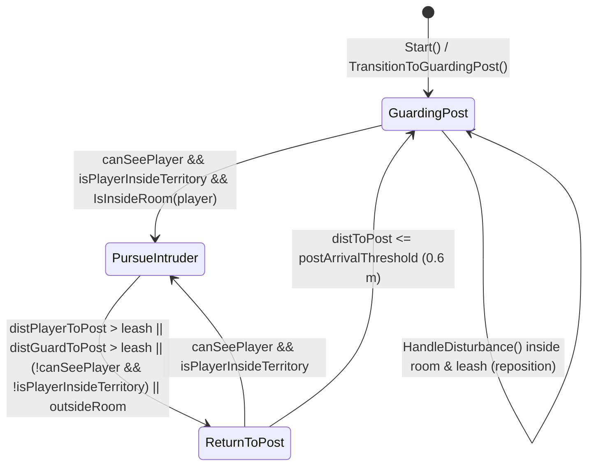

# DefensiveGuardAI & DefenseDecisionPolicy Trace

**Owner:** Aqqil (`IT24104314`)
**Scripts:** `Assets/Scripts/DefensiveGuardAI.cs`, `Assets/Scripts/DefenseDecisionPolicy.cs`
**Assigned Sector:** `Room_4_Defensive` (Route B — Access Card B)

<!-- BLOCK:POLICY_INTRO -->
## 1. Scope and Design Goals

The Room 4 defensive guard (`Guard_Aqqil_Defensive`) protects the Access Card B security
terminal (`AccessCard_Pickup_Defensive`) without abandoning Room 4 to chase the player
across the warehouse. Unlike `PatrolGuardAI` (Room 2 circuit) or `SearchGuardAI` (Room 3
belief search), `DefensiveGuardAI` stays anchored to a defensive post, evaluates nearby
cover and shotgun engagement range, and returns to post when the intruder disengages.

### 1.1 Baseline Design Parameters

- **Sight Range / FOV:** `10.0 m` / `90 deg` (`eyeHeight = 0.6 m`)
- **Defense Perimeter:** `defenseRadius = 6.0 m` around `postPosition`
- **Pursuit Leash:** `leashDistance = 8.5 m` (code default) / `9.0 m` (Room 4 scene)
- **Weapon Loadout:** `WeaponType.Combat_Shotgun` (`12 dmg x 6 pellets`, `220 HP`)
- **Policy Module:** `DefenseDecisionPolicy.Score(...)` (pure static utility scorer)
- **Candidate Topology:** `17` points (`1` anchor + `2` concentric `8`-point rings)
<!-- END:POLICY_INTRO -->

<!-- SECTION:STATE_MACHINE -->
## 2. Attack / Guard / Retreat Decision Tree Architecture

Replacing the simple direct-chase draft and static 3-waypoint circuit, `DefensiveGuardAI`
combines a 3-state `DefensiveGuardState` FSM with a 17-candidate tactical ring evaluated
through `DefenseDecisionPolicy.Score`. Unity `NavMesh` computes complete paths (`TryReachable`);
the authored AI layer handles candidate generation, occlusion/range scoring, and leash bounds.

### 2.1 State-Transition Diagram

### 2.2 Attack / Guard / Retreat Role Matrix

| Posture | Enum State | Tactical Target Selection | Weapon / Perception Action |
| --- | --- | --- | --- |
| **GUARD** | `GuardingPost` | Anchor + 2x8 rings (`hasThreat=false`, or `true` on sound cue) | Sweeps `+/- 28 deg` (`sin(t*1.8)*28`); transitions on sight in territory |
| **ATTACK** | `PursueIntruder` | `DispatchPursuitDestination()` every `0.25 s` (throttled `0.75 s`) | Fires `Combat_Shotgun` only with `GuardShooting.HasVisualTarget` |
| **RETREAT** | `ReturnToPost` | Direct NavMesh return to `postPosition` | `perceptionMemory.SetReturningState()`; snaps to `postFacing` on arrival |

### 2.3 Complete Transition Condition Table (`DefensiveGuardAI.cs`)

| From State | To State | Exact Boolean Guard Condition | Side Effects on Transition |
| --- | --- | --- | --- |
| `Any` | `GuardingPost` | `Start()` or arrival `distToPost <= 0.6 m` | `isReturning = false`, `inspectionWaitTimer = Random(2.0, 2.5)`, `nextTacticalDecision = 0` |
| `GuardingPost` | `PursueIntruder` | `canSeePlayer && isPlayerInsideTerritory && IsInsideRoom(player)` | `enemyMovement.SetChaseSpeed()`, `nextTacticalDecision = 0`, `DispatchPursuitDestination()` |
| `PursueIntruder` | `ReturnToPost` | `distPlayer > leash || distGuard > leash || (!canSee && !inTerr) || !insideRoom` | `SetDestination(postPosition)`, `perceptionMemory.SetReturningState()`, `SetPatrolSpeed()` |
| `ReturnToPost` | `PursueIntruder` | `canSeePlayer && isPlayerInsideTerritory && IsInsideRoom(player)` | Cancels retreat immediately if player steps back into `defenseRadius` with LOS |

### 2.4 17-Point Tactical Ring Generation (`DispatchInspectionPoint`)

- `i = 0`: `raw = postPosition` (`(16.0, 1.08, 8.0)` objective anchor).
- `i = 1..8`: inner ring at `r1 = min(2.5 m, max(0.5 m, leashDistance - 1 m))` every `45 deg`.
- `i = 9..16`: outer ring at `r2 = min(5.0 m, max(0.5 m, leashDistance - 1 m))` every `45 deg`.
- Only candidates passing `IsInsideRoom(raw)`, `GuardDecisionQueries.TryReachable`
  (`NavMeshPathStatus.PathComplete`), `IsInsideRoom(c.position)`, and `dist <= leashDistance`
  are scored; failed slots record `"Outside room/leash or no complete path"`.
<!-- END:STATE_MACHINE -->
<!-- SECTION:DECISION_POLICY_BASE -->
<!-- SECTION:THREAT_COVER_RANGE -->
<!-- SECTION:LEASH_BOUNDS -->
<!-- SECTION:SWITCHING_BONUS -->
<!-- SECTION:PRESSURE_RETREAT -->
<!-- SECTION:VERIFICATION_LOG -->
