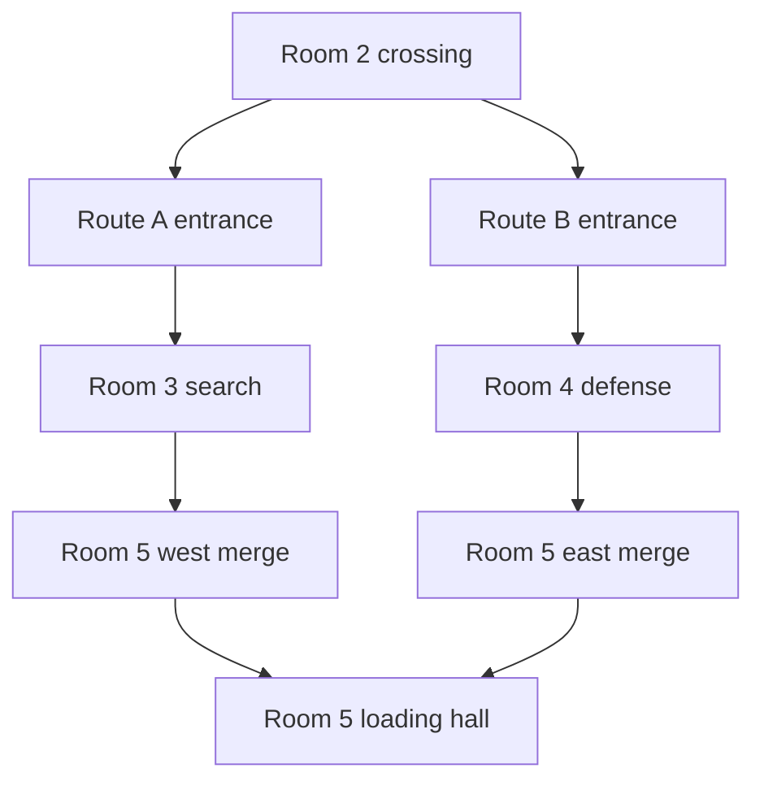

# Warehouse layout and Room 2 patrol space

Directions use world X/Z, with north toward positive Z. Metres follow the scene's scale convention. Editor layout code supplies placement intent. The serialized scene is the authority for the loaded geometry.

## Scope and coordinate references

| Reference | X span (m) | Z span (m) | Use |
| --- | --- | --- | --- |
| Room 2 floor design | −11 to 11 | −20 to −2 | Expanded floor in the editor layout pass |
| Room 2 guard predicate | −11 to 11 | −18 to −2 | Inclusive X/Z bounds in `PatrolGuardAI.IsInsideRoom` |
| South safe-side approach | centered at 0 | below −18 | Outside the Room 2 guard predicate |
| Route A door | centered near −5 | near −2 | Player branch to the search sector |
| Route B door | centered near 5 | near −2 | Player branch to the defensive sector |

The predicate checks the sampled patrol endpoint. The serialized `RoomBounds`
property exists, while `IsInsideRoom` uses literal X/Z bounds and ignores Y.
For a strict corridor-containment check, inspect every route segment as well as
the endpoint. Read the [decision trace](PatrolUtilityTrace.md) for the gate order.

## Zone responsibilities

| Zone | Approach and purpose | Navigation and sight check |
| --- | --- | --- |
| Room 1 threshold | South entrance from the safe room | Compare positions just north and south of Z = −18 |
| Room 2 southern crossing | Move between east and west inspection lanes | Leave both lane entries usable around the first cover objects |
| Room 2 west storage | Shelves, cover bay and Route A approach | Confirm a return path from the shelf end before keeping a waypoint |
| Room 2 east storage | Shelves, cover bay and Route B approach | Keep the northeast dead end distinct from the signed exit |
| Room 2 main aisle | Central angle into both branch approaches | Preserve lateral crossing space and visible route markers |
| Room 3 / Route A | Search sector beyond the west branch | Use room-specific guard behavior inside the sector |
| Room 4 / Route B | Defensive sector beyond the east branch | Preserve the branch independently of Route A |
| Room 5 loading hall | Two merges, side aisles, central progress to card reader | Exercise both flank spines and a fallback if a cross aisle is blocked |

Either route can support the card-reader flow. The scene's card and reader
logic determines progression. The Room 2 guard selects goals from its own
waypoint array, and the larger connectivity graph supports design checks.

## Walls and sightline control

| Feature | Editor layout reference | Review |
| --- | --- | --- |
| East/west perimeter | Walls centered on X ±11, nominal 0.5 m thick | Use the interior collision faces for clear width |
| South wall split | Two walls near Z −20 with center lintel | Check the smaller guard boundary at Z −18 independently |
| North wall split | Center and outer wing segments near Z −2 | Keep the marked exit gaps and their approach turns clear |
| Northeast dead-end partition | `DeadEnd_Partition_NE` at (8.2, 1.8, −4.5) | Keep the occluding back wall and leave the approach reversible |
| Floor guides | `FloorGuide_RouteA` and `FloorGuide_RouteB` | Editor script disables their colliders |

Use the guard eye and the player's head/chest target heights when examining
cover. A ray at ankle height can report a different obstruction. A partition
can block perception and still leave a complete route around its end.

## Shelf spacing and doorway clearance

Measure the shortest horizontal face-to-face distance at each pinch point.
Record the obstacle transforms and the effective collider extents, especially
for rotated barricades, shelf endcaps and crate corners. Preserve room to
turn after exiting an aisle so outer corners do not intersect the new heading.

| Station | Record | Acceptance evidence |
| --- | --- | --- |
| South crossing | Clear face gap and two approach headings | Side-to-side complete path with space at both turns |
| East shelf end | Tip of shelf to nearest adjacent collider | Approach and return both complete around the cover stack |
| West shelf end | Clearance toward the shock-pad bypass | Path can turn without relying on the trap trigger |
| North split | Jamb, guide and signed doorway alignments | Both branch entrances remain independently usable |
| Loading hall merge | Central connector and outer aisle corners | Alternate route stays usable when one connector is blocked |

Use the [clearance worksheet](LightingAndOptimizationLog.md#navmesh-clearance)
for the nominal radius calculation. Inspect curved approaches with test
origins offset left, centered and offset right. A centered straight line only
tests one approach.

## Cover and prop placement

Editor layout references from `ExpandRoom2` use X/Z positions in metres.

| Prop family | Placement reference | Design constraint |
| --- | --- | --- |
| West barricade | (−7.5, −11) | Preserve a path past each open end |
| East barricade | (7.5, −11) | Check the turn from storage to the northern approach |
| Southwestern and northwestern crate stacks | (−8.5, −15.5) and (−8.5, −6.5) | Check cover gaps at both crouched and standing eye heights |
| Southeastern and northeastern crate stacks | (8.5, −15.5) and (8.5, −6.5) | Keep the signed door face visible from the lane |
| Barrels | Verify scene instances in peripheral bays | Keep their collider silhouettes and interaction space off branch throats |
| Hardware details | Bands, fasteners, rings | Visual detail should preserve the parent prop's collision footprint |

Occlusion depends on collision, masks and the ray targets. A dark corner
can affect player readability while leaving the current AI sight test clear.
A trigger volume can overlap a route that is mechanically walkable.

## Branch and flank topology

- Room 2: inspect the west and east lintels from positions still inside its predicate.
- Route A: follow the western branch, sector and connector into the west merge.
- Route B: follow the eastern branch, sector and connector into the east merge.
- Room 5: keep the center spine and two side aisles usable for alternate approaches.
- The northeast dead-end bay offers cover and a return path through its entrance.

## Retained route constraints

Keep the signed split, both storage aisle approaches and the center connectors.
The northeast partition remains an occluder and dead-end boundary. Drop shortcuts
that assume an opening through it or that rely on the safe-side floor for
the guard's return circuit. Record rejected fixture intent in the trace and
retain only supported connections in the layout summary.

A single closed crossing is an alternate-route test. A closed approach and
return pair is a disconnected destination test. Compare these cases with the
warehouse CSV rather than substituting straight-line distance for a route.
